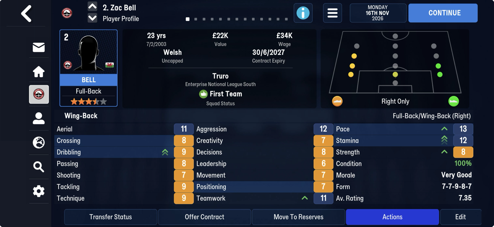
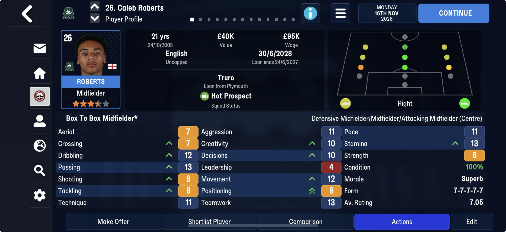
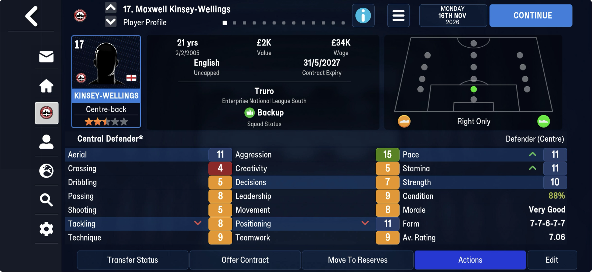
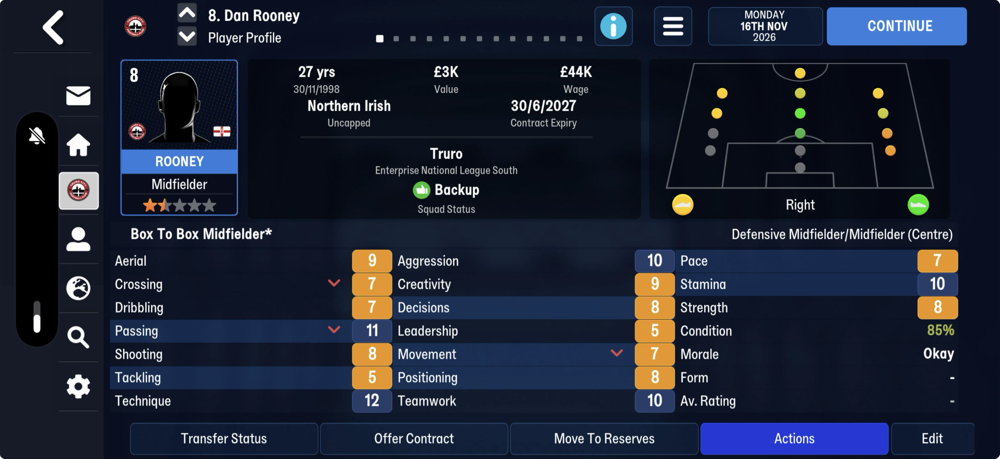
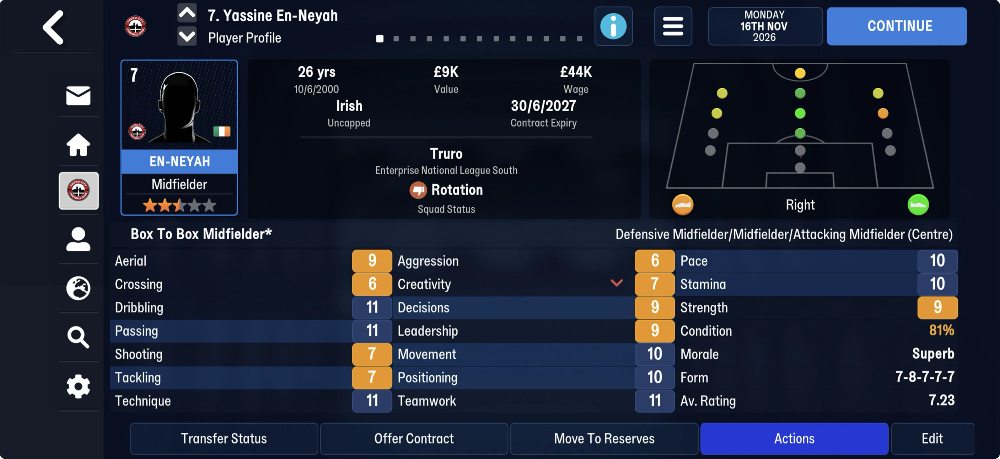
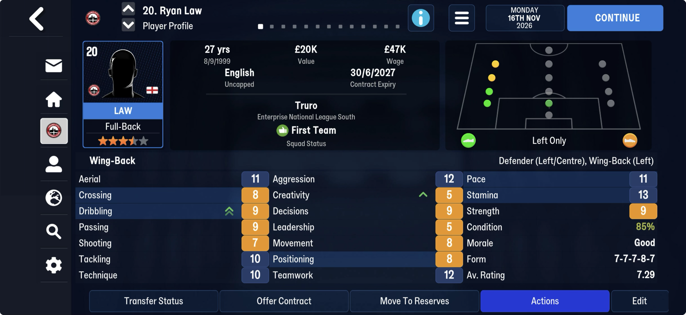
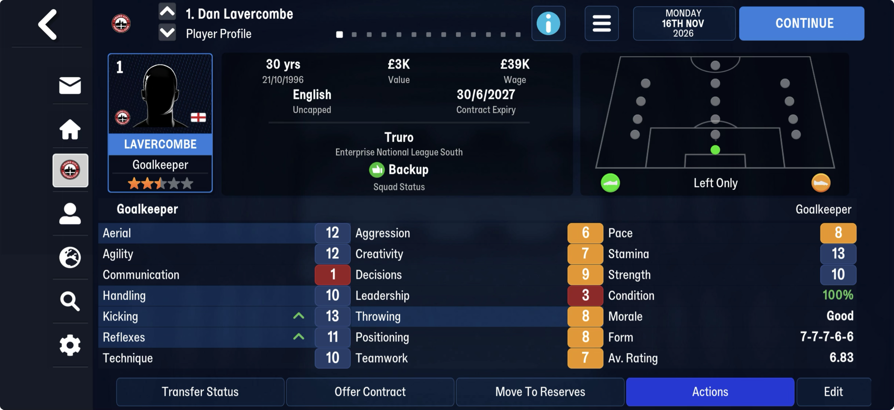

# attribute_changes  ([`fmparser/tables/attribute_changes.py`](../../fmparser/tables/attribute_changes.py))

**The change arrows on a player's profile**: one signed byte per attribute, one 23-byte row per
person, both games. `extract.py` writes `attribute_changes.json`: every row with a change, its
`tid` and the 23 columns by attribute name (`unknown_<column>` for the five not yet named).

| save | from | rows | set |
|---|---|---|---|
| truro-2026-07-22 / 07-25 / 08-08 / 11-16 (FMM27) | 58,958,685 on 16 Nov | 44,960 × 23 B | 0 / 0 / 3 / 23 |
| frem-2021-06-27 / 2023-07-02 / 2026-06-11 / 2030-06-22 / 2030-06-30 | 52,721,064 on 2026-06-11 | 32,966 × 23 B | 0 / 31 / 48 / 54 / 55 |
| bucaspor-2023-04-01 | | 34,312 × 23 B | 29 |

Between [player progress](player_progress.md) and [training](training.md), with no count or
frame of its own: row k is person tid k, and the person count is the u32 in front of the
training rows. Once taken for padding.

## Layout

`[person count × 23 B]`, each byte an i8:

| col | attribute | col | attribute |
|---|---|---|---|
| 0 | Crossing | 12 | Positioning |
| 1 | Dribbling | 13 | Teamwork |
| 2 | Aerial | 14 | Pace |
| 3 | Passing | 15 | Stamina |
| 4 | Shooting | 16 | Strength |
| 5 | Tackling | 17 | *not named*; by position the keeper's Agility |
| 6 | *not named*; by position Technique | 18 | *not named*; by position Communication |
| 7 | *not named*; by position Aggression | 19 | *not named*; by position Handling |
| 8 | Creativity | 20 | Kicking |
| 9 | Decisions | 21 | Reflexes |
| 10 | Leadership | 22 | Throwing |
| 11 | Movement | | |

Zero is no arrow. One arrow is ±1; a double arrow is 2 or more (Zac Bell's +3 Stamina shows
as a double). Values run −3 to +3. No Truro save sets columns 6, 7 and 17–19; 11 rows across
the FMM22 saves do (column 6 three times, 18 and 19 on goalkeepers), with no screen yet to
name them.

**Whose rows are set**: the managed club's players only, youth candidates included (the
16-year-old Barnaby Dolaghan, on the youth candidates page on 16 Nov, has Decisions +1 and
Movement +1). Every row is zero on a day-one save.

## Evidence

Seven Player Profile screens on truro-2026-11-16 (`tests/test_attribute_changes_evidence.py`):
each player's 23 stored bytes, and every arrow on the screen is its column's change with the
arrow's sign, every attribute without an arrow 0. Columns 8 and 9 come from Ryan Law
(Creativity up) and Yassine En-Neyah (Creativity down) next to Caleb Roberts (Creativity and
Decisions up); 20 and 21 from Dan Lavercombe (Kicking and Reflexes up).

## What the change is measured from

Not the season start and not one fixed day. A row can hold a change from August next to one
from November: En-Neyah's Creativity −1 is already on the 8 Aug save and still there on 16 Nov.

Our players' attributes in the store are stated by their scrapbook entry, written on the 1st of
a month, and a row is **not** a correction to add to them. Against the seven screens, the store
matches 108 of 119 values and the store plus the row only 99: some of a row's changes are
already in the entry (Bell's, before 1 Nov) and some are not (Kinsey-Wellings', En-Neyah's,
Lavercombe's, after it; Dan Rooney's entry is from 1 Aug, so his three drops are missing).
Nothing in the row says which change came when. A save each side of the 1st of a month would
show it.

## How it is found

From the end of player progress to four bytes before the training rows; accepted only if that
span is exactly the training table's person count × 23. A byte added in front moves training
with it and the span is refused (the evidence test checks this).

## Output

`attribute_changes.json`: `[{tid, Crossing, Dribbling, Aerial, Passing, Shooting, Tackling,
unknown_6, unknown_7, Creativity, …, Throwing}]` in column order, rows with a change only.

### FMM22

The same 23-byte row at the same place, one per person (32,966 on Frem, 34,312 on Bucaspor).
The columns are taken from FMM27's screens; no FMM22 screen checks them.
