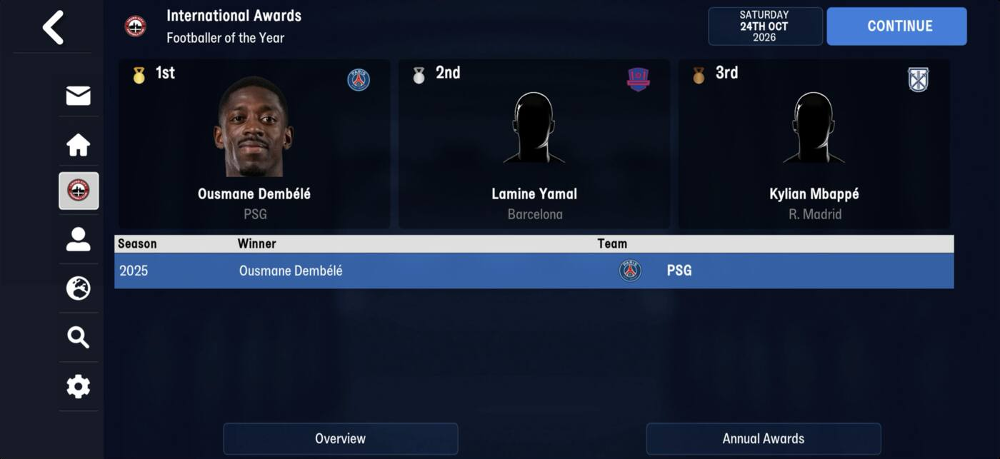

# award_history  ([`fmparser/tables/award_history.py`](../../fmparser/tables/award_history.py))

**Every edition of every award**, the 1st to 3rd placed: the "Season / Winner" list on an
award's screen, and monthly awards month by month. [awards](awards.md) holds each award's
latest edition only; this holds them all. Straight after [training](training.md).

| | editions |
|---|---|
| frem-2021-06-27 (day one) | 807, one per award (the database's real-world winners) |
| frem-2023-07-02 | 868 |
| frem-2026-06-11 | 1,364 (up to 36 editions of one award) |
| truro-2026-08-08 | 1,124 |

## Layout

`[count u32]`, then 92-byte editions. The same layout on both games.

```
[award_id u32][day u16][year u16]     the award (an awards row) and the edition's date
3 x 28 B                              1st, 2nd, 3rd
```

A place is `[person_tid u32][first_name_id u32][last_name_id u32][common_name_id u32]
[club_tid u32][u32][score u32]`: the person's name ids as they were (his tid is a slot that
a newgen can take later), his club then (`ffffffff` for none), and the score (votes, or goals
on a Top Goalscorer). The u32 before the score is 0 on every FMM27 place and small on many
FMM22 ones. An unfilled place is all `ff`.

The date is day 0 of the year on an annual award, and the month's last day on a monthly one
(151, 273, 304 …), so a Player of the Month has one edition a month.

## Evidence

`tests/test_award_history_evidence.py`, eight saves of both games: every edition names an
award the awards table has, every placed person and club resolves, and each award's latest
edition names the same 1st as the awards table (265 of 265 on frem-2026-06-11, 340 of 340
on truro-2026-08-08), which the award screens confirm ([awards](awards.md)). On
truro-2026-08-08 the World Footballer of the Year 2025 edition is Dembélé 50, Yamal 39,
Mbappé 34, as on the International Awards screen:



## Quirks

> **Lead:** the National League South Player of the Month screen lists September Tom Tweedy
> and August Rakish Bingham (img/awards-fmm27-4.jpg). A save from that day would pin a
> monthly edition to bytes.

## Output

`output/<label>/award_history.json`: `[{award_id, date, places: [3 × {person_tid,
first_name_id, last_name_id, common_name_id, club_tid, score}]}]` in stored order. Not
loaded yet.
