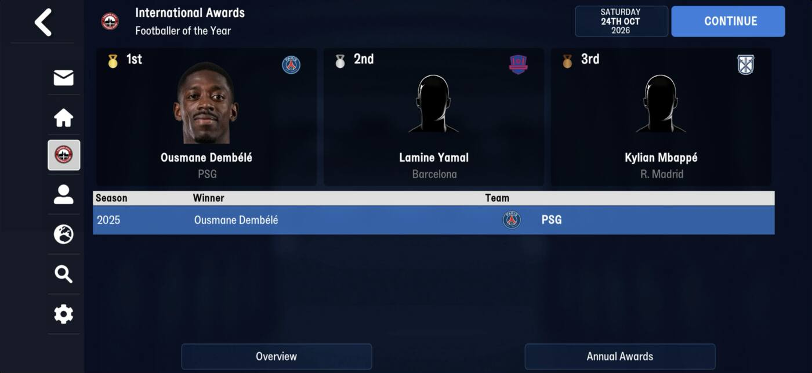
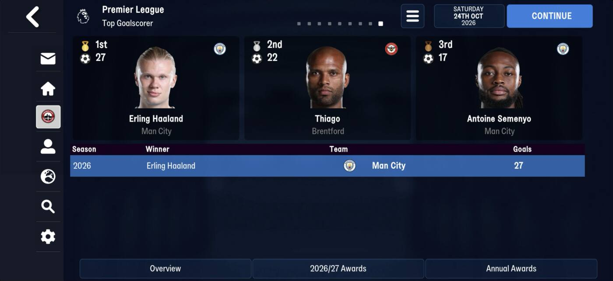
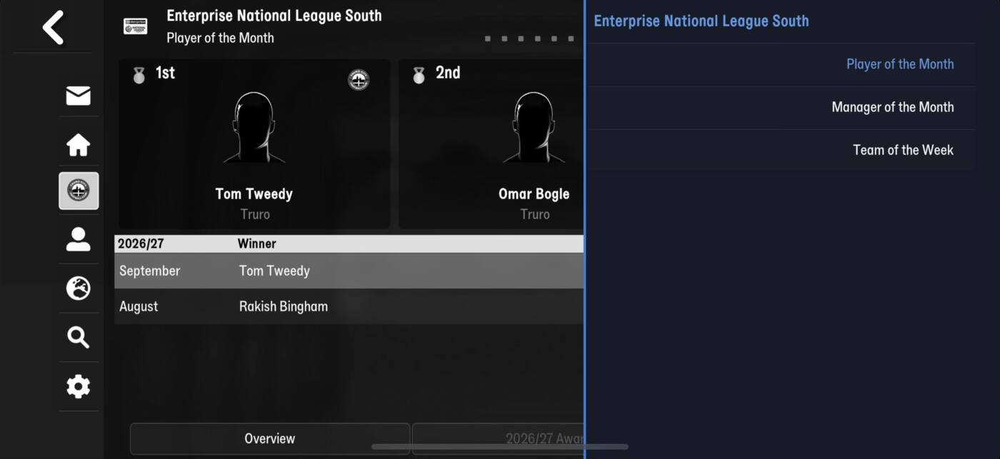

# awards  ([`fmparser/tables/awards.py`](../../fmparser/tables/awards.py))

Every award the game hands out (World Footballer of the Year, each league's Player of the
Year, Top Goalscorer, Team of the Week, Manager of the Year), each with **its latest
edition's three entries**: the person, his club, the year and his score. The first of four
count-framed tables between [cities](cities.md) and [currencies](currencies.md): awards,
[unions](unions.md), [derbies](derbies.md), [regions](regions.md).

| | Truro (FMM27) | Frem (FMM22) | Bucaspor (FMM22) |
|---|---|---|---|
| awards | 1,123 | 807 | 807 |
| filled entries | 523 (truro-2026-08-08) | 602 (frem-2026-06-11) | |

## Layout

```
[>= 8 x ff][count u32]
per award:  [id u32 = slot][uid u32]
            [len u32][name][terminator]          "Footballer of the Year"
            [len u32][long name][terminator]     "World Footballer of the Year"
            23-byte body
            3 x 26-byte entry
            FMM27 only: 1 byte
```

The terminator is `00` on FMM22 and `ff` on FMM27, as in every FMM27 string table.

The body:

| offset | field | type | meaning | how we know |
|---|---|---|---|---|
| +0 | `continent_id` | u16 | `ffff` on worldwide awards | equals its nation's continent on 697 of 701 FMM22 awards with a nation, 928 of 931 FMM27 |
| +2 | `nation_id` | u16 | `ffff` on continental and worldwide awards | resolves on every award; "Danish Players' Player of the Year" is Denmark |
| +4 | `cid` | u16 | the competition; `ffff` on a nation-wide award | "Portuguese Premier League Top Goalscorer" is the Portuguese Premier League |
| +6 | | u8 | 37 on most; 4 on a Top Goalscorer, 3 on Manager of the Year | |
| +7 | | u8 | 1 on player awards, 7 on Team of the Year/Week, 2 on manager awards | |
| +8..+15 | | | unnamed; +15 is 1 on every Team of the Week | |
| +16 | `last_day` | u16 | day of year the latest edition was decided | 323/2025 for the World Footballer on frem-2026-06-11 |
| +18 | `last_year` | u16 | `1900` (with day 1) when never awarded | 611 of 807 FMM22 awards |
| +20..+22 | | | unnamed | |

The entry:

| offset | field | type | meaning | how we know |
|---|---|---|---|---|
| +0 | `person_tid` | u32 | `ffffffff` on an unfilled entry | every filled entry is a person, both games |
| +4 | `club_tid` | u32 | his club when he won | |
| +8 | `year` | u16 | | |
| +10 | `score` | u16 | votes on a voted award, goals on a Top Goalscorer | Sporting's top scorer, 23 |
| +12 | | u16 | FMM22 1–30 on filled entries; 0 on every FMM27 one | |
| +14 | `first_name_id` | u32 | the winner's name as it was | equal to the person's own on all 523 FMM27 entries |
| +18 | `last_name_id` | u32 | | |
| +22 | `common_name_id` | u32 | `ffffffff` when he has none | |

**How it is found.** From the cities table's end, the next frame (`after_frame`), whose
record 0 has id 0. The walk must read the declared count with `id == slot` throughout.

## Evidence

Structural and cross-table, on frem-2026-06-11 and truro-2026-08-08
(`tests/test_world_lists_evidence.py`): both walks read every declared award with id equal
to its slot and the right terminator after every name, a fixed three entries per award, and
end on the unions' frame. Every filled entry names a person; the competition and nation
fields name what the award's own name says.

The award screens, taken on 24 Oct 2026 (the save read is truro-2026-08-08; these three
awards had not changed in between):






| on screen | stored (truro-2026-08-08) |
|---|---|
| Footballer of the Year: 1st Dembélé PSG, 2nd Yamal Barcelona, 3rd Mbappé R. Madrid, season 2025 | award 0 entries 0–2: Dembélé / PSG / 2025 / 50, Yamal / Barcelona / 39, Mbappé / R. Madrid / 34 |
| Premier League Top Goalscorer: Haaland 27, Thiago 22, Semenyo 17, season 2026 | award 210: the same three, `score` 27, 22, 17, `year` 2026 |
| National League South Top Goalscorer: Brad Dolaghan, Worthing | award 499 entry 0: Dolaghan / Worthing / 23 |

So the entries are the **placings, 1st to 3rd**, `year` is the season the screen shows, and
on a Top Goalscorer `score` is goals. A voted award's score is not shown on screen.

## Quirks

> **Quirk:** the three entries are the latest edition only, not three years of history. A
> season's winners are kept by keeping that season's snapshot.

> **Quirk:** the entries are the placings, but not always in score order: "English
> Players' Player of the Year" on frem-2026-06-11 stores 753, 751, 760 for 1st to 3rd. On a
> voted award the score is not what decides the placing.

> **Lead:** a monthly award's screen lists every month of the season (Player of the Month:
> September Tom Tweedy, August Rakish Bingham), but the table holds one edition. The month
> history is stored somewhere else; a save from the screen's day finds it.

> **Quirk:** a winner's name ids are stored because his tid is a slot. On FMM22, 39 of 563
> filled entries' names differ from the person who holds the tid now, which is what a
> retired winner whose slot went to a newgen looks like.

> **Lead:** the unnamed body bytes (+6, +7, +15) look like the award's kind and
> frequency: National League South has Player of the Month, Manager of the Month and Team of
> the Week, and an annual Top Goalscorer.

## Output

`output/<label>/awards.json`: a list in id order, each award as stored, with `entries` a
list of three. Not loaded yet.
