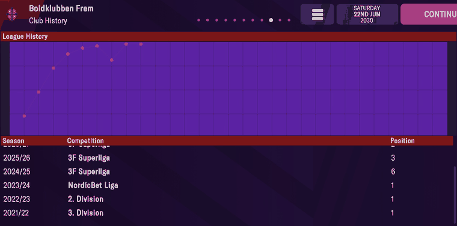
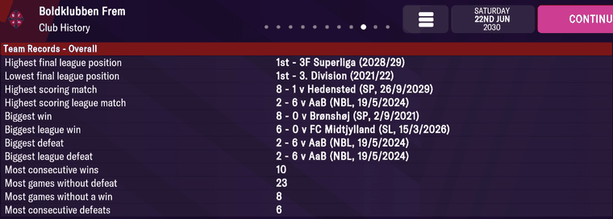
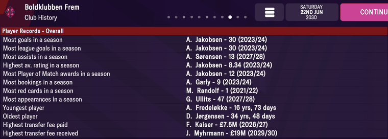

# club_records  ([`fmparser/tables/club_records.py`](../../fmparser/tables/club_records.py))

Every club's Club History screens: League History, Team Records and Player Records, overall
and for the current season. A table of variable-length club rows framed by a bare
`[count u16]`, immediately after the career-history pool (`history_end` in [`tables/history.py`](../../fmparser/tables/history.py)).
1,057 clubs on Frem, 1,060 on Bucaspor. Written by the running game, not shipped with the
database.

## Layout

```
header  [count u16]                     clubs in the table
row     [club_tid u16]                  strictly ascending through the table
        [n u8][n × league list]         one list per league the club has played in
        [12 × team row]    Team Records   - Overall
        [12 × player row]  Player Records - Overall
        [12 × team row]    Team Records   - this season
        [12 × player row]  Player Records - this season
```

**League list, 212 bytes:** `[cid u16]`, then 30 season slots of 7 bytes, filled from slot 0;
an unused slot is seven `0xFF`.

| offset | width | field | meaning |
|---|---|---|---|
| +0 | 2 | `cid` | the league (the list's own cid, repeated) |
| +2 | 1 | `position` | final position |
| +3 | 2 | `year` | the season's **start** year: 2021 = 2021/22 |
| +5 | 2 | `teams` | clubs in the league that season |

**Team row, 21 bytes.** The club tid is at the END of the row.

| offset | width | field | meaning |
|---|---|---|---|
| +0 | 4 | `value` | f32, the number the record is ranked on; what it counts depends on the category (below) |
| +4 | 2 | `comp_cid` | the competition; `0xFFFF` = unwritten slot |
| +6 | 2 | `season` | the season's start year |
| +8 | 2 | `day` | day of the year, 0-based (0 = 1 January) |
| +10 | 2 | `unk10` | |
| +12 | 2 | `unk12` | `ffff` on every row read |
| +14 | 1 | `unk14` | |
| +15 | 2 | `club_tid` | the club; `0xFFFF` on the `table` categories |
| +17 | 2 | `opponent_tid` | |
| +19 | 1 | `score_for` | from `club_tid`'s side |
| +20 | 1 | `score_against` | |

**Player row, 22 bytes.**

| offset | width | field | meaning |
|---|---|---|---|
| +0 | 4 | `player_tid` | `0xFFFFFFFF` = unwritten slot |
| +4 | 4 | `value` | f32: a count, a rating, an age in days, or money in £ (below) |
| +8, +12, +16 | 4 each | `unk8`, `unk12`, `unk16` | `unk16` is `ffffffff` on most rows |
| +20 | 2 | `season` | the season's start year |

**The slot index is the category**; no category id is stored. In slot order:

| slot | team record (`kind`, what `value` is) | player record (`unit`) |
|---|---|---|
| 0 | highest final league position (`table`, position) | most goals in a season (count) |
| 1 | lowest final league position (`table`, position) | most league goals in a season (count) |
| 2 | highest scoring match (`match`, total goals) | most assists in a season (count) |
| 3 | highest scoring league match (`match`, total goals) | highest av. rating in a season (rating) |
| 4 | biggest win (`match`, goal difference) | most Player of Match awards in a season (count) |
| 5 | biggest league win (`match`, goal difference) | most bookings in a season (count) |
| 6 | biggest defeat (`match`, goal difference, negative) | most red cards in a season (count) |
| 7 | biggest league defeat (`match`, goal difference) | most appearances in a season (count) |
| 8 | most consecutive wins (`streak`, run length) | youngest player (days) |
| 9 | most games without defeat (`streak`) | oldest player (days) |
| 10 | most games without a win (`streak`) | highest transfer fee paid (money_gbp) |
| 11 | most consecutive defeats (`streak`) | highest transfer fee received (money_gbp) |

The blocks are preallocated and filled in place: a slot is written or not independently of
the rest of its block.

## Evidence

`frem-2030-06-22`, Frem's Club History screens. Frem's row starts at byte 46,718,823
(`5a 01` = tid 346, `04` = four league lists).

**League History.** The first list is cid 2 (3F Superliga); its slot 1, at 46,718,835, is
`02 00 | 03 | e9 07 | 0c 00`. The fourth list, at 46,719,462, is cid 1147 (3. Division):
slot 0 `7b 04 | 01 | e5 07 | 0c 00`.



| on screen | parsed |
|---|---|
| 2025/26 3F Superliga 3 | `cid` 2, `year` 2025 (`e9 07`), `position` 3, `teams` 12 |
| 2024/25 3F Superliga 6 | `cid` 2, `year` 2024, `position` 6 |
| 2023/24 NordicBet Liga 1 | `cid` 3, `year` 2023, `position` 1 |
| 2022/23 2. Division 1 | `cid` 4, `year` 2022, `position` 1 |
| 2021/22 3. Division 1 | `cid` 1147, `year` 2021 (`e5 07`), `position` 1 |

**Team Records - Overall.**



Slot 2, at 46,719,716: `00 00 10 41 | 07 01 | ed 07 | 0c 01 | 08 00 ff ff 02 | 5a 01 | 88 14 | 08 | 01`

| on screen | parsed |
|---|---|
| Highest scoring match: 8 - 1 v Hedensted (SP, 26/9/2029) | `value` 9.0 (total goals), `comp_cid` 263 (Sydbank Pokalen, code `SP`), `season` 2029, `day` 268 (26 Sep), `club_tid` 346, `opponent_tid` 5256 (Hedensted), 8-1 |
| Highest scoring league match: 2 - 6 v AaB (NBL, 19/5/2024) | slot 3: `value` 8.0, `comp_cid` 3 (`NBL`), **`season` 2023**, `day` 139 (19 May in leap-year 2024), 2-6 |
| Biggest win: 8 - 0 v Brønshøj (SP, 2/9/2021) | slot 4: `value` 8.0 (goal difference), `season` 2021, `day` 244 |
| Biggest league win: 6 - 0 v FC Midtjylland (SL, 15/3/2026) | slot 5: `value` 6.0, `comp_cid` 2 (`SL`), `season` 2025, `day` 73 |
| Biggest defeat: 2 - 6 v AaB | slot 6: `value` −4.0 |
| Highest final league position: 1st - 3F Superliga (2028/29) | slot 0: `value` 1.0, `comp_cid` 2, `season` 2028 |
| Lowest final league position: 1st - 3. Division (2021/22) | slot 1: `value` 1.0, `comp_cid` 1147, `season` 2021 |
| Most consecutive wins 10 · without defeat 23 · without a win 8 · consecutive defeats 6 | slots 8–11: `value` 10, 23, 8, 6 |

**Player Records - Overall.**



| on screen | raw bytes (`player_tid` · `value` · … · `season`) | parsed |
|---|---|---|
| Most goals in a season: A. Jakobsen - 30 (2023/24) | `82 26 00 00` · `00 00 f0 41` · … · `e7 07` | tid 9858 (Adam Jakobsen), 30.0, season 2023 |
| Highest av. rating: A. Jakobsen - 8.34 (2023/24) | | 8.34 |
| Most appearances: G. Ullits - 47 (2027/28) | | tid 10404, 47.0, season 2027 |
| Youngest player: A. Fredeløkke - 16 yrs, 73 days | `37 74 00 00` · `00 e8 b8 45` · … · `ea 07` | tid 29751, 5917.0 = 16 × 365.25 + 73 |
| Oldest player: D. Jørgensen - 34 yrs, 48 days | `0f 24 00 00` · `00 c8 42 46` · … · `e8 07` | tid 9231, 12466.0 = 34 × 365.25 + 48 (rounded down); see Quirks for the name |
| Highest transfer fee paid: F. Kaiser - £7.5M (2026/27) | | 7,383,382.0, season 2026 |
| Highest transfer fee received: J. Myhrmann - £19M (2029/30) | | 19,000,000.0, season 2029 |

Tested by `tests/test_world_evidence.py` (Frem, this save) and `tests/test_club_records.py`
(Southampton on `frem-2026-06-11`, slot by slot).

## Quirks

> **Quirk:** `season` is the campaign's START year, and the match date's year isn't stored.
> AaB 2-6, played 19 May 2024, has `season` 2023. A record's calendar date is `day` in
> `season` or `season + 1`, depending on where the day falls against the league's calendar.

> **Quirk:** `player_tid` is a slot, not a person: the game reuses a retired player's tid for
> a newgen. Frem's oldest player is D. Jørgensen (34 in 2024), but tid 9231 now holds Steffen
> Heidler, born 2011. The value and season are right; the name is whoever holds the tid now.
> Name a record holder by the person who held the tid in `season` (`mart.dim_person` keys
> people by tid and date of birth), never by today's occupant.

> **Quirk:** a `streak` row's opponent, score and day bytes are left over from an earlier
> write, and its `comp_cid`/`season` say nothing about the streak (Frem's four streak rows
> read season 2020, before the career began). The parser nulls `opponent_tid` and the scores
> unless the category is a `match`.

> **Quirk:** in the per-season Team Records table `season` reads `0x07E4` (2020) on every row;
> it is not the season.

> **Quirk:** money and ages are shown rounded. £7.5M on screen is 7,383,382 stored; 34 yrs
> 48 days is 12,466. Search a band around the displayed number, never the exact figure.

> **Dead end:** this table is not a fixture list, and the complete results of other clubs'
> matches are not in it. A match appears because it set a record, once per slot and table it
> holds, so the same game sits in two slots (highest scoring match and highest scoring league
> match) and in both the overall and the season table. Where fixtures really are:
> [fixtures](fixtures.md) (`fix_man`).

> **Quirk:** the "14-byte standings record" a search for a doubled cid finds is this table's
> league list seen from the middle: `[club_tid u16][n u8 = 1][cid u16][cid u16][position u8]
> [year u16][teams u16]`, the u16 before it being the previous row's last `season`. That
> search finds 353 hits on frem-2030-06-22, 352 inside this table (the other is not a club row). A league list holds the
> final position and team count only; a table's other columns are rebuilt from the
> [fixtures](fixtures.md) (`mart.standings`).

> **Decision:** `scrape_club_records` raises if the walk reads fewer clubs than the count
> declares or the club tids don't ascend: either means the walk is misframed, and nothing it
> read can be trusted.

## Output

Three files, each row carrying `offset`, `club_tid`, `table` (`overall` / `season`), `slot`
and its category:

- `output/<label>/club_records.json`: written team-record slots → `raw.club_records`
- `output/<label>/player_records.json`: written player-record slots → `raw.player_records`
- `output/<label>/club_league_history.json`: one row per filled season slot
  (`club_tid, cid, year, position, teams`) → `raw.club_league_history`
