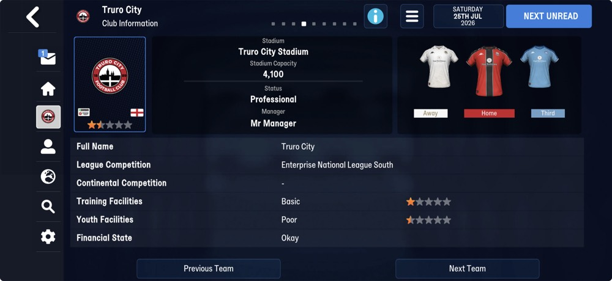
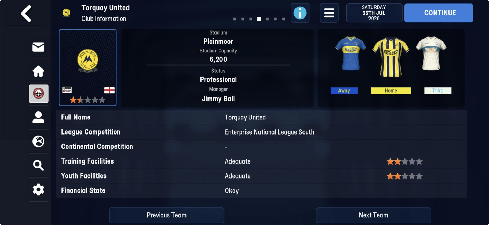
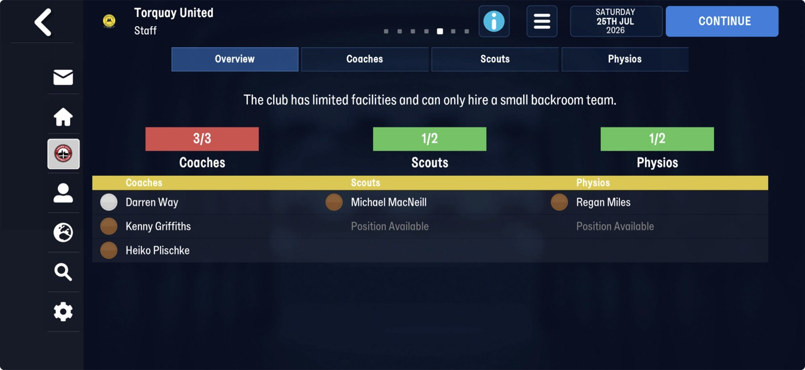
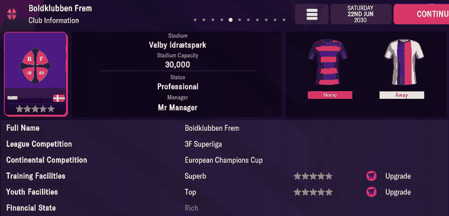
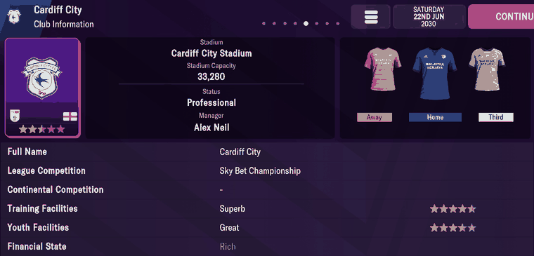
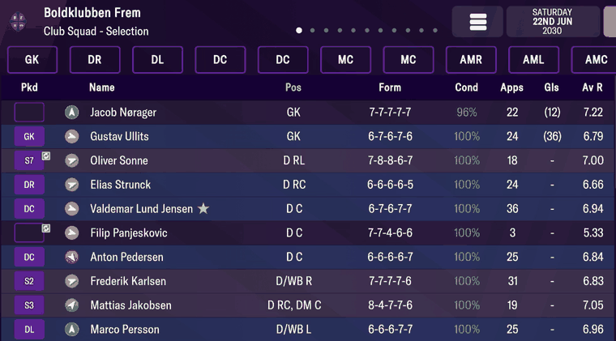
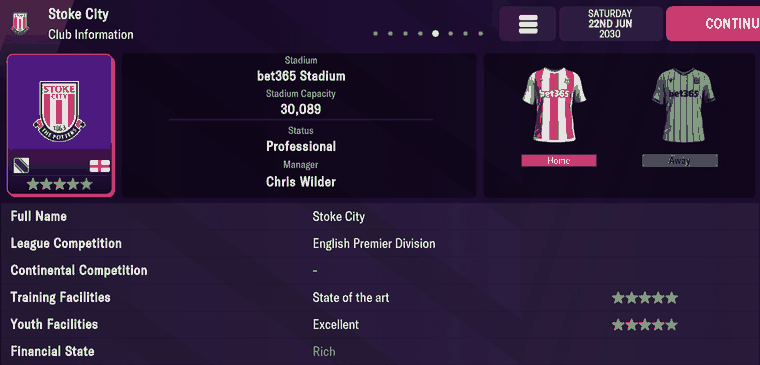

# clubs  ([`fmparser/tables/clubs.py`](../../fmparser/tables/clubs.py))

Every team in the world, one record per tid: clubs, reserve and B sides, national teams and
U21 national teams, all stored club-shaped. It follows the round-name table directly
(`[0xFF run][count u32]`, located by `after_frame` from `ROUNDS_TABLE`'s end) and is walked by
declaration with `tid == slot index`. 9,830 slots on both Truro saves (FMM27), the walk ending
on the competitions' frame; on FMM22 11,331 on Frem and 12,278 on Bucaspor. Variable-length
records, so there is no stride. FMM22's record has fewer names and a different closing block
(Layout, FMM22).

## Layout

A record is the segments of `CLUB_TABLE_FMM27`, in this order. Most of the trailer's fields
were first checked against FMM22 screens (Frem, Cardiff, Stoke); Truro's and Torquay's Club
Information screens confirm the ones marked FMM27 below, and the rest are read at the same
offsets.

| segment | field | type | meaning | how we know |
|---|---|---|---|---|
| `CLUB_HEAD` | `tid` | u32 | the team id; equals the slot index | the walk's invariant, on every slot of both careers |
| | `uid` | i32 | database id. **Negative on a national team: `-uid` is the nation's uid** | all 251 national teams, `frem-2030-06-22` (FMM22) |
| names | `name` `ff`, `short` `ff`, `code`, `three_letter_name`, `alt_code` | 5 × `[len u32][utf-8]` | long name, short name, code, 3-letter name, alternative code. An `ff` byte follows the first two on every club. `alt_code` is empty on most clubs | FMM27: Truro City / Truro / Truro / TRU / TCFC; `code` holds what FMM22's does (Parkgt, MDU, PTFC; FMM22 FCK, GHBK); `alt_code` TCFC, PC, MDST |
| `CLUB_TRAILER` (167 B) +0 | `based_id` | u16 | nation whose league the club plays in | Cardiff City = England (FMM22 screenshot); Truro = England (FMM27) |
| +2 | `nation_id` | u16 | the club's home nation | Cardiff City = Wales |
| +4 | `colour_0..5` | 6 × u16 | club colours, RGB555 (`0x7FFF` is white) | decode to the right kits |
| +16 | kits | 6 × (2 B + 10 × u16) | six kits: two flag bytes, then ten RGB555 colours. Slot 0 home, 1 away, 2 third; slots 3–5 not identified | Cardiff's three kits, Frem's and Stoke's two (FMM22 screenshots); Truro's three (FMM27) |
| +148 | `status` | u8 | 1 = Professional | screenshots on both versions; values 0–3 |
| +149 | `academy` | u8 | **Training Facilities**, 1–20 (fmm-editor's name is wrong; see Quirks) | three FMM22 and two FMM27 Club Information screens |
| +150 | `facilities` | u8 | **Youth Facilities**, 1–20 (fmm-editor's name is wrong) | three FMM22 and two FMM27 Club Information screens |
| +151 | `att_avg`, `att_min`, `att_max` | 3 × u16 | named from fmm-editor; **not attendance** (TODO "Unnamed fields in records we already read") | |
| +157 | `reserves` | u8 | | |
| +158 | `league_id` | u16 | the club's league cid | Frem 2 = 3F Superliga, Cardiff 6 = Sky Bet Championship (FMM22); Truro and Torquay 331 = Enterprise National League South (FMM27) |
| +160 | `other_division` | u16 | `0xFFFF` when `league_id` is the club's league | |
| +162 | `other_last_position` | u8 | | |
| +163 | `stadium_id` | u16 | → [stadiums](stadiums.md) | Frem 181 = Valby Idrætspark (FMM22); Truro 11983, Torquay 95 (FMM27) |
| +165 | `last_league` | u16 | | |
| `flag_68` | | u8, then 68 B **only when it is 1** (`core.Conditional`) | unnamed; fmm-editor's `Unknown4Flag` | set on 1,088 clubs; the walk lands only this way |
| `block_167` | | `[u32 n][n B]` | unnamed; `n` is 8 | |
| `CLUB_STANDING` (23 B) +0 | `league_pos` | u8 | | |
| +1 | `reputation` | u16 | | Frem 6494 (3½ stars), Cardiff 5371 (2½ stars); Truro 2800, Torquay 3500 (★½) |
| +3 | | 20 B | unnamed | |
| `affiliates` | | `[u16 n][n × 21 B]` | `[4 B][club1_tid u32][club2_tid u32][start day u16, year u16][end day u16, year u16][1 B]` | |
| `squad` | | `[u16 = 40][40 × tid u32]` | the first-team squad, fixed 40 slots; empty slots are `0`, `ffff` or `ffffffff` | Frem's squad screen (FMM22, below) |
| `CLUB_STAFF_FMM27` (127 B) +0 | `staff_0..10` | 11 × u32 | the coaching staff; an AI club's manager is not in it, the user's is (Quirks) | Torquay's five staff, not Jimmy Ball (FMM27); Cardiff without Alex Neil (FMM22) |
| +44 | `main_club_tid` | u32 | the parent team: a reserve side's first team, a U21 side's senior national team | Frem Reserves 7296 → 346 (FMM22) |
| +48 | `club_type` | u8 | 0 club (B sides included), 1 national team, 2 reserve side, 3 U21 national team | FMM22: 251 type-1 rows are exactly the negative-uid rows; 228 type-3 rows are exactly the `… U21` names |
| +49 | | 76 B | unnamed | |
| +125 | | u8 | unnamed (Lead below) | |
| +126 | `gender` | u8 | fmm-editor's last field (Lead below) | |

`scrape_clubs` derives three fields: `league_cid` (`league_id` when `other_division` is
`0xFFFF` and the id is real), `country` (= `based_id`), and drops empty squad/staff slots.

> **Lead:** `gender` (+126, fmm-editor's last field) is 1 on 1,354 clubs whose names are
> those of men's clubs and nations as well as "Proven Girls Football Club": FMM27's women's
> sides, by the names. Unconfirmed in game.

> **Lead:** +125 is 5 on Truro (the managed club) and 0 on every other club.

> **Quirk:** an AI club's manager is missing from its staff list, as on FMM22, but on FMM27
> the **user's is in it**: Torquay's list holds its five backroom staff and not Jimmy Ball,
> while Truro's holds Stewart Yetton, Joe Whittaker and Mr Manager (tid 44959). `mart.club_managers`
> (the staff member missing from the list) finds no manager for the managed club; the header's
> club tid names that club, and the person who is its manager is the one to special-case
> downstream.

### FMM22

`CLUB_TABLE`. Where it departs from FMM27:

| segment | FMM22 | how we know |
|---|---|---|
| names | **three strings**: `name`, `short`, `code` (3-letter). The `NAME_END` byte after the first two is `00`, or `ff` after an empty name | screenshots; the walk lands on `tid + 1` |
| `flag_68` | absent: `block_167` follows the trailer | |
| `CLUB_STAFF` | **123 B**: the same 49 named bytes, then 74 B unnamed (no +125, no `gender`) | |
| `tail` | `[u16 m][m × 9 B]` after `CLUB_STAFF`, unnamed; FMM27 has none | read this way on FMM27, the walk breaks at the slot after Truro, whose +125 reads 5 |

## Evidence

`truro-2026-07-25`. Truro City's Club Information screen; the record (tid 3,125) starts at
byte 10,710,904, its trailer at 10,710,961, `CLUB_STANDING` at 10,711,141:

| on screen | raw bytes | parsed |
|---|---|---|
| Full Name `Truro City` | `@10,710,912 0a 00 00 00 "Truro City" ff` | `name`; then `short` Truro, `code` Truro, `three_letter_name` TRU, `alt_code` TCFC |
| England flag on the card | trailer +0 `8b 00`, +2 `8b 00` | `based_id` = `nation_id` = 139: England, as the person table suggested |
| Status `Professional` | +148 `01` | `status` 1 |
| Training `Basic` ★, Youth `Poor` ½★ | +149 `04`, +150 `03` | `academy` 4, `facilities` 3: FMM22's scale, ⌊value / 2⌋ / 2 stars |
| Home red/black, Away white, Third light blue | kits 0, 1, 2 | `kits[0]` `#c82028`/`#080808`, `kits[1]` `#988058`/`#f8f8f8`, `kits[2]` `#205090`/`#70a0c8` |
| card stars ★½ | `CLUB_STANDING` +1 `f0 0a` | `reputation` 2800 |
| `Enterprise National League South` | +158 `4b 01` | `league_id` 331: [competition](competitions.md) 331 is Enterprise National League South |
| `Truro City Stadium`, 4,100 | +163 `cf 2e` | `stadium_id` 11983: [stadium](stadiums.md) 11983 is Truro City Stadium, capacity 4,100 |

This settles tid 3,125 as Truro City, the club 28 people point at.

Torquay United (tid 395, record at 9,121,810, trailer at 9,121,869), an AI club in the same
league:

| on screen | raw bytes | parsed |
|---|---|---|
| Status `Professional`, Training `Adequate` ★★, Youth `Adequate` ★★ | +148 `01 09 08` | `status` 1, `academy` 9, `facilities` 8 |
| `Enterprise National League South` (Truro's league) | +158 `4b 01` | `league_id` 331, as Truro |
| `Plainmoor`, 6,200 | +163 `5f 00` | `stadium_id` 95: Plainmoor, capacity 6,200 |
| card stars ★½ | `CLUB_STANDING` +1 `ac 0d` | `reputation` 3500 |
| Staff: coaches Way, Griffiths, Plischke; scout MacNeill; physio Miles | `CLUB_STAFF_FMM27` at 9,122,236: `be 09 00 00` `d9 0a 00 00` `b7 86 00 00` … | `staff` [2494, 2777, 34487, 7705, 32643], the five on screen |
| Manager `Jimmy Ball` | tid 2519, `club_tid` 395, absent from the list | the AI manager is the staff member missing from the list |

Tested by
`tests/test_reference_fmm27_evidence.py`.

### FMM22

`frem-2030-06-22`. Frem's Club Information screen; Frem's record starts at byte 6,501,332, its
trailer at 6,501,378.

| on screen | raw bytes | parsed |
|---|---|---|
| Full Name `Boldklubben Frem` | `@6,501,340 10 00 00 00 "Boldklubben Frem"` | `name` |
| flag on the card: Denmark | trailer +0 `8a 00`, +2 `8a 00` | `based_id` = `nation_id` = 138 (Denmark) |
| Status `Professional` | +148 `01` | `status` = 1 |
| Training `Superb` ★★★★½, Youth `Top` ★★★★★ | +149 `12`, +150 `14` | `academy` = 18, `facilities` = 20 |
| League Competition `3F Superliga` | +158 `02 00` | `league_id` = 2 |
| home kit, red/blue hoops | +16 flag `31`, then the colours | `kits[0]` red `#e00000` / navy `#002080` |
| card stars ★★★½ | `CLUB_STANDING` +1 `5e 19` | `reputation` = 6494 |

Cardiff City, record at 6,546,281, trailer at 6,546,328:

| on screen | raw bytes | parsed |
|---|---|---|
| England flag on the card; a Welsh club | trailer +0 `8b 00`, +2 `af 00` | `based_id` 139 (England), `nation_id` 175 (Wales) |
| Training `Superb` ★★★★½, Youth `Great` ★★★½ | +149 `13`, +150 `0f` | `academy` = 19, `facilities` = 15 |
| Home blue, Away pink, Third mint | kits 0/1/2 start `57 01`, `ef 79`, `fe 7f` | `kits[0]` `#0050b8`, `kits[1]` `#f07878`, `kits[2]` `#f8f8f0`/`#b8e0d0` |
| Manager `Alex Neil` | tid 3037 not in `staff_0..10`; his person record's club is 426 | manager = the club's staff member missing from the list |
| card stars ★★½ | `CLUB_STANDING` +1 `fb 14` | `reputation` = 5371 |

Frem's squad screen. The array's count is `28 00` (40) at 6,501,582; 25 slots are filled, and
every player on screen is one of them (Nørager 13304, Ullits 10404, Sonne 10198, …). The
array's order is not the screen's.

Stoke City, record at 6,595,197, trailer at 6,595,239. The facilities that settle which byte
is which (see Quirks):

| on screen | raw bytes | parsed |
|---|---|---|
| Training `State of the art` ★★★★★, Youth `Excellent` ★★★★ | +148 `01 14 10` | `status` 1, `academy` = 20, `facilities` = 16 |
| bet365 Stadium, 30,089 | +163 `bb 02` | `stadium_id` 699 → `bet365 Stadium`, capacity 30,089 |
| Home red/white stripes, Away green; no third kit | kits 0, 1 | `kits[0]` white/`#c81028`, `kits[1]` black/`#009830`; `kits[2]` is the black-and-white default Frem also carries |

Tested by `tests/test_world_evidence.py`.

## Quirks

> **Quirk:** `academy` is Training Facilities and `facilities` is Youth Facilities, the
> reverse of fmm-editor's names. Three Club Information screens fit one scale this way round
> and none the other (FMM22): Frem 18 / 20, Cardiff 19 / 15, Stoke 20 / 16 (training / youth) show
> 15 ★★★½, 16 ★★★★, 18–19 ★★★★½, 20 ★★★★★, i.e. stars = ⌊value / 2⌋ / 2. Read the
> fmm-editor way, Frem's 18 would be five stars and Cardiff's 19 three and a half. Truro's
> 4 / 3 and Torquay's 9 / 8 (FMM27) fit the same scale. The parser
> and raw keep the byte names; `int.team_snapshots` maps `academy` to `training_facilities`
> and `facilities` to `youth_facilities` (#196).

> **Quirk:** a club with no third kit still fills kit slot 2, with the same black-and-white
> default (Frem and Stoke show only Home and Away).

> **Quirk:** `main_club_tid` is kept only when `0 < tid < 70000`, so the one parent that IS
> tid 0 is lost: on FMM22, Algeria U21 (11103) has `main_club_tid` None while the other 227 U21 sides
> resolve. Open in TODO as "Club `main_club_tid` drops tid 0".

> **Quirk:** national teams aren't a block at the front. On FMM22, tids 0–50 are national teams
> (Algeria, Angola, …), but the other 200 sit among the clubs, up to tid 6343 (Netherlands
> Antilles). Use `club_type = 1` or a negative `uid`, never a tid range. U21 national teams
> are the last 228 slots.

> **Quirk:** `based_id` and `nation_id` differ on a few dozen clubs (38 on `frem-2030-06-22`):
> Welsh clubs in the English pyramid, Derry City in Ireland's league, Liechtenstein's clubs in
> Switzerland's. The card's flag is `based_id`.

> **Quirk:** the squad array is who is in the squad: loaned-in players are in it, reserves
> aren't. `club_tid` on the person record is who owns the player. A lapsed loan can leave a
> departed player's `club_tid` on the club, so "our squad" comes from this array
> (`mart.squad_membership`).

> **Quirk:** a club's league is its own record's field (`league_id`, the stg model's
> `league_cid`), and it is there on a save with no matches played: `frem-2023-07-02`, two days
> after the rollover with an empty match table, puts 12 clubs in each Danish division (cids 2,
> 3, 4, 1147), as every Frem save does. It is this season's league; `last_league` is last
> season's. Never derive a club's league from the competitions of the games it has played:
> after the rollover those are last season's, and on that save 16 of the 48 clubs in the four
> divisions have changed division.
>
> Sanity check after any change here: `select league_cid, count(*) from stg.club_details
> where snapshot_date = '<date>' and league_cid in (2, 3, 4, 1147) group by 1` gives 12 for
> each. Don't filter division members by squad size: a club can hold a place with no players
> (FC Sydvest 0 and Brønshøj 3 on `frem-2023-07-02`).

> **Quirk:** club, competition and nation records share a shape (long name, short name,
> code). A scan by shape lands in the wrong table (a club once claimed Belgium's nation id);
> walk each table from its own frame.

> **Decision:** the field order after the names comes from `nyongrand/fmm-editor`'s FMM26
> `Club.cs`, except where a screen says otherwise (the two facilities bytes above). FMM26 has
> four name strings (it adds a six-letter name); FMM27 has five and FMM22 three, so each
> version reads its own count.

> **Decision:** the whole record is carried, unnamed bytes declared `UNKNOWN`, so
> `scripts/audit/audit_records.py` accounts for every byte.

## Output

`output/<label>/clubs.json`, `{tid: club}`. The loader splits it into `raw.clubs` (tid and
name), `raw.club_details` (the trailer), `raw.club_squad`, `raw.club_staff` and
`raw.club_affiliates`. On FMM27 each club also carries `code`, `three_letter_name`,
`alt_code` and `gender`.
