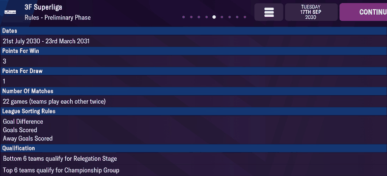
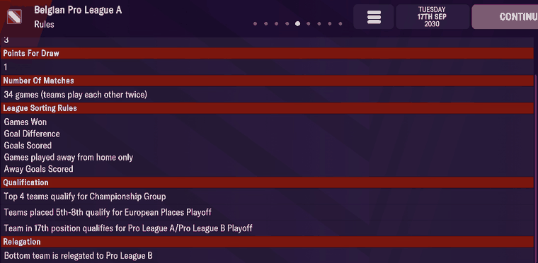
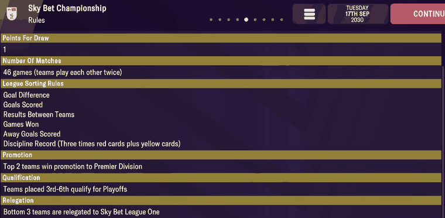
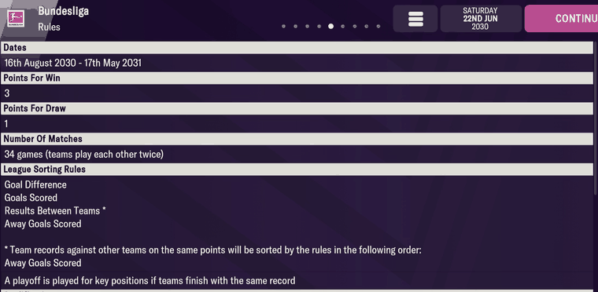

# comp_rules  ([`fmparser/tables/comp_rules.py`](../../fmparser/tables/comp_rules.py))

Each loaded competition's structure: its stages (league phase, championship and relegation
groups, group stage, knockout) and each knockout stage's rounds, with teams and legs. One
archive member per loaded competition, `comp_<uid>.dat`, named by the competition's
**uid** ([competitions](competitions.md)): 147 on every Frem save, 149 on Bucaspor's. A
member is a 54-byte header and one block in the save's tagged format, declared per tag.

The same declarations read the data dictionary's 453 competition rule files
([rule_files](rule_files.md)): a configured member is a copy of the rule file it names.

## Layout

```
member  [54-byte header][n_fields tagged fields][binary state, not read]
FILE    stgs: [STAGE, …]                                  + ~160 unread top-level tags
STAGE   id (code), indx, type, ntms, stnm, ngps, rnds: [ROUND, …]
ROUND   stnm, ntms, nmlg
```

The tagged format (`[tag, 4 B reversed][01][type][value]`, containers, lists, strings) is
specified once, in `fmparser/core/types.py` above `read_tree`. The block reads to exactly its
declared field count and ends on the trailer `XSvC EdBr EdDt SubF` (`SubF` the source folder);
the bytes after it are runtime state.

**Header** (`HEADER`): +6 `d9 01` on every member; +20 `season_year`, the season's start year
(2029 on 68 members of frem-2030-06-22; later years on competitions whose next edition is set
up, 0 on 44); +48 `base_year` 2000 on all; +50 `n_fields`, the declared top-level field count.
74 members declare **0 fields**: the competition is loaded but its rules are not set up (a
stub; 44 of them have `season_year` 0).

| tag | field | meaning | how we know |
|---|---|---|---|
| `stgs` | `stages` | the stage list, in order | |
| stage `id` | `stage_code` | a FourCC: `leag`, `cham`, `rele`, `prom`, `bppr` (League Path), `chpr` (Champions Path), `grou`, `play`, `dcup` …; one rule file stores the number 4 | |
| stage `indx` | `stage_index` | the stage's index: a fixture's `stage_index` (+76) | the fixtures' labels, [rounds](rounds.md) |
| stage `type` | `stage_type` | 0 knockout, 1 league, 2 groups, 6 play-off feeder | |
| stage `ntms` | `stage_teams` | teams in the stage | Superliga 12 / 6 / 6 |
| stage `stnm` | `stage_name_id` | a [round-name](rounds.md) id: 236 Preliminary Phase, 108 Championship Group | the fixture screens, [rounds](rounds.md) |
| stage `ngps` | `n_groups` | groups in a group stage | |
| stage `rnds` | `rounds` | the knockout rounds; element k is a fixture's `round_index` k (+77) | the cup screens, [rounds](rounds.md) |
| round `stnm` | `round_name_id` | round-name id: 8 Third Round, 17 Quarter Final, 18 Semi Final, 20 Final | |
| round `ntms` | `round_teams` | teams in the round; absent where the draw sets it | |
| round `nmlg` | `legs` | legs per tie, 1 or 2 | |

A name id is stored either as `stnm`'s own value or as the `stgn` child of an `stnm` container
(`{id 'stnm', stgn <id>}`, `NAME_REF`); a scalar can be a pair of equal u32s (`(28, 28)`).
Every other tag a member carries is listed in the schema's `unread` set (seen, deliberately
not read); `tests/test_comp_rules.py` fails on a tag that is in neither.

**Unread stage tags whose meaning a rules screen shows** (Evidence, below). Not read by the
parser yet; TODO, "Decode the competition rules".

| tag | what it is | the screen |
|---|---|---|
| `nrds` | round-robin rounds: 2 = teams play each other twice | "22 games (teams play each other twice)" for 12 teams |
| `sort` | the table's tie-breakers after points, a list of codes in order | "League Sorting Rules" |
| `relr` | relegation: `{nrpl <n>, comp <uid>}`, the bottom n go down to that competition; `mnpl`/`mxpl` a minimum and maximum where a play-off decides | "Relegation": Belgium `{nrpl 1, comp 2}` "Bottom team is relegated to Pro League B"; Championship `{nrpl 3, comp 13}` bottom 3 to League One; Bundesliga `{nrpl 2, comp 23, mnpl 2, mxpl 3}` bottom 2 to Bundesliga 2 (a third through the 16th-place play-off) |
| `prmr` | promotion: `{nrpl <n>, comp <uid>}` | "Promotion": Championship `{nrpl 2, mnpl 3, comp 11}`, "Top 2 teams win promotion to Premier Division" (3 with the play-off winner) |
| `qurl` | where places go: `{nmsn <stage name id>, stag <stage index>, nrpl <n>}` = the top n; `topp`/`btpl` = a band of positions, 0-based; `comp` = another competition | "Qualification" |

`sort` codes, as the screens and the store's tables show them:

| code | rule | from |
|---|---|---|
| 0 | Goal Difference | all three screens |
| 1 | Goals Scored | all three screens |
| 3 | Results Between Teams (head to head) | Champions Cup screen; and Spain's First and Second Division (and all but one Spanish league) read `[3, 0, 1]`, the league whose rebuilt tables disagree with the game only where head to head decides (TODO, "League tables outside Denmark") |
| 18, 29 | the head-to-head sub-rules, Goal Difference then Goals Scored | Champions Cup screen, the footnote |
| 30 | the head-to-head sub-rule Home Goals Scored: North American Nations League `[0, 1, 3, 30, 22]` reads Goal Difference, Goals Scored, Results Between Teams\* (\* Home Goals Scored), Discipline Record (×3); member byte 1,937 | North American Nations League screen |
| 5, 39 | both shown as "Away Goals Scored" (5 in the Danish and Belgian leagues, 39 in the European group stages); what separates them is unknown | all three screens |
| 13 | Games played away from home only (it precedes 5 in Belgium's list) | Belgian screen |
| 2 | Games Won | Champions Cup and Belgian screens |
| 16 | Away Games Won | Champions Cup screen |
| 20 | Discipline Record (two times red cards plus yellow cards) | Champions Cup screen |
| 22 | Discipline Record (three times red cards plus yellow cards) | Sky Bet Championship screen |
| 14 | probably "A playoff is played for key positions if teams finish with the same record": the one Bundesliga line with no other code (`[0, 14, 1, 3, 5]` for Goal Difference, Goals Scored, Results Between Teams, Away Goals Scored) | Bundesliga screen |
| 7 | Coefficient | Champions Cup screen |

Seen but not on a screen: 6 (Belgium's Championship Group and European Places Playoff stages, `[6, 2, 0, 1, 13, 5]`). England's top flight reads `[0, 1, 3]`, the
Bundesliga `[0, 14, 1, 3, 5]`, Belgium's `[2, 0, 1, 13, 5]` (and `[6, 2, 0, 1, 13, 5]` on its
play-off stages).

## Evidence

`frem-2030-06-22`. **`comp_6.dat`, the 3F Superliga** (uid 6). Header:

```
03 01 74 61 64 2e | d9 01 | 00 07 01 04 00 20 00 01 07 00 06 01 | ed 07 | 00 00 00 00 | 38 d9 9e 3f
10 00 01 01 00 00 00 01 00 00 00 d0 07 00 00 00 00 00 | d0 07 | 3a 00 00 00
```

`season_year` 2029, `base_year` 2000, 58 top-level fields. Its `file` is
`dan_prem_3_6_euro_teams` in `.\europe\dan\leagues\`. The stage list reads:

| `indx` | `id` | `type` | `ntms` | `stnm` |
|---|---|---|---|---|
| 0 | `leag` | 1 league | 12 | 236 Preliminary Phase |
| 1 | `cham` | 1 | 6 | 108 Championship Group |
| 2 | `rele` | 1 | 6 | 171 Relegation Stage |
| 3, 4 | `ep1r`, `ep2r` | 6 feeder | | |
| 5 | `epof` | 0 knockout | 2 | 172 European Places Playoff; one round, 2 teams, 1 leg |
| 6 | `peri` | 2 groups | 12 | 2 groups |

The first stage at member byte 196: `67 61 65 6c` (the `id` value `leag`, reversed), then
`78 64 6e 69 01 11 00` (`indx`, u8, 0), `…`; its `ntms` at 214: `73 6d 74 6e 01 11 0c` (12).

**`comp_1301406.dat`, the Sydbank Pokalen**: one `dcup` stage of 104 teams, seven rounds:
First (92 teams), Second (52), Third (32), Fourth (16), Quarter Final (8, **2 legs**), Semi
Final (4, **2 legs**), Final (2, 1 leg). The two-legged quarter- and semi-finals are on the
cup's Fixtures screens ([rounds](rounds.md), `img/rounds-1..3.png`).

**Members and rule files agree**: all 73 configured members name a rule file (`file`) that is
in the dictionary, and for all 73 the stage and round list read from the member equals the one
read from that file (stage code, teams, round, round teams, legs).

**Rules screens.** Sydbank Pokalen, Rules - Final (`img/comp_rules-1.png`): "Date 30th May
2030", extra time then penalties, "Winner qualifies for the EURO Cup Playoff". The final is
round 6, `stnm` 20 (member byte 2,462: `6d 6e 74 73 01 11 14`), one leg (`nmlg` at 2,602:
`67 6c 6d 6e 01 11 01`). Its date is not stored as a date but as a rule, the unread `date`
container `{spld 'ascension'}` (byte 2,531: `64 6c 70 73 01 1a 09 00 00 00` "ascension"):
Ascension Day 2030 is Thursday 30 May, and the world fixture list has the Pokalen's final on
2030-05-30.


EURO Cup, Rules - League Path Third Qualifying Round (`img/comp_rules-2.png`): draw Monday 22nd
July 2030, played 8th–15th August 2030, "Winners qualify for the Playoff". In
`comp_1301396.dat` the League Path is stage 0 (`bppr`, 6 teams, name 2000016479), its round 0
`stnm` 151 Third Qualifying Round (byte 3,248: `6d 6e 74 73 01 12 97 00`) with `nmlg` 2 (byte
3,599: `67 6c 6d 6e 01 11 02`): two legs, the two dates on screen, and two unread date rules,
`date` and `dat2` (`in_2` 3 and 4). The draw is the unread `drdt` `{time 1230, dyow 2, dyom 24,
mont 7}`; that it means "the Monday on or before 24 July" fits 22 July 2030 but is one example,
so unverified.

**Sorting and qualification.** These two screens are from a later save (in-game 17 September
2030); the bytes below are frem-2030-06-22's, whose lists are identical to frem-2030-09-14's
for every loaded competition.

3F Superliga, Rules - Preliminary Phase (`img/comp_rules-3.png`): 22 games, teams play each
other twice; League Sorting Rules Goal Difference, Goals Scored, Away Goals Scored; "Bottom 6
teams qualify for Relegation Stage", "Top 6 teams qualify for Championship Group". In
`comp_6.dat`, stage 0:
- `nrds` at byte 264: `73 64 72 6e 01 11 02`, 2 rounds of 11 opponents = 22 games;
- `sort` at 1,788: `74 72 6f 73 01 0b 03 00 00 00 | 01 11 00 | 01 11 01 | 01 11 05`, the
  list `[0, 1, 5]`;
- `qurl` at 1,631, two rules: `{nmsn 108 Championship Group, stag 1, nrpl 6}` and
  `{nmsn 171 Relegation Stage, stag 2, topp 6, btpl 11}`, positions 7–12.



European Champions Cup, Rules - Group Stage (`img/comp_rules-4.png`): Results Between Teams\*,
Goal Difference, Goals Scored, Away Goals Scored, Games Won, Away Games Won, Discipline Record,
Coefficient, and \* sorted by Goal Difference, Goals Scored; "Team in 3rd position qualifies for
EURO Cup First Knockout Round", "Top 2 teams qualify for First Knockout Round". In
`comp_1301394.dat`, stage 2 (`grou`, 8 groups of 4, `nrds` 2):
- `sort` at 14,284: ten u8 codes `03 12 1d 00 01 27 02 10 14 07`, `[3, 18, 29, 0, 1, 39, 2,
  16, 20, 7]`: the screen's eight lines in order, the footnote's two sitting after code 3;
- `qurl` at 11,828: `{nrpl 2, nmsn 164 First Knockout Round}` and `{nmsn 164, comp 1301396
  (EURO Cup), stag 4, topp 2, btpl 2}`, the third place.

Belgian Pro League A, Rules (`img/comp_rules-5.png`, in-game 17 September 2030): 34 games;
League Sorting Rules Games Won, Goal Difference, Goals Scored, Games played away from home
only, Away Goals Scored; top 4 to the Championship Group, 5th–8th to the European Places
Playoff; bottom team relegated to Pro League B. In `comp_1.dat` (uid 1), stage 0 (`leag`, 18
teams, `nrds` 2):
- `sort` at 2,366: `74 72 6f 73 01 0b 05 00 00 00 | 01 11 02 | 01 11 00 | 01 11 01 | 01 11 0d
  | 01 11 05`, `[2, 0, 1, 13, 5]`, the five lines in order;
- `qurl` at 2,134: `{nmsn 108, stag 1, topp 0, btpl 3}` (top 4) and `{nmsn 172, stag 2, topp 4,
  btpl 7}` (5th–8th);
- `relr` at 747: `72 6c 65 72 01 0a 03 00 00 00 … 6c 70 72 6e 01 11 01 | 70 6d 6f 63 01 11 02`,
  `{id 'relr', nrpl 1, comp 2}`, one club down to Pro League B (uid 2).

The screen's third qualification line, "Team in 17th position qualifies for Pro League A/Pro
League B Playoff", is not in this stage's `qurl`; it probably comes from the entry rules
(`ftac`) of the play-off stage `relp`, which name competitions 1 and 2. Not mapped.



Sky Bet Championship, Rules (`img/comp_rules-8.png`, in-game 17 September 2030): 46 games;
Goal Difference, Goals Scored, Results Between Teams, Games Won, Away Goals Scored, Discipline
Record (three times red cards plus yellow cards); top 2 promoted, 3rd–6th to the play-offs,
bottom 3 relegated to League One. `comp_12.dat` stage 0 (24 teams, `nrds` 2):
- `sort` at 3,750: `… 01 11 00 | 01 11 01 | 01 11 03 | 01 11 02 | 01 11 05 | 01 11 16`,
  `[0, 1, 3, 2, 5, 22]`;
- `prmr` at 3,349: `{nrpl 2, mnpl 3, comp 11}`; `relr` at 3,390: `{nrpl 3, comp 13}`.



Bundesliga, Rules (`img/comp_rules-6.png`, `-7`, in-game 22 June 2030): 34 games; Goal
Difference, Goals Scored, Results Between Teams\*, Away Goals Scored, \* sorted by Away Goals
Scored, and "A playoff is played for key positions if teams finish with the same record";
"Bottom 2 teams are relegated to Bundesliga 2", 16th to the Bundesliga/Bundesliga 2 play-offs.
`comp_22.dat` stage 0 (18 teams):
- `sort` at 1,938: `… 01 11 00 | 01 11 0e | 01 11 01 | 01 11 03 | 01 11 05`, `[0, 14, 1, 3, 5]`;
- `relr` at 1,119: `{nrpl 2, comp 23, mnpl 2, mxpl 3}`.

The head-to-head footnote has no code of its own here (the Champions Cup's has 18 and 29), so
how the game builds it is not settled. The screen's Continental Qualification lines are not
in this stage's tags; not mapped.



Spain's First Division (`comp_67.dat`, `sort` at 2,515): `01 11 03 | 01 11 00 | 01 11 01`,
`[3, 0, 1]`. The English Premier Division (`comp_11.dat`, at 3,690): `[0, 1, 3]`.

The disciplinary rules (EURO Cup: a ban after 3 yellow cards; the Pokalen: after every 2; the
Superliga: a points system, a ban after 19, 17 more, then every 16) and the Superliga's loan
rules are not read; where they are stored is not established (TODO, "Decode the competition
rules").

> **Quirk:** a stub (0 fields) is a loaded competition, not a missing one. Read its structure
> from the dictionary's rule file instead; nothing does so today.

## Output

`output/<label>/competition_rounds.json`: one row per (competition, stage, round) for every
configured member, `{uid, stage_index, stage_code, stage_type, stage_teams, stage_name_id,
n_groups, round_index, round_name_id, round_teams, legs}`; a stage with no rounds gives one row
with `round_index` null. Loads into `raw.competition_rounds`; `int.stages` and `int.rounds` build
`mart.dim_stage` and label fixtures from it. Extracted together with the [fixtures](fixtures.md) (`--no-archive` skips both).
