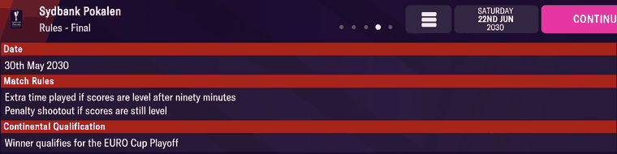

# comp_rules  ([`fmparser/tables/comp_rules.py`](../../fmparser/tables/comp_rules.py))

Each loaded competition's structure: its stages (league phase, championship and relegation
groups, group stage, knockout) and each knockout stage's rounds, with teams and legs. One
archive member per loaded competition, `comp_<uid>.dat`, named by the competition's
**uid** ([competitions](competitions.md)): 147 on every Frem save, 149 on Bucaspor's. A
member is a 54-byte header and one block in the save's tagged format, declared per tag.

The same declarations read the data dictionary's 453 competition rule files
([rule_files](rule_files.md)): a configured member is a copy of the rule file it names.

## Layout

```
member  [54-byte header][n_fields tagged fields][binary state, not read]
FILE    stgs: [STAGE, …]                                  + ~160 unread top-level tags
STAGE   id (code), indx, type, ntms, stnm, ngps, rnds: [ROUND, …]
ROUND   stnm, ntms, nmlg
```

The tagged format (`[tag, 4 B reversed][01][type][value]`, containers, lists, strings) is
specified once, in `fmparser/core/types.py` above `read_tree`. The block reads to exactly its
declared field count and ends on the trailer `XSvC EdBr EdDt SubF` (`SubF` the source folder);
the bytes after it are runtime state.

**Header** (`HEADER`): +6 `d9 01` on every member; +20 `season_year`, the season's start year
(2029 on 68 members of frem-2030-06-22; later years on competitions whose next edition is set
up, 0 on 44); +48 `base_year` 2000 on all; +50 `n_fields`, the declared top-level field count.
74 members declare **0 fields**: the competition is loaded but its rules are not set up (a
stub; 44 of them have `season_year` 0).

| tag | field | meaning | how we know |
|---|---|---|---|
| `stgs` | `stages` | the stage list, in order | |
| stage `id` | `stage_code` | a FourCC: `leag`, `cham`, `rele`, `prom`, `bppr` (League Path), `chpr` (Champions Path), `grou`, `play`, `dcup` …; one rule file stores the number 4 | |
| stage `indx` | `stage_index` | the stage's index: a fixture's `stage_index` (+76) | the fixtures' labels, [rounds](rounds.md) |
| stage `type` | `stage_type` | 0 knockout, 1 league, 2 groups, 6 play-off feeder | |
| stage `ntms` | `stage_teams` | teams in the stage | Superliga 12 / 6 / 6 |
| stage `stnm` | `stage_name_id` | a [round-name](rounds.md) id: 236 Preliminary Phase, 108 Championship Group | the fixture screens, [rounds](rounds.md) |
| stage `ngps` | `n_groups` | groups in a group stage | |
| stage `rnds` | `rounds` | the knockout rounds; element k is a fixture's `round_index` k (+77) | the cup screens, [rounds](rounds.md) |
| round `stnm` | `round_name_id` | round-name id: 8 Third Round, 17 Quarter Final, 18 Semi Final, 20 Final | |
| round `ntms` | `round_teams` | teams in the round; absent where the draw sets it | |
| round `nmlg` | `legs` | legs per tie, 1 or 2 | |

A name id is stored either as `stnm`'s own value or as the `stgn` child of an `stnm` container
(`{id 'stnm', stgn <id>}`, `NAME_REF`); a scalar can be a pair of equal u32s (`(28, 28)`).
Every other tag a member carries is listed in the schema's `unread` set (seen, deliberately
not read); `tests/test_comp_rules.py` fails on a tag that is in neither.

## Evidence

`frem-2030-06-22`. **`comp_6.dat`, the 3F Superliga** (uid 6). Header:

```
03 01 74 61 64 2e | d9 01 | 00 07 01 04 00 20 00 01 07 00 06 01 | ed 07 | 00 00 00 00 | 38 d9 9e 3f
10 00 01 01 00 00 00 01 00 00 00 d0 07 00 00 00 00 00 | d0 07 | 3a 00 00 00
```

`season_year` 2029, `base_year` 2000, 58 top-level fields. Its `file` is
`dan_prem_3_6_euro_teams` in `.\europe\dan\leagues\`. The stage list reads:

| `indx` | `id` | `type` | `ntms` | `stnm` |
|---|---|---|---|---|
| 0 | `leag` | 1 league | 12 | 236 Preliminary Phase |
| 1 | `cham` | 1 | 6 | 108 Championship Group |
| 2 | `rele` | 1 | 6 | 171 Relegation Stage |
| 3, 4 | `ep1r`, `ep2r` | 6 feeder | | |
| 5 | `epof` | 0 knockout | 2 | 172 European Places Playoff; one round, 2 teams, 1 leg |
| 6 | `peri` | 2 groups | 12 | 2 groups |

The first stage at member byte 196: `67 61 65 6c` (the `id` value `leag`, reversed), then
`78 64 6e 69 01 11 00` (`indx`, u8, 0), `…`; its `ntms` at 214: `73 6d 74 6e 01 11 0c` (12).

**`comp_1301406.dat`, the Sydbank Pokalen**: one `dcup` stage of 104 teams, seven rounds:
First (92 teams), Second (52), Third (32), Fourth (16), Quarter Final (8, **2 legs**), Semi
Final (4, **2 legs**), Final (2, 1 leg). The two-legged quarter- and semi-finals are on the
cup's Fixtures screens ([rounds](rounds.md), `img/rounds-1..3.png`).

**Members and rule files agree**: all 73 configured members name a rule file (`file`) that is
in the dictionary, and for all 73 the stage and round list read from the member equals the one
read from that file (stage code, teams, round, round teams, legs).

**Rules screens.** Sydbank Pokalen, Rules - Final (`img/comp_rules-1.png`): "Date 30th May
2030", extra time then penalties, "Winner qualifies for the EURO Cup Playoff". The final is
round 6, `stnm` 20 (member byte 2,462: `6d 6e 74 73 01 11 14`), one leg (`nmlg` at 2,602:
`67 6c 6d 6e 01 11 01`). Its date is not stored as a date but as a rule, the unread `date`
container `{spld 'ascension'}` (byte 2,531: `64 6c 70 73 01 1a 09 00 00 00` "ascension"):
Ascension Day 2030 is Thursday 30 May, and the world fixture list has the Pokalen's final on
2030-05-30.



EURO Cup, Rules - League Path Third Qualifying Round (`img/comp_rules-2.png`): draw Monday 22nd
July 2030, played 8th–15th August 2030, "Winners qualify for the Playoff". In
`comp_1301396.dat` the League Path is stage 0 (`bppr`, 6 teams, name 2000016479), its round 0
`stnm` 151 Third Qualifying Round (byte 3,248: `6d 6e 74 73 01 12 97 00`) with `nmlg` 2 (byte
3,599: `67 6c 6d 6e 01 11 02`): two legs, the two dates on screen, and two unread date rules,
`date` and `dat2` (`in_2` 3 and 4). The draw is the unread `drdt` `{time 1230, dyow 2, dyom 24,
mont 7}`; that it means "the Monday on or before 24 July" fits 22 July 2030 but is one example,
so unverified.

The disciplinary rules on the same screens (EURO Cup: a ban after 3 yellow cards; the Pokalen:
after every 2) are not read; where they are stored is not established (TODO, "Decode the
competition rules").

> **Quirk:** a stub (0 fields) is a loaded competition, not a missing one. Read its structure
> from the dictionary's rule file instead; nothing does so today.

## Output

`output/<label>/competition_rounds.json`: one row per (competition, stage, round) for every
configured member, `{uid, stage_index, stage_code, stage_type, stage_teams, stage_name_id,
n_groups, round_index, round_name_id, round_teams, legs}`; a stage with no rounds gives one row
with `round_index` null. Loads into `raw.competition_rounds`; `int.stages` and `int.rounds` build
`mart.dim_stage` and label fixtures from it. Extracted together with the [fixtures](fixtures.md) (`--no-archive` skips both).
