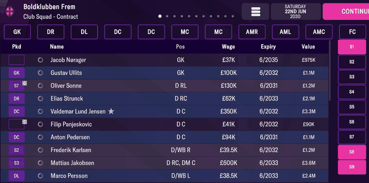
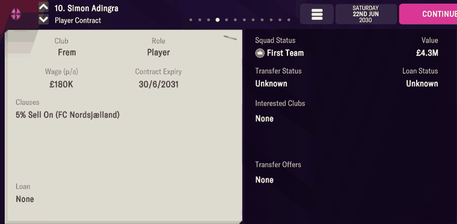

# contracts  ([`fmparser/tables/contracts.py`](../../fmparser/tables/contracts.py))

Every person's contract: wage, expiry, start date and an active flag. A preallocated grid of
fixed 83-byte slots, one per tid (`tid == slot index`), at ~29 MB. In front of slot 0 sit 11
bytes of `0x12`, then the grid's capacity as a u32 at `base − 6` (59,632 on Frem, 60,765 on
Bucaspor) and two more bytes. The capacity is not a headcount: slots are filled from tid 0
and the walk stops at the first slot whose tid isn't its index (33,127 used on Frem).

## Layout

| offset | field | type | meaning | how we know |
|---|---|---|---|---|
| +0 | `tid` | u32 | equals the slot index | the walk's invariant |
| +4 | `marker` | u8 | bit 0 set = a current contract (1, 3, 17, 21) | all 38 contracts on Frem's two Contract screens read 1 |
| +5 | `wage_units` | u16 | the weekly wage in units of £10: `× 10` is £/week, `× 520` is £/year | the Contract screens (below) |
| +7 | | 6 B | unnamed | |
| +13 | `expiry` | date `[day-of-year u16, 0-based][year u16]` | the day the contract ends | the Expiry column, 38 of 38 |
| +17 | | 19 B | unnamed | |
| +36 | `start_date` | date | when the contract began | Adingra's equals his `joined_date` |
| +40 | | 43 B | unnamed | |

## Evidence

`frem-2030-06-22`, Club Squad → Contract for the first team and the reserves. Every row, 38
of 38, has wage `× 520` within 2.4% of the screen's rounded £ figure and the screen's
expiry month and year:



| player | `wage_units` | × 520 | screen | expiry | screen |
|---|---|---|---|---|---|
| Jacob Nørager | 71 | 36,920 | £37K | 2035-06-29 | 6/2035 |
| Gustav Ullits | 193 | 100,360 | £100K | 2032-06-28 | 6/2032 |
| Valdemar Lund Jensen | 675 | 351,000 | £350K | 2032-06-28 | 6/2032 |
| Fredrik Bak | 37 | 19,240 | £19.25K | 2032-06-28 | 6/2032 |
| Johannes Tjørnelund | 197 | 102,440 | £100K (the widest gap, 2.4%) | 2032-06-28 | 6/2032 |
| Louka Ravn (reserves) | 9 | 4,680 | £4.7K | 2031-06-29 | 6/2031 |

Simon Adingra's Player Contract screen, slot at byte 31,367,776:



```
b8 67 00 00  01  5e 01  00 00 00 00 00 00  b4 00 ef 07  …  e3 00 ec 07 …
tid 26552    marker  350                   day 180 of 2031   day 227 of 2028
```

| on screen | parsed |
|---|---|
| Wage (p/a) `£180K` | `wage_units` 350 → £3,500/week → £182,000/year |
| Contract Expiry `30/6/2031` | `expiry` 2031-06-30 |
| (joined Frem 15 Aug 2028) | `start_date` 2028-08-15 |

His scrapbook entry ([player_lists](player_lists.md)) stores the same wage in pounds:
`wage` 3,500. Tested by `tests/test_people_evidence.py`.

## Quirks

> **Quirk:** the expiry day matters. Most current deals end on 28, 29 or 30 June (the day
> moves with the year), but a few hundred end on 29–31 May or 30–31 December. Keep the full
> date; never assume 30 June.

> **Quirk:** the grid runs past the person table. Slots 32,966 to 33,126 (161 of them) hold
> tids no person has, with no wage and both dates 1 Jan 2021 (the career's "no date"), on
> every Frem save. They are part of the walk, not people. Tids in this range do turn up in
> match stats: 58 of them (32,967–33,066) play for 14 reserve sides on this save, the
> anonymous filler the game uses to simulate reserve leagues.

> **Quirk:** an even `marker` is not always a departed player. Frem's staff, all still at the
> club, read 2, 12, 14, 16 or 20 with expiries in 2021–2024. What those markers mean is not
> known; only bit 0 is read.

> **Quirk:** the reserves' Contract screen ends with greyed rows with no contract (wage and
> expiry `-`, value `Free`). They are placeholders, not players: no person record carries
> their names, and none needs to.

> **Quirk:** a lapsed loan or contract can leave a player's `club_tid` on a club he has left.
> Whether a player is in a squad comes from the club's squad array ([clubs](clubs.md)), and
> whether he is out on loan from [player_progress](player_progress.md); neither comes from
> this grid.

## Output

`output/<label>/contracts.json`: every used slot in tid order (`tid, marker, wage_units,
expiry, start_date`), lapsed contracts included, loaded into `raw.contracts`. Which contract
is current, and the wage in pounds, are decided in the store.
