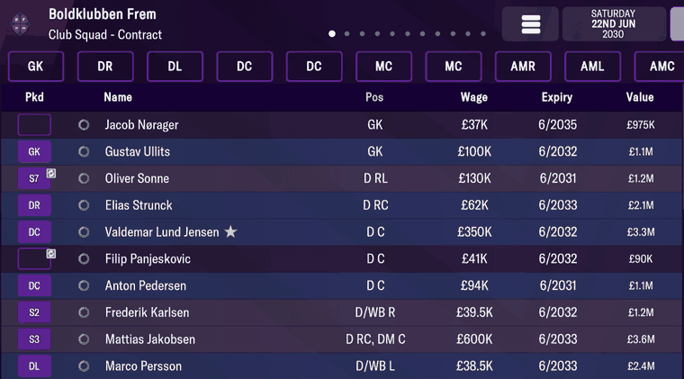
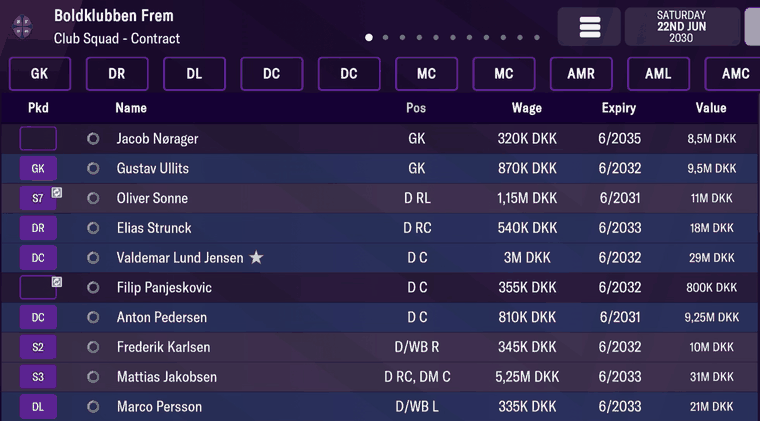
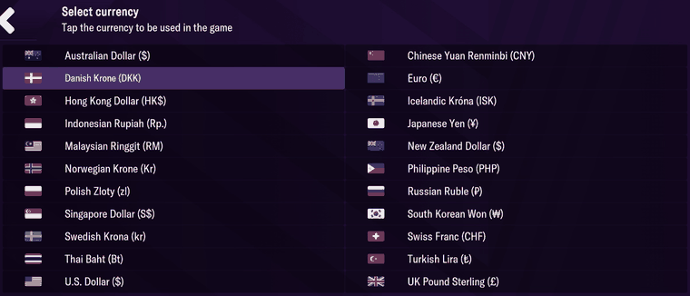

# currencies  ([`fmparser/tables/currencies.py`](../../fmparser/tables/currencies.py))

The game's currencies and their exchange rates against the pound. A count-framed table of 173
variable-length records at ~13.98 MB, `[≥ 8 × 0xFF][count u16 = 173]`. Record 0 is the
Albanian Lek; the count is the same in both careers.

## Layout

| field | type | meaning | how we know |
|---|---|---|---|
| `uid` | u16 | database id; not dense, not ordered (Syrian Pound 24922, Macao Pataca 51535) | |
| `name` | `[len u32][utf-8]` | no NUL | |
| `exchange_rate` | f32 | units of this currency per £1; United Kingdom Pound is exactly 1.0 | the Contract screen in £ and in DKK (below) |

`locate_currencies` finds record 0 by its bytes (`uid 2`, length 12, `Albanian Lek`) and
checks that a run of `0xFF` sits in front of the count.

## Provenance

`frem-2030-06-22`. The two records that matter for a check, at bytes 13,946,062 and 13,947,605:

| record | raw bytes | parsed |
|---|---|---|
| Danish Krone | `17 00` `0c 00 00 00 "Danish Krone"` `f1 2f 0b 41` | `uid` 23, `exchange_rate` 8.699204 |
| United Kingdom Pound | `56 00` `14 00 00 00 "United Kingdom Pound"` `00 00 80 3f` | `uid` 86, `exchange_rate` 1.0 |

Frem's Club Squad → Contract screen, once in pounds and again after switching the game's
currency to Danish Krone (Settings → Select currency):

Every kroner figure is the pound figure × 8.699204, within the screen's rounding:

| player | wage in £ | × 8.699204 | wage on screen in DKK |
|---|---|---|---|
| Gustav Ullits | £100K | 869,920 | 870K DKK |
| Marco Persson | £38.5K | 334,919 | 335K DKK |
| Elias Strunck | £62K | 539,351 | 540K DKK |
| Frederik Karlsen | £39.5K | 343,619 | 345K DKK |
| Mattias Jakobsen | £600K | 5,219,522 | 5,25M DKK |

The ratio of the two displayed figures runs from 8.57 (£350K → 3M DKK) to 8.85 (£130K →
1,15M DKK). That spread is display rounding on both screens, not a second rate: every £ figure
× 8.699204 lands within 2% of its DKK figure (worst: Sonne, 1.7%). Tested by
`tests/test_world_provenance.py`.

## Quirks

> **Quirk:** the game's currency picker is not this table. It lists 24 currencies under its
> own names (`UK Pound Sterling (£)`, `Danish Krone (DKK)`, `Euro (€)`); this table holds 173
> (`United Kingdom Pound`, `European Euro`). Match a picker entry by its rate, not its name.
>
> 

> **Quirk:** a uid is an identifier, not a range. A `uid ≤ 4096` gate once cut the table at
> Macao Pataca (uid 51535), losing the last 79 currencies. Walk by the declared count.

> **Quirk:** the count frame's `0xFF` run can be 9 or 10 bytes, because the record before it
> may end in `0xFF`. Test for `≥ 8`, never `== 8`.

## Output

`output/<label>/currencies.json`, `{uid: currency}` with each record's byte `offset`, loaded
into `raw.currencies`.
