# fixtures  ([`fmparser/tables/fixtures.py`](../../fmparser/tables/fixtures.py))

Every result in the loaded world, every club, for this calendar year and the last: the
Fixtures/Results screens of every club and competition. 92-byte records in the save's zstd
archive, member `fix_man.dat` ([`docs/save-archive.md`](../save-archive.md) has the
container), stored as one grid per calendar year, the current year first. 26,627 records on
`frem-2030-06-22` (7,915 for 2030, 18,712 for 2029), across both careers' clubs and national
sides alike. Our own clubs' matches in full detail are [matches](matches.md).

## Layout

Offsets from the record's first byte.

| offset | field | type | meaning | how we know |
|---|---|---|---|---|
| +1 | `opener` | u8 | always `0x14` | the locator keys on it |
| +2 | | 4 | `ff ff ff ff` | the locator keys on it |
| +6 | `home_goals` | u8 | home score after 90 minutes | our 70 matches |
| +7 | `home_extra_goals` | u8 | home score after extra time; `ff` = no extra time | 3-2 after 2-2 |
| +8 | `home_pens` | u8 | home shoot-out score; `ff` = none | |
| +11 | `away_goals` | u8 | away score after 90 minutes | |
| +12 | `away_extra_goals` | u8 | | |
| +13 | `away_pens` | u8 | | |
| +31 | `stage_key` | u32 | the stage: a record index into `comp_man.dat`'s stage grid (`tables/comp_stages.py`) | |
| +35 | `seq_id` | u16 | **the venue's stadium id**, not a sequence (Quirks) | |
| +41 | `home_tid` | u32 | home club | our 70 matches, venue right on all |
| +47 | `away_tid` | u32 | away club | |
| +53 | `day_raw` | u16 | day of the year **1-based** in the low 9 bits; the top 7 bits (1, 2 or 3) unnamed | |
| +55 | `year` | u16 | the match's year | |
| +57, +59 | `day2_raw`, `year2` | u16 | a second date, unread | |
| +66 | `season_year` | u16 | the campaign's **start** year: 2028 for 2028/29; 0 on friendlies | |
| +76 | `stage_index` | u8 | the stage's `indx` in the competition's rules ([`tables/comp_rules.py`](../../fmparser/tables/comp_rules.py)); `ff` = none | |
| +77 | `round_index` | u8 | the round in the stage's `rnds`; `ff` on league stages | |
| +78 | `round` | u8 | the matchday within the stage, 0-based; for a knockout, the round; `ff` on friendlies | |
| +72 | (unread) | u32 | **the referee**: an official's tid, `ffffffff` when none (Quirks) | Mikkel Redder, below |
| +83 | `subr` | u8 | stage class from the rules file; unnamed values | |

The rest (+0, +9, +14..30, +37, +45, +51, +61, +68, +79..82, +84..91) is declared in
`FIXTURE` and unread; +16..23 is constant zero and +26..30 constant `00 00 00 00 14`.
`stage_attr_80`/`81` are named for being constant within a stage, nothing more.

**How it is found.** `segments` scans the decompressed member for the opener `[u8][0x14]
[ff ff ff ff]` and splits the hits into runs of exact 92-byte steps. Each run tiles its span
exactly (`count × 92`). The grids are walked in file order.

## Evidence

`frem-2030-06-22`, the Vejle 2-4 Frem report ([matches](matches.md),
`img/matches-1.png`). The fixture sits at offset 1,963,665 of the decompressed `fix_man.dat`:

| on screen | raw bytes | parsed |
|---|---|---|
| Vejle 2 - 4 Frem | +6 `02`, +11 `04`, +41 `8c 04 00 00`, +47 `5a 01 00 00` | home 1164, away 346, 2-4 |
| 23 Sep 2029 | +53 `0a 07` (`0x070a & 0x1ff` = 266), +55 `ed 07` | day 266, 1-based: 23 September 2029 |
| Vejle Stadion | +35 `43 0f` | `seq_id` 3907 = stadium 3907, Vejle Stadion, Vejle's own |
| Referee: Mikkel Redder | +72 `ff 25 00 00` | 9727, the official's tid ([officials](officials.md)) |
| Preliminary Phase | +76 `00` | `stage_index` 0 → the Superliga's stage 0 → [rounds](rounds.md) 236 |

Vendsyssel 0-2 Frem (`img/matches-10.png`): `seq_id` 190 = Nord Energi Arena, +72 = 10510,
the referee Jakob A. Sundberg.

Hedensted 1-8 Frem (`img/matches-7.png`), at offset 1,967,253: +35 `9e 1e` = stadium 7838,
Hedensted Stadion; +72 `4b 25 00 00` = 9547, the referee Sandi Putros; `stage_index` 0 and
`round_index` 2, the Pokalen's Third Round ([rounds](rounds.md)).

**Frem's Club Fixtures for 2029/30, row by row.** The list has 50 rows, and the fixture list
holds exactly 50 Frem records from July 2029, one per date. Every row matches its record on
date, opponent (the club's short name), venue and score. The screen prints the score
home-first, as stored: "19 Aug 29 · 2-0 · AaB · A" is AaB 2-0 Frem, shown red.

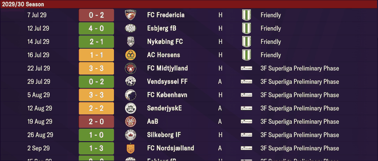
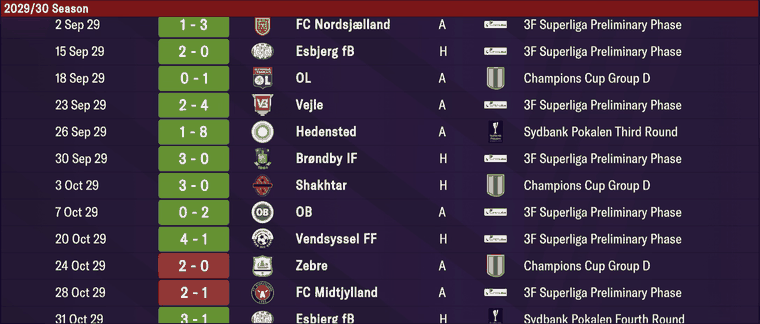
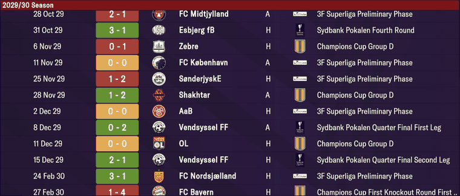
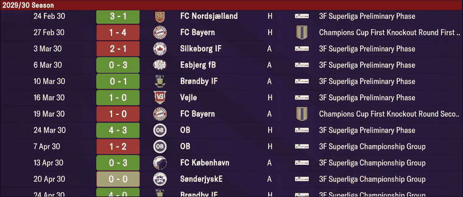
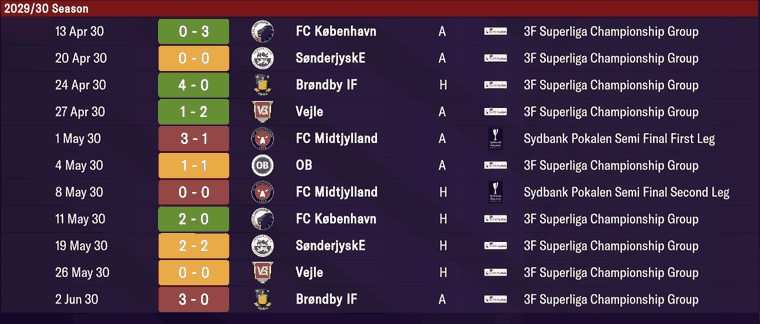

**FC København's Club Fixtures, row by row:** 43 rows, 43 records, every one matching on
date, opponent, venue and score (`img/fixtures-6..10.png`).

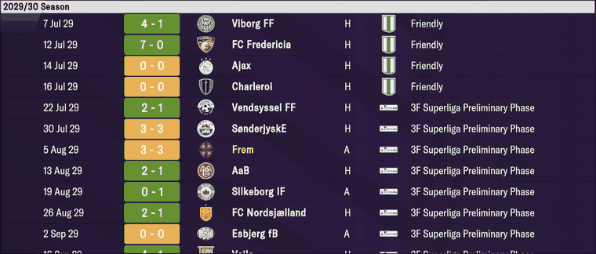
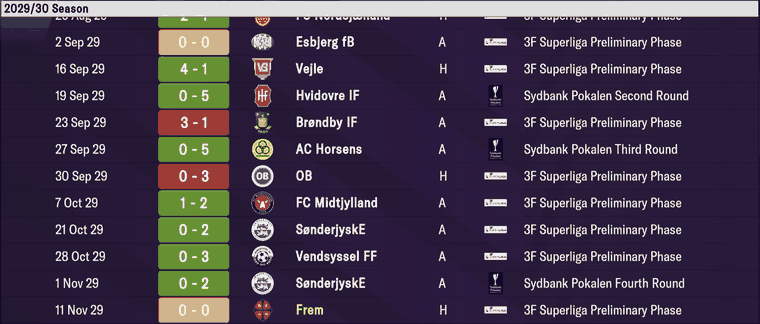
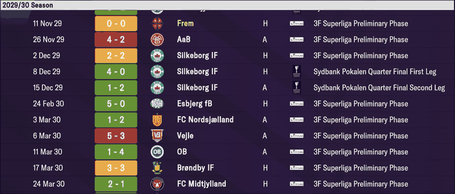
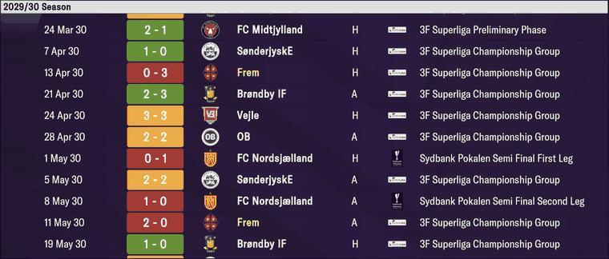
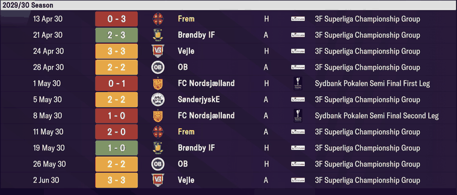

**The cup's round screens** (Sydbank Pokalen Fixtures): eight ties of the Quarter Final Second
Leg and both Semi Final legs, each one record in its leg's `stage_key` (389, 428, 429) with
the score shown.

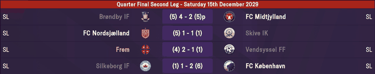
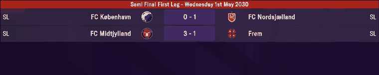
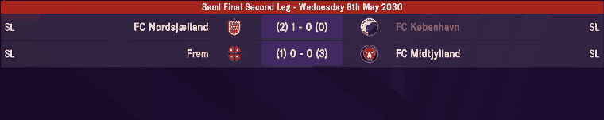

The bracketed numbers are the aggregate, which no record holds. Brøndby 4-2 Midtjylland,
level 5-5 on aggregate and marked `p`, reads `home_pens` 2, `away_pens` 4 and `ff` in the
extra-time bytes: a shoot-out straight after the second leg, Midtjylland through.

The labels (Friendly, 3F Superliga Preliminary Phase / Championship Group, Champions Cup
Group D, Sydbank Pokalen Third Round … Semi Final Second Leg, Champions Cup First Knockout
Round First/Second Leg) are not in the record. They come from `stage_key`, `stage_index` and
`round_index` through the rules ([rounds](rounds.md)), and `site.matches` reproduces all 50,
group letter and leg included.

All 70 of our matches in the [matches](matches.md) table are here with the same date, clubs
and score. Tested by `tests/test_matches_evidence.py`.

## Quirks

> **Quirk:** it is a results list, not a fixture list. On every save measured, mid-season
> included, no record is unplayed; the last is the day before the save. A future fixture
> isn't in the save in this form. (`ff` in the score bytes is coded for, never seen.) The
> rule files' `fxds`, `ofxd`, `nfxd` and `mtdy` records are scheduling rules (a day of the
> week, a day and month in template year 2000, a kick-off time such as 1900), with no clubs
> and no score.

> **Quirk:** only two calendar years are held: the save's year and the one before. On
> `frem-2030-06-22` the list runs from 1 January 2029 to 21 June 2030, so the first half of
> 2028/29 is already gone. Union across snapshots for a whole season.

> **Quirk:** the day is 1-based, unlike every other day field in the save. Reading it 0-based
> shifts every date a day late. Measured by joining our own matches on clubs and score and
> letting the date come out: every one needed −1 (`DAY_BASE`). Never check this field by
> joining on it: a uniform shift only makes fewer rows join.

> **Quirk:** `+6`/`+11` are the 90-minute score. A match that went to extra time keeps the
> 90-minute score there and the after-extra-time score at `+7`/`+12` (2-2, then 3-2). A tie
> decided on penalties without extra time has the shoot-out at `+8`/`+13` and `ff` at
> `+7`/`+12`, as Brøndby 4-2 Midtjylland (pens 2-4) does. No record holds a tie's aggregate,
> though the screens show it: `site.matches` sums our ties' legs (`tie_gf`, `tie_ga`). `mart.match_stages` takes
> the full-time score from our own matches where it holds them.

> **Quirk:** `seq_id` is the venue's stadium id ([stadiums](stadiums.md)): the home club's
> stadium on 17,787 of 26,627 records on `frem-2030-06-22`, and its parent club's on 8,054 more
> (reserve and youth sides have no stadium of their own). The rest are other grounds. Every
> Frem home match reads 181, Frem's stadium. Nothing downstream uses it as a sequence.

> **Quirk:** the record carries no competition. A fixture's competition comes from a match
> we played in the same `stage_key`, or the stage's rules (`mart.match_stages`). A group stage
> is one `stage_key` per group, and each leg of a two-legged knockout tie is its own
> `stage_key` (the second leg's `subr` reads 44 on every tie of ours).

> **Quirk:** the record is home-first and the venue is right on all of our 70 matches. The
> 25-byte [match_slots](match_slots.md) table, by contrast, holds no venue.

> **Quirk:** a match is held once: no `(date, home, away)` repeats on `frem-2030-06-22`. The
> two grids are 117 KB apart, and what sits between them is not identified.

> **Quirk:** +72 (inside the unread `+68..75`) is the referee's tid: an [official](officials.md)
> on 11,254 of 26,627 records, `ffffffff` on the rest, including every friendly, our reserve
> fixtures and our European matches. Each of our 32 league matches has a referee who lists
> the Superliga among his competitions, and a referee has two matches on one day on only 7
> of 11,247 referee-days. Not read yet (TODO "Field names that say the wrong thing, and the
> referee").

> **Quirk:** national sides appear as club-shaped tids from the club table (tid 0 is Algeria).

## Output

`output/<label>/world_fixtures.json`: one row per record, in file order (`home_tid,
away_tid, date, year, round, home_goals, away_goals, home_extra_goals, away_extra_goals,
home_pens, away_pens, stage_key, seq_id, season_year, stage_index, round_index, subr`), `ff`
read as null and the date 0-based. Loads into `raw.world_fixtures`. `extract.py --no-archive`
skips it.
