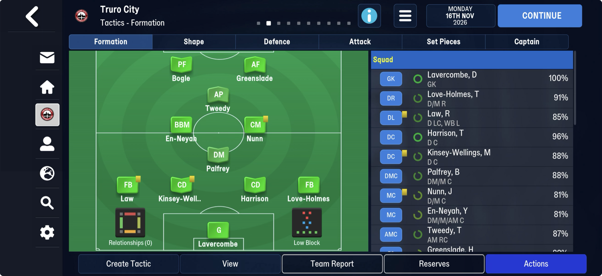
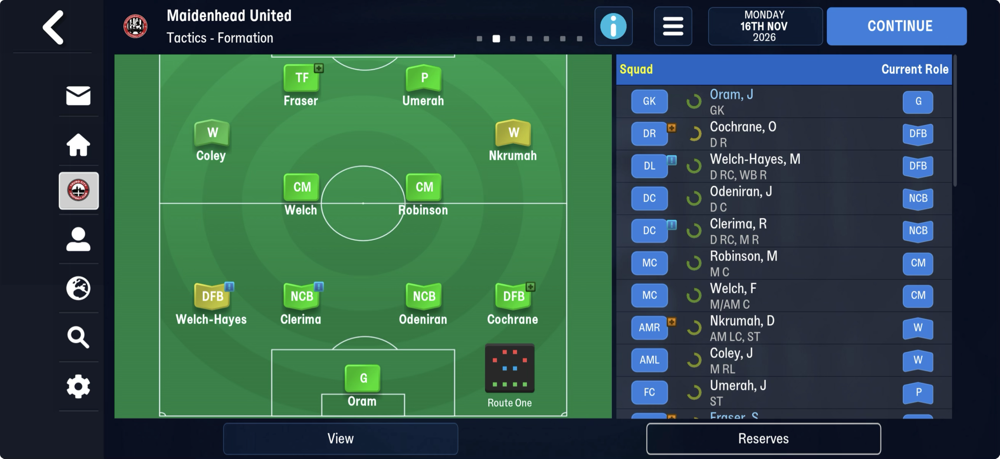
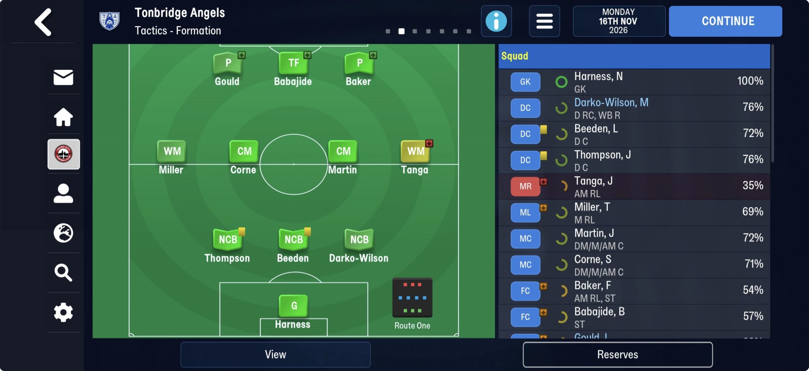
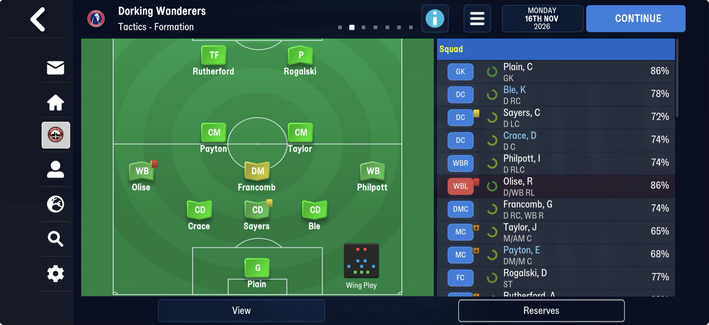
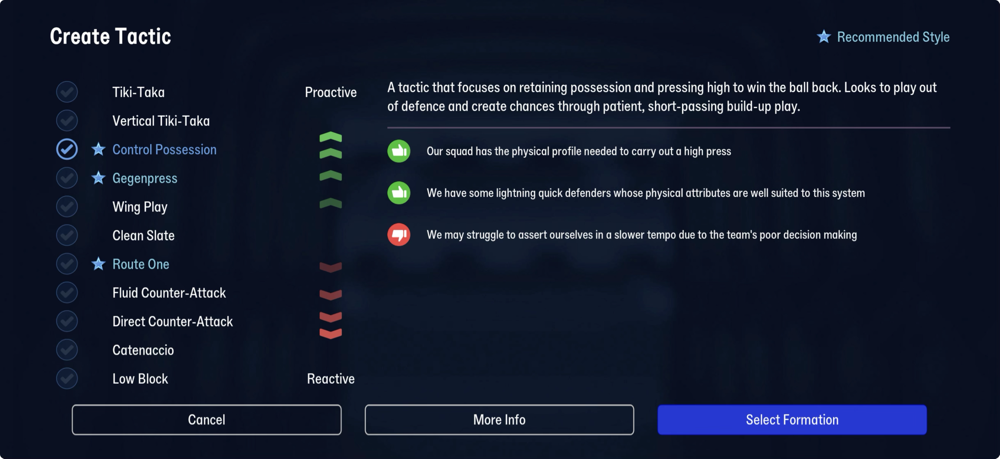

# formations  ([`fmparser/tables/formations.py`](../../fmparser/tables/formations.py))

**The game's 21 stock formations, each with the position of its 11 slots.** The list a
staff record's formation fields index ([staff](staff.md)), and the layout the managed club's
saved tactics ([alt_managed_club](unread/alt_managed_club.md)) and the tactic in each of
[our matches](matches.md) are stored in. Both games, the same 21. `extract.py` writes
`formations.json` (the names, which the loader reads) and `formation_catalog.json` (index,
name, the 11 position codes).

| save | from | to |
|---|---|---|
| truro-2026-11-16 (FMM27) | 27,855,891 | 27,882,393 |
| frem-2026-06-11 (FMM22) | 20,596,961 | 20,623,463 |

Between the [season-year blocks](unread/rf_season_years.md) and the
[team selections](team_selections.md), whose count follows the last record.

## Layout

21 × 1,262 B, no count:

| offset | field | type | meaning |
|---|---|---|---|
| +0 | | u32 | 0x07f4b976 on every record (`76 b9 f4 07`), saved tactics too |
| +4 | `name` | 32 B | NUL-padded: `3-4-3`, `3-4-3 DM`, `4-4-2 Diamond` … |
| +36 | `positions` | 11 × u16 | slot 0 the goalkeeper, then the outfield slots in the tactic's order |
| +58 | | 1,204 B | not read: the codes again, eleven `01` bytes, `[u16][u16]` grids (positions in each phase, by the look of it) |

FMM27's order: 3-4-3, 3-4-3 DM, 4-1-2-2-1, 4-1-4-1, 4-2-1-3, 4-2-2-2, 4-2-3-1, 4-2-3-1 DM,
4-2-4, 4-3-1-2, 4-3-2-1, 4-3-3, 4-4-1-1, 4-4-2, 4-4-2 Diamond, 4-5-1, 5-1-2-2, 5-2-1-2,
5-2-2-1, 5-3-2, 5-4-1. FMM22 opens with 4-4-2.

### Position codes

A row bit in bits 0-6 and one lane bit in bits 7-11:

| row bit | row | | lane bit | lane |
|---|---|---|---|---|
| 0x01 | goalkeeper | | 0x800 | right flank |
| 0x04 | defence | | 0x400 | inside right |
| 0x08 | defensive midfield; its flanks are the wing-backs (the screen's WBR/WBL) | | 0x200 | centre |
| 0x10 | midfield | | 0x100 | inside left |
| 0x20 | attacking midfield | | 0x080 | left flank |
| 0x40 | attack | | | |

So 4-4-2 is GK `0001`, back four `0804 0084 0404 0104`, midfield `0810 0090 0410 0110`,
strikers `0440 0140`; a back three is `0404 0204 0104`, wing-backs `0808 0088`.

**A wide centre-back is the inside lane on the defence row**: a back three is inside right
`0404`, centre `0204`, inside left `0104`, and a back four's pair is `0404` and `0104`. The
game has no separate code or label for it: its squad list calls all of them DC, as it calls
every inner midfielder MC and every striker FC. `primitives.pitch_position`, which reads the
match table's copies of these codes, emits those labels; the lane survives in the bytes.

## Evidence

truro-2026-11-16: the 21 names, and the 4-4-2 Diamond's eleven codes, which Truro's saved
4-1-2-1-2 carries code for code. The lanes come from four Tactics – Formation screens taken
that day: each team's [selection](team_selections.md), placed at its formation's codes, puts
every one of 44 starters where the screen shows him (Truro in the Diamond, Maidenhead 4-2-4,
Tonbridge 3-4-3, Dorking 5-1-2-2: below). `tests/test_team_selections_evidence.py`, which
fails with the inside lanes swapped.

| team | formation | placed by the codes (right to left) |
|---|---|---|
| Truro City | 4-4-2 Diamond | Love-Holmes DR, Harrison DRC, Kinsey-Wellings DLC, Law DL; Nunn MRC, En-Neyah MLC; Greenslade STRC, Bogle STLC |
| Maidenhead United | 4-2-4 | Odeniran DRC, Clerima DLC; Robinson MRC, Welch MLC; Nkrumah AMR, Coley AML; Umerah STRC, Fraser STLC |
| Tonbridge Angels | 3-4-3 | Darko-Wilson DRC, Beeden DC, Thompson DLC; Tanga MR, Martin MRC, Corne MLC, Miller ML; Baker, Babajide, Gould |
| Dorking Wanderers | 5-1-2-2 | Ble DRC, Sayers DC, Crace DLC; Philpott DMR (WBR), Olise DML (WBL); Taylor MRC, Payton MLC; Rogalski STRC, Rutherford STLC |

The screens also show each player's role (NCB, DFB, W, TF, P, WM, BBM, AP …) and a team
style. Neither is in the formation or the team selection.

### Team style: not stored for AI teams, by every test so far

FMM27 has eleven styles (the Create Tactic screen, below): Tiki-Taka, Vertical Tiki-Taka,
Control Possession, Gegenpress, Wing Play, Clean Slate, Route One, Fluid Counter-Attack,
Direct Counter-Attack, Catenaccio, Low Block. No name is stored as text anywhere in the
save. Ten league sides' Tactics – Formation screens on 16 Nov:

| style | teams (manager's preferred formation) |
|---|---|
| Route One | Maidenhead (4-2-4), Tonbridge (3-4-3), Ebbsfleet (4-2-3-1) |
| Wing Play | Dorking (5-1-2-2), Maidstone (4-2-3-1), Weston-super-Mare (4-2-3-1) |
| Direct Counter | Salisbury (4-1-2-2-1), Torquay (4-2-3-1) |
| Low Block | Farnham (4-2-3-1); Truro (our own choice) |

No byte of the club rows (131 B), the manager's staff record (39 B, including the five
unnamed bytes at +34, which share one vocabulary and once looked like a style: Ebbsfleet and
Farnham both read 9 there), the manager's person record or the team selection's u8 is equal
within a style and different between Route One and Wing Play. The same formation carries
every style (4-2-3-1: all four), so the style is not in the formation either. The likeliest
reading is that the game picks an AI side's style from its squad when it needs one, as the
Create Tactic screen recommends styles from our squad's attributes (the stars, and reasons
such as "our squad has the physical profile needed to carry out a high press"). The roles on
the screens follow the style (Route One sides: target forward and poacher; Wing Play: wing-backs
and wingers), so roles are probably computed the same way.

## Next

Name the 1,204-byte tail (the phase grids). Find the managed club's own style and roles
(the tactic records in [alt_managed_club](unread/alt_managed_club.md) are the place to look).
