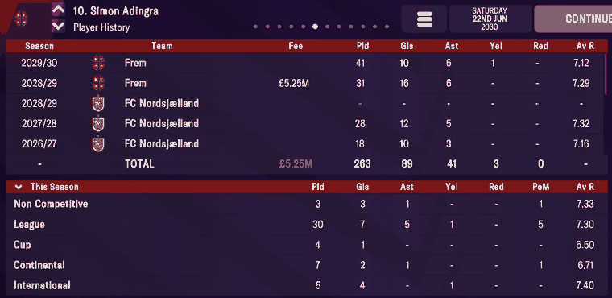
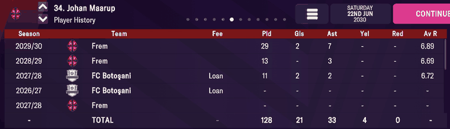

# history  ([`fmparser/tables/history.py`](../../fmparser/tables/history.py))

Every player's career, season by season: the Player History screen's lines. A fixed pool of
16-byte records after a `[count u32]`, at ~42 MB, linked into one chain per player. The
pool's size never changes within a career (265,423 records on every Frem save, 295,648 on
Bucaspor); only its byte position drifts. Nothing in the pool names a player: a player's
[player_attributes](player_attributes.md) record points at the first record of his chain
(`history_head`).

## Layout

| offset | field | type | meaning | how we know |
|---|---|---|---|---|
| +0 | `season` | u8 | the season's end year is `1971 + code` (`0x3a` = 2028/29) | Player History (below) |
| +1 | `apps` | u8 | | |
| +2 | `goals` | u8 | goals conceded, for a goalkeeper | Ullits' lines |
| +3 | `assists` | u8 | | |
| +4 | `reds` | u8 | 0 before the career | |
| +5 | `yellows` | u8 | 0 before the career | |
| +6 | `rating` | u16 | average rating × 100; 0 before the career | 729 = 7.29 |
| +8 | `club` | u16 | club tid; `0xFFFF` = none | |
| +10 | `fee` | u16 | `ffff` none, `fffe` loan, `fffd` or `0` free, else £000s; `fffa` (7,788 records) and `fffc` (3,759) also occur, unread | 5250 = £5.25M; `Loan` on screen |
| +12 | `next` | u32 | the next record of this chain; `0xFFFFFFFF` ends it | |

A chain holds a player's lines in the order they were written, roughly oldest first but not
sorted by season. The first is the oldest line the pool holds for him, at his first club.
Seasons played during the career are written into records freed elsewhere in the pool, so a
chain jumps. Every record is on exactly one chain (26,033 chains on `frem-2030-06-22`); the
free records waiting to be reused sit in one-record chains.

The pool's invariant is that the pointers form a forest: every record is on exactly one
chain (`core.forest`), checked on every record. `locate_history` finds the base from pairs of
neighbouring records that still point at each other (k → k+1), then keeps the candidate whose
declared count fits the file and passes the forest check.

## Evidence

`frem-2030-06-22`. Simon Adingra's chain starts at record 226,909 (his `history_head`); the
pool starts at byte 42,398,193.

| record | raw bytes | parsed | on screen |
|---|---|---|---|
| 32,723 | `39 1c 0c 05 00 00 dc 02 a1 09 ff ff …` | 2027/28, 28 apps, 12 goals, 5 assists, 7.32, FC Nordsjælland | 2027/28 FC Nordsjælland 28 12 5 7.32 |
| 211,927 | `3a 00 00 00 00 00 00 00 a1 09 82 14 …` | 2028/29, no games, FC Nordsjælland, fee 5250 | 2028/29 FC Nordsjælland - - - |
| 29,896 | `3a 1f 10 06 00 00 d9 02 5a 01 ff ff ff ff ff ff` | 2028/29, 31, 16, 6, 7.29, Frem, end of chain | 2028/29 Frem **£5.25M** 31 16 6 7.29 |

The screen's TOTAL is the chain plus the season in progress. His chain's apps add up to 222
and the screen's 2029/30 line has 41: 263, as shown. Goals 79 + 10 = 89, assists 35 + 6 =
41, yellows 2 + 1 = 3.

Gustav Ullits' chain shows the other fee codes: his 2021/22 loan to B.93 reads `fe ff` on
the B.93 line, and his free move from FC Nordsjælland reads `fd ff`.

Johan Maarup's chain shows loans and the screen's order:

| record | parsed | on screen |
|---|---|---|
| 61,933 | 2027/28, Frem, no games | 2027/28 Frem - (bottom row) |
| 164,135 | 2026/27, FC Botoşani, no games, `fffe` | 2026/27 FC Botoşani Loan - |
| 155,704 | 2027/28, FC Botoşani, 11 apps, 2 goals, 2 assists, 6.72, `fffe` | 2027/28 FC Botoşani Loan 11 2 2 6.72 |
| 1,242 | 2028/29, Frem, 13 apps, 0, 3, 6.69, end of chain | 2028/29 Frem 13 - 3 6.69 |

The chain's apps add up to 99 and his 2029/30 line has 29: 128, as shown (goals 19 + 2,
assists 26 + 7, yellows 4 + 0). Tested by `tests/test_people_evidence.py`.

## Quirks

> **Quirk:** the screen lists the chain newest first, in chain order, without sorting by
> season. Maarup's 2027/28 Frem line was written before his 2026/27 Botoşani loan line, so
> it shows below it. A loan year carries two lines: the loan club's, with `fffe`, and a
> no-games line at the parent club.

> **Quirk:** the season in progress is not in the pool. Adingra's 2029/30 line (41 games)
> appears on screen but no record holds it; the pool gains the line when the season ends.

> **Quirk:** a transfer fee sits on the line of the club the player LEFT; the screen prints
> it on the line of the club he joined. A loan's `fffe` sits on the loan club's own line,
> where the screen prints `Loan`. Adingra's £5.25M is stored on his last FC Nordsjælland record
> and shown beside Frem. `mart.fact_transfer` reads it as the fee of the move away.

> **Quirk:** the pool is recycled from the oldest lines of players still playing, not only
> from retired players. Raheem Sterling's chain on `frem-2030-06-22` starts at 2019/20 (ten
> lines); on a 2027 save it started at 2016/17, and his screen in 2021 began at Liverpool
> 2010/11. The screen's TOTAL is the sum of the lines still held, so it shrinks too. An earlier
> snapshot can hold lines a later one has dropped: union history across snapshots
> (`int.player_career_lines`, `mart.fact_player_season`).

> **Quirk:** cards and ratings exist only for seasons played during the career. Earlier
> lines read 0, which means not recorded, not a clean record.

> **Quirk:** `next` once read as a row counter. On a fresh save every record points at the
> one after it, so it looks like `k + 1`; once seasons are recycled into free records it
> isn't. A rule that starts a new player at every break in the `+1` sequence over-splits an
> established save by ~2.5×. Read chains from `history_head`.

> **Quirk:** the count is a capacity, the same on every save of a career (265,423 on five
> Frem saves from 2023 to 2030, 295,648 on both Bucaspor saves). It bounds the walk; it says
> nothing about how much history exists. The pool recycles rather than grows, which is what
> sets it apart from [club_records](club_records.md) and [our matches](matches.md): both
> grow (the [savefile map](savefile-map.md#behaviour-classes-which-matter-more-than-the-offsets)).

> **Quirk:** [club_records](club_records.md) starts on the byte after the last record, with
> no gap: `21 04 81 00 …` on Frem is its club count (1,057) and its first club's tid (129),
> `24 04 0e 01 …` on Bucaspor (1,060, tid 270).

## Output

`output/<label>/history.json`: the whole pool column-wise (`base, count, header, rows`). The
loader follows each player's chain from his `history_head` into `raw.player_history` (one
row per player, with his origin club) and `raw.player_history_seasons` (one row per line).
