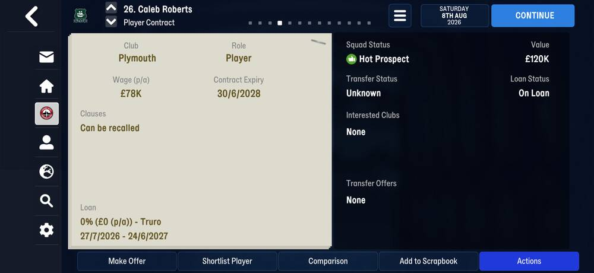

# loans  ([`fmparser/tables/loans.py`](../../fmparser/tables/loans.py))

**Every loan in the world**: the player, the club he is on loan at, the start and end dates,
the share of his wage the loan club pays, and an option. A pool of 25-byte slots after the [contract grid](contracts.md);
a player on loan points at his slot from the [per-person rows](person_index.md)
(`loan_slot`). His parent club is his own `club_tid` in the [person table](person_info.md).

| | capacity | loans |
|---|---|---|
| frem-2021-06-27 (day one) | 6,243 | 1,962 |
| frem-2023-07-02 (after a rollover) | 6,243 | 512 |
| frem-2026-06-11 | 6,243 | 2,312 |
| bucaspor-2023-04-01 | 6,243 | 2,624 |
| truro-2026-08-08 | 6,637 | 3,010 |

## Layout

`[u16 0][u32 capacity]`, then `capacity` slots of 25 bytes. The same layout on both games.

| offset | field | type | meaning | how we know |
|---|---|---|---|---|
| +0 | `tid` | u32 | the player; `ffffffff` on an empty slot | every used slot is pointed at by exactly this person |
| +4 | `club_tid` | u16 | the club he is on loan at | the four slots naming Frem are players loaned to Frem (below) |
| +6 | `start` | `[day u16][year u16]` | | |
| +10 | `end` | `[day u16][year u16]` | the season's end on most loans | every Frem loan on frem-2026-06-11 ends 29 June 2026 |
| +14 | `wage_pct` | u8 | the share of his wage the loan club pays, 0–100 | Caleb Roberts's contract card, below |
| +15 | | u8 | 1 on every slot | Roberts's card has the clause "Can be recalled"; one card can't tie it to this byte |
| +16 | `option` | u8 | 1 on about a third of loans | |
| +17 | | u32 | with `option` 1, money-sized (1,656 to 75,000,000): probably the fee to buy. With 0, either 0 or a number like 1,508,051 that is not money | the transfer band holds the same numbers on loan bids |
| +21 | | 4 B | 0 on FMM22; 0 or `ffffffff` on FMM27 | |

An empty slot is always `ffffffff ffff 0000b307 0000b307 00 01 00 ffffffff ffffffff`.

**How it is found.** The pool has no `0xFF` frame, and on frem-2030-06-22 it does not start
where the contract grid's span ends (89 bytes later), so it is found by its back-links: the
first person with a `loan_slot` gives a candidate base wherever his tid occurs after the
contract grid, and the base is accepted only if every linked person's slot holds his tid and
every other slot below the capacity is the empty pattern.

## Evidence

`tests/test_loans_evidence.py`, on eight saves of both games: the pool is found, its
capacity is the game's, every loan's person points at its slot, every other slot is empty,
every loan club is a club, and no player is on loan at his own club.

Against the [player progress](player_progress.md) table, whose on-loan bit the store's loan
spells come from, on frem-2026-06-11: the 11 Frem players progress marks as out on loan are
exactly the loans whose player belongs to Frem or its reserves (to Fredericia, Hvidovre,
Holbæk, Hobro, Roskilde, …). The four slots whose `club_tid` is Frem are the four players
loaned in, from Granada and the Midtjylland, Nordsjælland and Brøndby reserves; progress
does not mark them, as it marks loans out only.

`truro-2026-08-08`, Caleb Roberts's contract card (from the [contracts](contracts.md)
evidence):

| on screen | slot 2,514 bytes | parsed |
|---|---|---|
| Loan … Truro | `35 0c` at +4 | `club_tid` 3125 |
| 27/7/2026 – 24/6/2027 | `cf 00 ea 07 ae 00 eb 07` | `start` 2026-07-27, `end` 2027-06-24 |
| 0% (£0 (p/a)) | `00` at +14 | `wage_pct` 0 |

The u32 at +17 reads 10,000 on his slot, with `option` 0.

## Quirks

> **Lead:** `option` and the u32 at +17. A contract card for a loan with an option to buy
> would name both.

> **Quirk:** the pool covers the whole world, not just our club: this is where a "who is
> on loan where" view for every league can come from, which the progress bit (our squad
> only) can't give.

## Output

`output/<label>/loans.json`: `[{slot, tid, club_tid, start, end, wage_pct, option}]` for every
used slot, in slot order. Loaded as `raw.loans` → `stg.loans` → `int.loan_spells` →
`mart.fact_loan_spell` (agreed dates, `wage_pct`, `has_option`, `ended_early_by_date`), and on
the site as each current loan's end and our wage share on the player sheet
(`site.squad`, `core.ours.loans`) and the wage bill we pay (`site.finances.wage_paid_gbp`).

A loan made in the game is in the pool from its start day until it ends: on every save after
day one no slot starts after the save's date (the latest start is the save's own day on
frem-2030-06-30), and Tom Dean's loan to Truro (19 July to 1 January) is in the
truro-2026-07-22 pool and gone from the 25 July one, which is how the store dates a loan cut
short (`ended_early_by_date`). The day-one database is the exception: 1,839 of
frem-2021-06-27's 1,962 loans start later (the coming season's, up to March 2022), and a few
loans on every database start years back (Truro: one from 2006).
