# matches  ([`fmparser/tables/matches.py`](../../fmparser/tables/matches.py))

Our clubs' matches this season, each one in full: the match report, the stats, every
player's line and our tactic. A table of variable-length rows framed by a bare `[count u8]`,
holding the managed club's and its reserve side's matches in the order they were played: at
60,844,241 on `truro-2026-07-25` (one row), at 61,604,419 on `truro-2026-08-08` (three rows),
at ~55.7 MB on Frem (70 rows on `frem-2030-06-22`, 50 Frem, 20 reserves). FMM27 reads with
`MATCHES_TABLE_FMM27`. The game empties it on the career's rollover day. Every other club's results are in [fixtures](fixtures.md).

## Layout

```
header  [count u8]                      matches in the table
row     [head, 10 B]                    home, away, competition, day, year
        [n u8][n × event, 17 B]         the match's events
        [body, 5,665 B]                 everything else, fixed width
```

A row is `5,676 + 17 n` bytes, and the next row starts where it ends: on `truro-2026-08-08`
the three rows start at 61,604,420 (12 events), 61,610,300 (6) and 61,616,078 (9), 5,880 and
5,778 bytes apart. The body:

| body offset | span | block |
|---|---|---|
| +0 | 78 | body head: our side, the match header again, attendance, Player of the Match |
| +78 | 50 × 17 | the event list again, in 50 preallocated slots |
| +928 | 2 × 1,648 | the team blocks, home then away: `[80 B team head][20 × 70 B player slot][168 B team tail]` |
| +4,224 | 1,441 | the tail: our side's kick-off formation (the marker `76 b9 f4 07` at `+33`, the formation string at `+37`, the kick-off positions at `+69`) |

**Head, 10 bytes**: FMM22's 8, then `year` u16 at `+8`.

**Event, 17 bytes**: FMM22's record. The type codes differ:

| `type_byte` | meaning | evidence |
|---|---|---|
| `01` | goal | Starkie 17' |
| `24` | the goal's assist, at the goal's minute | Law |
| `26` | yellow card | Odeniran 9', Abbott 45+3', Nunn 89' |
| `2f` | a clear-cut chance, scored or not | one per chance in the team head's count, on all six sides |
| `17`, `18`, `27`, `29` | unnamed | each sits beside a goal or a chance |

`b0` is the event player's slot index, `posOrder − 1`.

**Body head, 78 bytes**: FMM22's, except that `+11` (`header_year`) and `+13` both read the
year where FMM22 has the day and the year. Attendance at `+15`, Player of the Match at `+63`.

**Team head, 80 bytes.** The side's own counters, as the stats screen shows them:

| offset | field | type | meaning |
|---|---|---|---|
| +4 | `corners` | u8 | |
| +5 | `clear_cut_chances` | u8 | |
| +6 | | 22 | `ff` throughout on every row read |
| +28 | `fouls` | u8 | |
| +29 | `fouls_against` | u8 | = the other block's `fouls` |
| +30 | `positions` | 11 × 2 | the side's eleven positions at full time, in `posOrder` order |
| +52 | `goals` | u8 | |
| +55 | `headers_won` | u8 | also the slots' sum |
| +62 | `manager_tid` | u32 | the side's manager, a staff tid |
| +68 | `offsides` | u8 | |
| +69 | `passes_attempted` | u16 | |
| +71 | `passes_completed` | u16 | |
| +73 | `crosses_attempted` | u8 | |
| +75 | `crosses_completed` | u8 | |
| +79 | `goals_against` | u8 | = the other block's `goals` |

Shots, shots on target, tackles won and yellow cards on the stats screen are sums of the
player slots. Possession and the team rating are not placed.

**Player slot, 70 bytes.** FMM22's one-byte stats in FMM22's order: the run from condition to
the substitution minutes starts 3 bytes earlier, everything from passes on 1 byte later, and
`xg_x100` is new.

| offset | field | | offset | field |
|---|---|---|---|---|
| +0 | `condition` | | +27 | `passC` |
| +1 | `crossA` | | +28 | `keyPass` |
| +2 | `crossC` | | +29 | `sid`, 2 bytes |
| +5 | `dribbles` | | +33 | `rating`, a whole number |
| +6 | | | +36 | `shotA` |
| +7 | `goals` | | +37 | `shotO` |
| +8 | `headA` | | +42 | `posOrder` |
| +9 | `headW` | | +43 | `tid`, u32 |
| +13 | `intercept` | | +49 | `tackA` |
| +16 | `subOn`, `ff` = not | | +50 | `tackW` |
| +17 | `sentOff`, `ff` = not | | +54 | `yellow` |
| +18 | `subOff`, `ff` = not | | +63 | `xg_x100`, u16: expected goals × 100 |
| +26 | `passA` | | | |

`+6` reads 7 on a booked player; `+19` is `ffffffff` on a starter and a value of its own on a
substitute; `+51` reads the side (0 home, 1 away); `+65` is a u16 that is non-zero on players
with key passes. Assists, mistakes and mistakes leading to a goal are not placed: on the one
competitive row they are 0 everywhere but Law's assist, and no slot byte reads it.

**How it is found**: as on FMM22, from a formation marker in a row whose body repeats its head;
FMM27's body repeats home, away and the year (`_LAYOUT_FMM27`).

### FMM22

```
header  [count u8]                      matches in the table
row     [head, 8 B]                     home, away, competition, day
        [n u8][n × event, 17 B]         the match's events
        [body, 5,093 B]                 everything else, fixed width
```

A row is `5,102 + 17 n` bytes, and the next row starts where it ends. The body:

| body offset | span | block |
|---|---|---|
| +0 | 78 | body head: our side, the match header again, attendance, Player of the Match |
| +78 | 50 × 17 | the event list again, in 50 preallocated slots; the first `n` equal the counted list |
| +928 | 2 × 1,363 | the team blocks, home then away: `[77 B team head][20 × 62 B player slot][46 B team tail]` |
| +3,654 | 1,439 | the tail: our side's kick-off formation and tactic |

**Head, 8 bytes**

| offset | field | type | meaning |
|---|---|---|---|
| +0 | `home_tid` | u16 | |
| +2 | `away_tid` | u16 | |
| +4 | `comp_id` | u16 | the competition's cid |
| +6 | `day` | u16 | day of the year, 0-based; the year is in the body head |

**Event, 17 bytes**

| offset | field | type | meaning |
|---|---|---|---|
| +0 | `b0` | u8 | unnamed, 1–17; carried into `raw.match_events` |
| +1 | `type_byte` | u8 | `01` goal, `02` own goal, `03` penalty, `04` missed penalty, `05` red card, `06` injury, `07`/`08` shoot-out kick scored/missed, `29` disallowed goal; `0e` unnamed (one, in a reserve fixture, on `frem-2030-06-22`) |
| +2 | `minute` | u8 | 0-based: the game shows `minute + 1` |
| +3 | `added` | u8 | added time: `89, 3` shows as 90+3 |
| +4 | `side` | u8 | 0 home, 1 away: the team of the event's player, own goals included |
| +5 | `tid` | u32 | the event's player, always one of the match's players |
| +9 | | 8 | two u32, `ffffffff` on most events; never a tid of the match |

**Body head, 78 bytes**

| offset | field | type | meaning |
|---|---|---|---|
| +0 | `club_tid` | u16 | our side: the managed club or its reserves |
| +2 | `opponent_tid` | u16 | |
| +4 | `club_comp_id` | u16 | = head `comp_id` |
| +6 | `home_flag` | u8 | 1 when `club_tid` is at home |
| +7 | `header_home_tid`, `header_away_tid`, `header_day` | 3 × u16 | = the head |
| +13 | `year` | u16 | the match date is `day` in `year` |
| +15 | `attendance` | u32 | 0 on friendlies |
| +63 | `player_of_match` | u32 | the game's Player of the Match (Quirks) |

**Team head, 77 bytes**

| offset | field | type | meaning |
|---|---|---|---|
| +3 | `goals_against` | u8 | = the other block's `goals` |
| +4 | `corners` | u8 | the side's corners, as the stats screen shows them (Quirks) |
| +5 | `clear_cut_chances` | u8 | the side's clear-cut chances (Quirks) |
| +6 | | 22 | a copy of `positions`, or `ff` throughout on friendlies and reserve fixtures |
| +30 | `positions` | 11 × 2 | the side's eleven positions at full time, in `posOrder` order (below) |
| +52 | `goals` | u8 | the side's score, own goals for it included |
| +68 | `offsides` | u8 | the side's offsides (Quirks) |

**Player slot, 62 bytes.** Twenty per side, preallocated. An unused slot keeps its
`posOrder` and has `tid` `ffffffff`. Every byte is a u8 unless marked.

| offset | field | | offset | field |
|---|---|---|---|---|
| +0 | `assists` | | +26 | `passC`, passes completed |
| +3 | `condition` (Quirks) | | +27 | `keyPass` |
| +4 | `crossA` | | +28 | `sid`, 2 bytes (the person's sid is 4) |
| +5 | `crossC` | | +32 | `rating`, a whole number |
| +8 | `dribbles` | | +35 | `shotA`, shots |
| +10 | `goals` | | +36 | `shotO`, shots on target |
| +11 | `headA` | | +41 | `posOrder`: 1–11 the starters, 12+ the bench |
| +12 | `headW` | | +42 | `tid`, u32 |
| +16 | `intercept` | | +48 | `tackA` |
| +19 | `subOn`, the minute; `ff` = not | | +49 | `tackW` |
| +20 | `sentOff`, the minute sent off; `ff` = not (Quirks) | | | |
| +21 | `subOff`, the minute; `ff` = not | | +53 | `yellow`, 1 = booked |
| +22 | `mistakes` | | | |
| +23 | `mistGoal`, mistakes leading to a goal | | | |
| +25 | `passA`, passes | | | |

**Tail, 1,439 bytes**

| offset | field | meaning |
|---|---|---|
| +33 | | the formation marker `76 b9 f4 07` |
| +37 | `formation` | ASCII, zero-padded to 32: `4-1-2-2-1` |
| +69 | `kickoff_positions` | 11 × 2: the formation's slots at kick-off, in the formation's own order |
| +102 | | `kickoff_positions` again, byte for byte |
| +220 | | 963 bytes: the formation's template from the formation catalog (Quirks) |
| +1196 | | eleven 8-byte rows, one per kick-off slot: five bytes, then `00 00 00` (Quirks) |

**A position is a `(band, column)` byte pair** (`core.primitives.pitch_position`). Band
`& 0x7f`: `01` GK, `04` D, `08` DM, `10` M, `20` AM, `40` ST; bit `0x80` marks the wide-left
player of the band. Column `08` is the wide-right player, so `(04, 08)` is DR, `(84, 00)` DL,
and any other column is the centre letter: DC, DMC, MC, AMC. GK and ST are always GK and FC.

Every byte of the row is declared, named or `UNKNOWN`: `scripts/audit/audit_records.py --map`
prints them.

**How it is found.** The formation marker sits at a fixed offset in every body. A marker
hit is a row when the bytes before it frame a row whose body repeats its head (clubs,
competition, home flag, day). From that row the walk steps back row by row to row 0, and the
byte in front of row 0 is the count. `scrape_matches` then requires the walk to read exactly
the declared count, no row before row 0 and none after the last.

## Evidence

`truro-2026-08-08`, Truro 1-0 Maidenhead United, Enterprise National League South, 8 August
2026. The row starts at byte 61,616,078: `35 0c 32 09 4b 01 db 00 ea 07 | 09` = home 3125
(Truro), away 2354 (Maidenhead), competition 331, day 219, 2026, nine events. Tested by
`tests/test_screens_fmm27_evidence.py`.

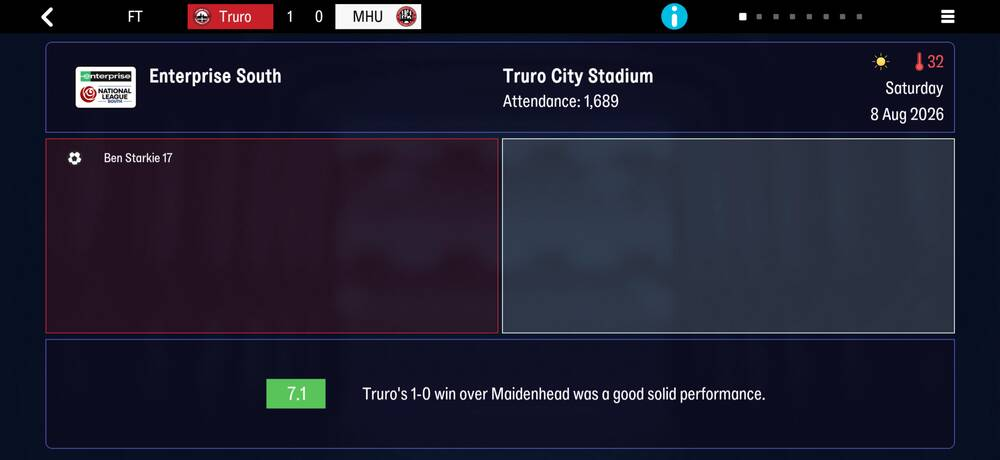

| on screen | raw bytes | parsed |
|---|---|---|
| Ben Starkie 17 | event `08 01 10 00 00 01 11 00 00` | type `01` goal, minute 16 + 1, home, tid 4353 |
| Attendance: 1,689 | body head +15 `99 06 00 00` | `attendance` 1689 |
| Saturday 8 Aug 2026 | head `db 00 ea 07` | day 219 of 2026 |

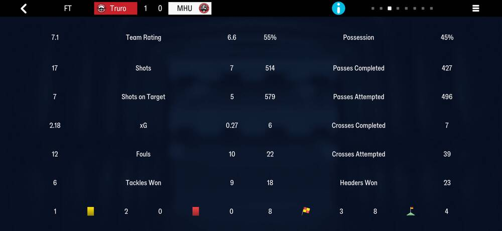

| on screen (Truro / Maidenhead) | raw bytes | parsed |
|---|---|---|
| Passes Attempted 579 / 496 | team head +69 `43 02` / `f0 01` | `passes_attempted` |
| Passes Completed 514 / 427 | +71 `02 02` / `ab 01` | `passes_completed` |
| Crosses Attempted 22 / 39, Completed 6 / 7 | +73 `16`/`27`, +75 `06`/`07` | `crosses_attempted`, `crosses_completed` |
| Fouls 12 / 10 | +28 `0c` / `0a` | `fouls` |
| Headers Won 18 / 23 | +55 `12` / `17` | `headers_won` |
| offsides 8 / 3, corners 8 / 4 | +68 `08` / `03`, +4 `08` / `04` | `offsides`, `corners` |
| Shots 17 / 7, on target 7 / 5, Tackles Won 6 / 9, yellow 1 / 2 | the slots | sums of `shotA`, `shotO`, `tackW`, `yellow` |
| xG 2.18 / 0.27 | slot +63, e.g. Bogle `68 00` | `xg_x100`: Truro's slots sum to 217, Maidenhead's to 27 |

No f32 in the body reads 2.18 or 0.27, and no team field holds 218 or 27: the screen's team
xG is the slots' sum, and Truro's 2.18 against 2.17 is the screen summing values the slots
store rounded. Each player's xG sits where his shots are: Bogle 5 shots, 1.04; Starkie 3, 0.60;
Harrison 1, 0.26.

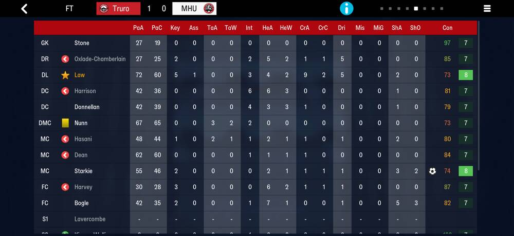
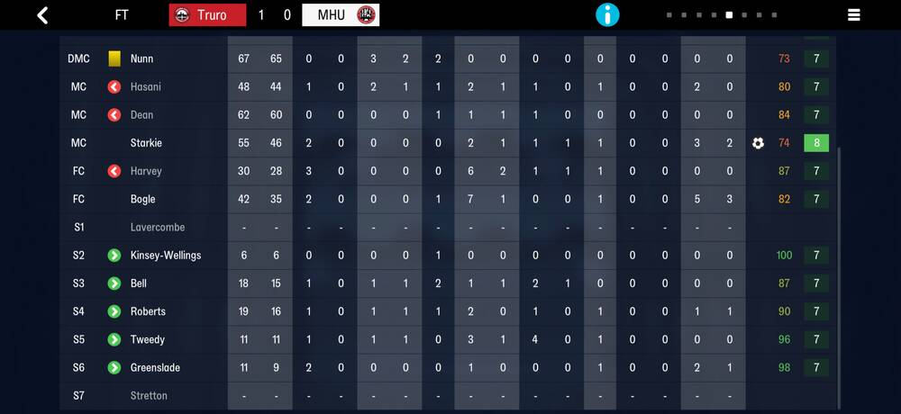
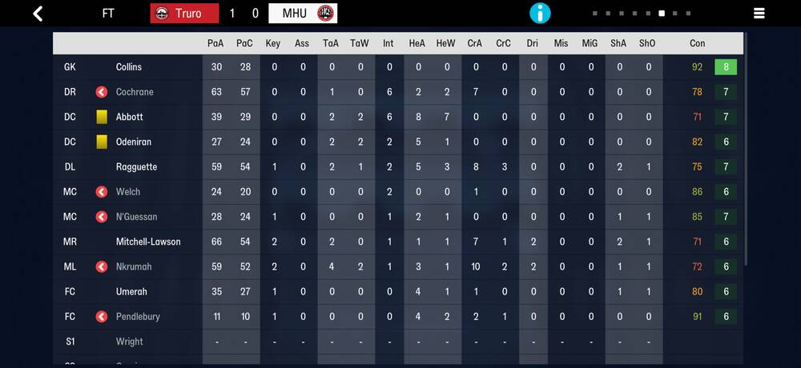
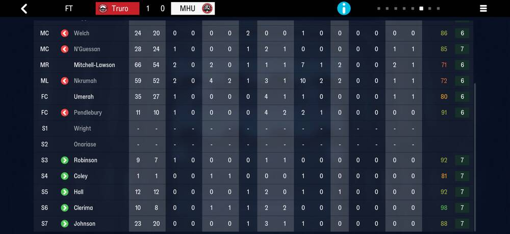

Law's line, `49 09 02 bd 0e 05 00 00 04 02 … 14 48 3c 05 bf 12 00 00 08 00 00 02 00 …`:
condition 73 (+0), crosses 9/2 (+1, +2), dribbles 5 (+5), headers 4/2 (+8, +9), passes 72/60
(+26, +27), key passes 5 (+28), rating 8 (+33), shots 2/0 (+36, +37). All 32 players who
played match their line on every placed column; the test pins each.

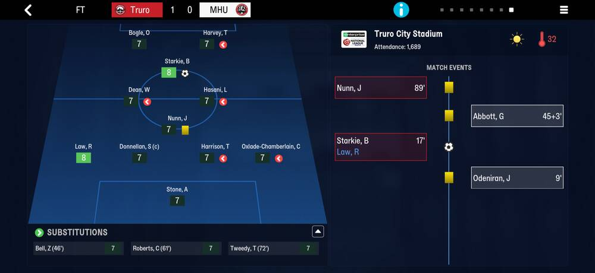

The nine events in stored order: Odeniran's booking (`26`, minute 8), Starkie's goal (`01`),
an unnamed `17` for Starkie at the same minute, Law's assist (`24`), Starkie's clear-cut
chance (`2f`, 27), Abbott's booking (44 + 3), Bogle's chance (57), Nunn's booking (88) and
Tweedy's chance (89 + 2). Truro's three `2f` events are the stats screen's three clear-cut
chances (team head +5).

### FMM22

`frem-2030-06-22`, Vejle 2-4 Frem, 3F Superliga, 23 September 2029. The row starts at byte
55,840,931: `8c 04 5a 01 02 00 09 01 | 08` = home 1164 (Vejle), away 346 (Frem), cid 2, day
265, eight events.

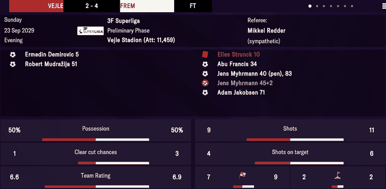

| on screen | raw bytes | parsed |
|---|---|---|
| Elias Strunck 10 (red) | `01 05 09 00 01 fc 24 00 00` | type `05`, minute 9 + 1, away, tid 9468 |
| Jens Myhrmann 40 (pen) | `03 27 00 01 21 75 00 00` | type `03`, minute 39 + 1, tid 29985 |
| Jens Myhrmann 45+2 (struck out) | `29 2c 02 01 21 75 00 00` | type `29` disallowed goal, minute 44 + 1, added 2 |
| Robert Mudražija 51 | `01 32 00 00 4b 23 00 00` | goal, minute 50 + 1, home, tid 9035 |
| Att: 11,459 | body head +15 `c3 2c 00 00` | `attendance` 11459 |
| the star beside Myhrmann (ratings screen) | body head +63 `21 75 00 00` | `player_of_match` 29985 |
| Preliminary Phase | | the fixture's `stage_index` 0 → [rounds](rounds.md) |

The eight events are stored in minute order, own side in `side`, exactly as listed.

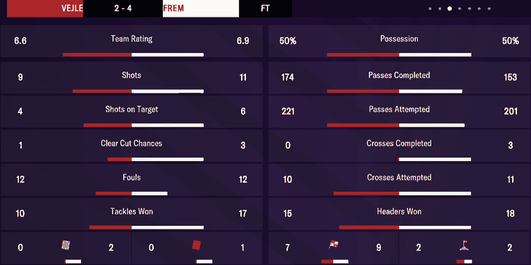

Every team figure the stats screen shows is the sum of the 18 slots per side: shots 9/11,
on target 4/6, passes completed 174/153 and attempted 221/201, crosses 0/3 and 10/11,
tackles won 10/17, headers won 15/18, yellow cards 0/2. Corners (2/2), clear-cut chances
(1/3) and offsides (7/9) equal team head +4, +5 and +68 (Quirks). Possession (50/50) and
fouls (12/12) are in neither team head. Team Rating is the slot mean truncated, not rounded
(Quirks).

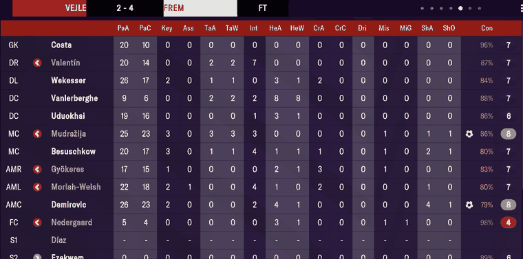
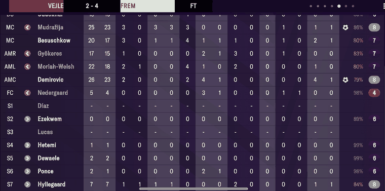
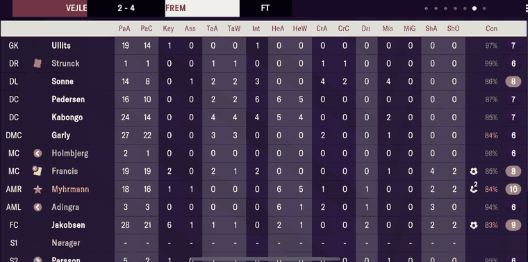
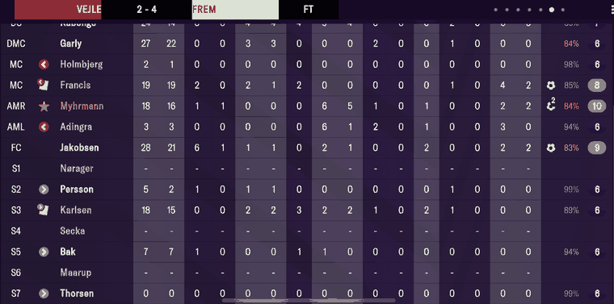

All 36 lines, 16 columns each, match the slots row for row in `posOrder` order (S1–S7 are
`posOrder` 12–18). The position column is `positions`: Vejle `GK DR DL DC DC MC MC AMR AML
AMC FC`, Frem `GK DR DL DC DC DMC MC MC AMR AML FC`, while the tail's kick-off formation is
`4-1-3-2` (`… 10 02 10 01 40 04 40 01`): the shape changed in the match. The arrows are
`subOn`/`subOff` (Holmbjerg off 11, Karlsen on 11), the yellow cards Francis's and Karlsen's
`yellow`. Strunck's slot, `00 00 00 63 01 01 … ff ff ff 0a ff`, is condition 99, one
cross, and `sentOff` (+20) = 10, the minute of his red card. The five rows shown as `-` (Díaz, Lucas,
Nørager, Secka, Maarup) are unused substitutes: `subOn` `ff`, condition 100, rating 6.
Hedensted 1-8 Frem, Sydbank Pokalen, 26 September 2029 (row at byte 55,846,169):

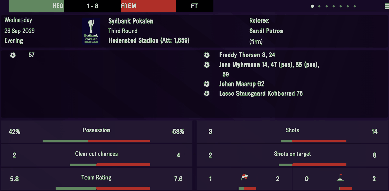
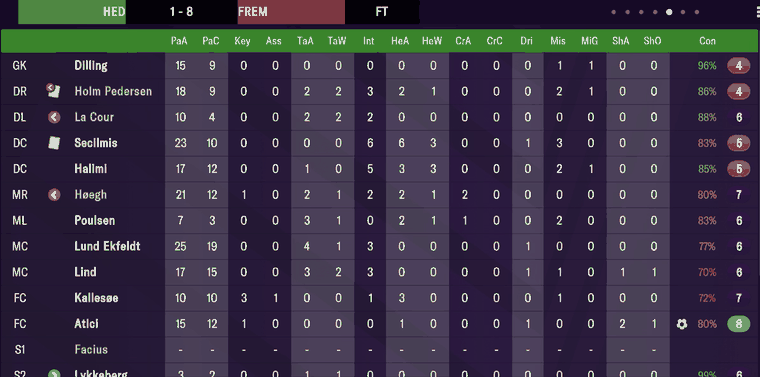
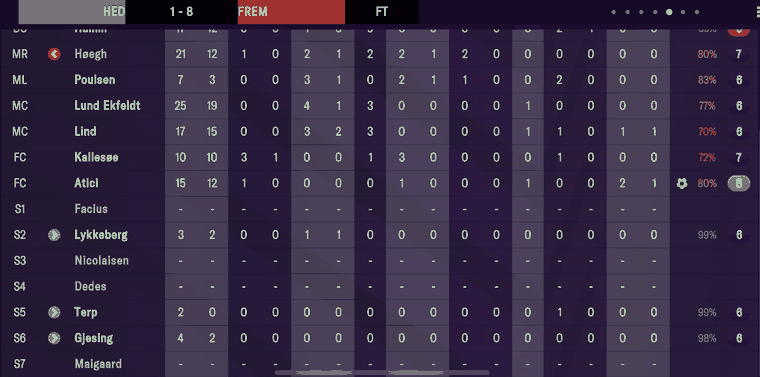

The nine events and all 18 of Hedensted's lines match. Every Hedensted player is a filler
tid (Quirks): the goal at 57, event `0a 01 38 00 00 ce 80 00 00` (goal, minute 56 + 1, home,
tid 32,974), is "Atici" with a goal icon on the ratings screen and a bare `57` in the report.
Shots 3/14 and on target 2/8 are the slot sums. Team Rating 5.8/7.6 is 82/14 and 92/12
truncated. Corners 0/2, clear-cut chances 2/4 and offsides 1/2 are team head +4, +5, +68
again (`08 00 02` and `01 02 04` from +3, then `01` and `02` at +68); possession 42/58 is in
neither head.

Vendsyssel 0-2 Frem, Sydbank Pokalen Quarter Final First Leg, 8 December 2029 (row at byte
55,939,110):

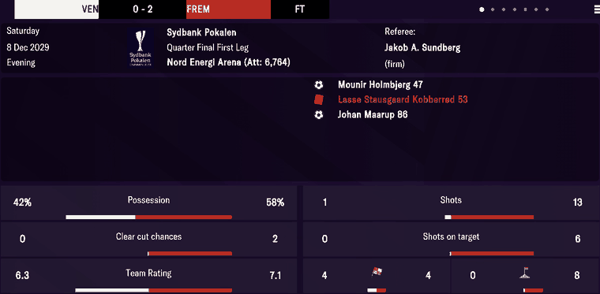

Three events (Holmbjerg 47, Kobberrød's red card 53, Maarup 86), attendance 6,764, shots
1/13 and on target 0/6 from the slots, Team Rating 6.3/7.1 = 89/14 and 86/12 truncated,
corners 0/8, clear-cut chances 0/2 and offsides 4/4 at team head +4, +5, +68. Kobberrød's slot
reads `sentOff` 53 at +20 (byte 55,942,054).

Tested by `tests/test_matches_evidence.py`.

## Quirks

> **Quirk:** the table is emptied on the career's rollover day (late June), so a save made
> after it holds no matches: `frem-2023-07-02` has 0. The season's matches survive only in a
> save taken before the rollover. The loader places each snapshot by the career's rollover
> day (`careers.py`).

> **Decision:** an empty table has no row to seed from, so it is not located, and
> `scrape_matches` returns `[]`. The loader then requires the table to hold exactly our
> clubs' matches in the [fixtures](fixtures.md) list since the last rollover
> (`check_against_fixtures`). The two agree match for match, friendlies included, on every
> save measured, so "no matches" while the fixture list shows games played is a locator
> failure, not an empty season.

> **Decision:** no year window and no delimiter scan. A row is recognised by its own
> head/body repeat and walked by the length it declares, so a match cannot be found twice
> or skipped. The season's first match has no row before it and is found like any other.

> **Quirk:** `player_of_match` is the game's own pick, not the top rating. It is a player of
> the match on every row and the highest-rated player on 68 of 70 on `frem-2030-06-22`. The
> loader's `star_home` / `star_away` are each side's top rating, a different thing.

> **Quirk:** a plain yellow card is not an event. It is the player slot's `yellow` byte. A
> red card is an event (`05`).

> **Quirk:** the screen's team stats are sums of the player slots, not stored figures:
> shots `Σ shotA`, on target `Σ shotO`, passes `Σ passA`, and so on. The loader computes
> them (`team_stats`).

> **Decision:** the store's team rating is the mean of the whole-number ratings of the
> players who appeared, **rounded** to one decimal (`load_duckdb._match_derived`). The screen
> truncates: six sides on three screens show 107/16 = 6.69 as 6.6, 104/15 = 6.93 as 6.9,
> 82/14 = 5.86 as 5.8, 92/12 = 7.67 as 7.6, 89/14 = 6.36 as 6.3 and 86/12 = 7.17 as 7.1. The
> rounded mean is the more accurate figure, so `raw.matches.*_rating` can read 0.1 above the
> screen by design.

> **Quirk:** team head +4 is corners, +5 clear-cut chances and +68 offsides: 18 of 18 values
> on three stats screens (2/2, 1/3, 7/9; 0/2, 2/4, 1/2; 8/0 corners, 2/0 chances, 4/4 offsides
> with Frem away). Over 464 sides on four saves their ranges are plausible (0–13, 0–7, 0–9)
> and +5 tracks goals (r 0.66). Unlike the screen's other team figures they are stored,
> not summed from the slots. +55 and +57, which matched Vejle's headers won and reds, do
> not hold on other matches.

> **Quirk:** player slot +20 is the minute a player was sent off: Strunck 10 and Kobberrød
> 53, as the reports show them. Over six saves it is set on all 22 players with a red-card
> event (the event's minute, or one less) and on 10 without one, `ff` otherwise; those ten
> are probably second-yellow dismissals, which raise no event. The store keeps both:
> `int.player_matches.sent_off_minute` is the red-card event's minute (and what `minutes`
> uses), `dismissal_minute` the slot's.

> **Dead end:** possession and fouls are not in the row. Possession was searched as u8 and
> u16 and as sum-to-100 pairs, across the whole row and the file around it, and 50/50 on the
> Vejle screen is in neither team head. It is not the pass share either: Vejle completed 174
> passes to Frem's 153 at 50/50.

> **Quirk:** `positions` (team head +30) is the full-time team sheet, the order the stats
> screen shows. The tail's `kickoff_positions` is our kick-off formation in its own slot
> order, and does not say which player took which slot. After an in-match change the two
> differ (13 of our 46 competitive matches on `frem-2030-06-22`), and reading a player's
> position as `kickoff_positions[posOrder - 1]` puts him in the wrong place. A player's
> position is his side's `positions`. Nothing records when or how the shape changed:
> there is no substitution or tactic event, and team head +6 is a copy of +30.

> **Quirk:** the column byte is a rank across the band, and the decoder keeps only the two
> edges. Two central midfielders read `01` and `04` (left and right of centre) and both
> decode as MC, which is also what the screen says. A band of four or more loses which
> interior player is which.

> **Quirk:** reserve fixtures carry one default array, `GK DR DL DC DC MR ML MC MC FC FC`,
> on all 20 of them: the AI-run side never sets a tactic. Don't read reserve positions as a
> lineup.

> **Quirk:** only our side's formation string is stored. The opponent's shape is its
> `positions`.

> **Dead end:** the tail's 963 bytes at +220 are the formation's template from the
> formation catalog at ~20.6 MB, byte for byte on the 20 4-4-2 matches and within a few
> bytes on the rest. A shape not in the catalog (4-1-3-2) has no copy. It is geometry, not
> match data: no possession, no roles.

> **Quirk:** the eleven rows at tail +1196 follow the kick-off slots. Bytes 0–1 look like a
> role family (`24 48` keeper, `01 23` / `41 22` full-backs, `81 42` inside forward) and
> bytes 2–4 change between matches in the same role. Unverified: no screen with the roles
> has been matched to them.

> **Quirk:** `condition` is `ff` for an unused substitute only in friendlies and reserve
> fixtures. In a competitive match an unused substitute has a condition and a `rating` of 6.
> A player appeared when `posOrder <= 11` or `subOn != ff`; never infer it from `condition`
> or `rating`.

> **Quirk:** sixteen player slots are used in reserve fixtures, eighteen in competitive
> matches and twenty in friendlies, for both sides.

> **Quirk:** tids 32,967–33,066 are not people. The person table ends at 32,965, and no
> squad in any snapshot holds them. They are anonymous filler the game fields when a side has
> too few real players: 179 lines for our reserves on `frem-2030-06-22`, and opponents short
> of players in cup, European and league matches. Hedensted fielded all 18 in a cup tie
> (32,967–32,986). One such tid turns out for up to seven clubs in a season. The Player
> Ratings screen gives each a surname drawn from the nation's pool in the browse-name table
> (all 18 Hedensted names sit at ordinals 20,773–21,944), but nothing in the save ties a tid
> to a name, and the report shows Hedensted's scorer with none at all (`57`). There is no name
> to find; `scripts/export_data.py` drops match rows it cannot name.

> **Quirk:** name a match row's player by `person_id` (`mart.fact_player_match`), never by
> tid alone. A tid is a recycled slot ([person_info](person_info.md)): grouping names by tid
> across snapshots picks between two people, differently on each run.

> **Quirk:** the shoot-out codes `07` / `08` are read from one shoot-out (Frem v
> Midtjylland, Sydbank Pokalen, 25 Oct 2022): all ten kicks at minute 120, and the score
> only closes if `07` is scored and `08` missed. One shoot-out can't tell a shoot-out kick
> from a goal at 90+30; recheck on the next one.

## Output

`output/<label>/matches.json`: one object per match, in the order played (`offset, date,
comp_id, home_tid, away_tid, club_tid, home_flag, attendance, score, team_head,
player_of_match, formation, kickoff_positions, home_positions, away_positions, events,
home_xi, away_xi`; `team_head` is `{home: {corners, clear_cut_chances, offsides}, away:
{…}}`, and `home_xi`/`away_xi` hold the used player slots, `sentOff` included). The loader
writes `raw.matches` (with the summed team stats, each side's three team-head counts as
`home_corners` … `away_offsides`, and the competition label: a two-legged play-off tie gets
First/Second Leg by date), `raw.match_events` and `raw.match_player_stats` (each starter's position from
his side's `positions`).
