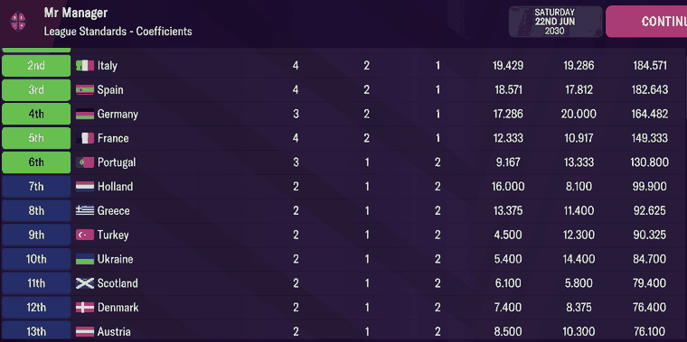
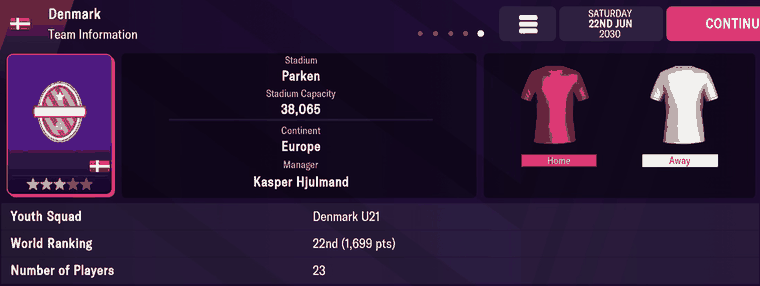

# nations  ([`fmparser/tables/nations.py`](../../fmparser/tables/nations.py))

Every nation: names, continent, capital and national stadium, its men's and women's national
teams' world rankings and continental coefficients, and the languages spoken there. A
count-framed table of 251 variable-length records in the reference block (~12.75 MB),
`[8 × 0xFF][count u16 = 251]`, in id order from 0, walked by declaration with
`id == slot index`. The walk ends exactly on the continent table's own count frame. 251 on
both Truro saves (FMM27) and on every FMM22 save of both careers.

FMM27 stores fmm-editor's FMM26 `Nation`, field for field (`NATIONS_TABLE_FMM27`). FMM22's
record has a single team, a ranking history and the languages near the end (Layout, FMM22).

## Layout

```
record  [uid u32][id u16][name][nationality][code]       NATION_HEAD, the strings
        [continent u16][capital u16][stadium u16]         NATION_TAIL
        [7 B]                                             NATION_INFO_FMM27
        [u8 n][n × (language_id u16, proficiency u8)]     languages
        [u8 flag][19 B][u8 n][n × f32][11 B] if flag      the men's team, then the women's
```

The head, tail and team fields were checked against screens on FMM22 (Evidence, FMM22); on
FMM27 `id == slot` holds on all 251 records of both Truro saves, the walk ends on the
continents' frame, and the nation ids from in-game screens agree (Evidence).

| segment | field | type | meaning | how we know |
|---|---|---|---|---|
| `NATION_HEAD` | `uid` | u32 | database id; a national team's club record carries `-uid` ([clubs](clubs.md)) | all 251 |
| | `id` | u16 | the nation id everything else points at; equals the slot index | the walk's invariant |
| strings | `name`, `nationality`, `code` | `[len u32][utf-8]`, the first two terminated `ff` | `Denmark`, `Danish`, `DEN` | Algeria … Netherlands Antilles |
| `NATION_TAIL` | `continent_id` | u16 | 0 Africa … 5 South America; `0xFFFF` on defunct states | Denmark 2 = Europe (Team Information, FMM22) |
| | `capital_city_id` | u16 → [cities](cities.md) | Denmark → 58, Copenhagen | FMM22 |
| | `national_stadium_id` | u16 → [stadiums](stadiums.md) | Denmark → 177, Parken | FMM22 |
| `NATION_INFO_FMM27` (7 B) +0 | `state_of_development` | u8 | name from fmm-editor | |
| +1 | | u8 | unnamed | |
| +2 | | u16 | unnamed | |
| +4 | `region_id` | u16 | fmm-editor's `Region` | |
| +6 | | u8 | unnamed | |
| `languages` | | `[u8 n][n × (language_id u16, proficiency u8)]` | languages spoken, proficiency 0–100 → [languages](languages.md) | England: English 100; Tanzania: Swahili 90, English 25 |
| men's team | `has_men_team` | u8 | the team follows when 1 | 1 on all 251 |
| team (19 B) +0 | | 8 B | four colours | |
| +8 | `game_importance` | u8 | name from fmm-editor | |
| +9 | `rival_nation_id` | u16 | `0xFFFF` = none | Denmark → Sweden, England → Scotland, Sweden → Norway (FMM22) |
| +11 | | u8 | unnamed | |
| +12 | `is_ranked` | u8 | | Denmark 1 (FMM22) |
| +13 | `world_ranking` | u16 | current world ranking | Denmark 22nd (Team Information, FMM22) |
| +15 | `ranking_points` | u16 | world ranking points | Denmark 1,699 (FMM22) |
| +17 | | u16 | unnamed | |
| `coefficients` | | `[u8 n][n × f32]` | continental coefficients by season, oldest first; 11 entries | Coefficients screen (Evidence, FMM22) |
| team end | | 11 B | unnamed | |
| women's team | `has_women_team`, then the same | | keys prefixed `women_` | 1 on all 251 |

`core.Conditional` reads each team only when its flag says so. The men's team keeps FMM22's
keys (`world_ranking`, `ranking_points`, `coefficients`).

| nation | men | women |
|---|---|---|
| England (139) | 4th, 1,922 points | 4th, 2,027 |
| Algeria (0) | 29th, 1,576 | 74th, 1,318 |
| Ireland (163) | 55th, 1,441 | 21st, 1,769 |

`scrape_nations` turns `rival_nation_id` outside 1–4096 into `None`, `is_ranked` into a bool,
and rounds coefficients to 4 places.

### FMM22

```
record  [uid u32][id u16][name][nationality][code]       names terminated 00
        [continent u16][capital u16][stadium u16]         NATION_TAIL
        [23 B]                                            NATION_TEAM, the one team
        [u16 n][n × u16]                                  ranking_history
        [u16 = 0]                                         NATION_GAP
        [u8 n][n × f32]                                   coefficients
        [u8 = 0]                                          NATION_GAP2
        [u8 n][n × (language_id u16, proficiency u8)]     languages
        [11 B]                                            NATION_END
```

- `name` and `nationality` end `00` (FMM27: `ff`).
- No `NATION_INFO_FMM27`, no presence flags, no women's team.
- The one team is `NATION_TEAM`, 23 B with the fields in a different order: +11
  `rival_nation_id` u16, +18 `is_ranked` u8, +19 `world_ranking` u16, +21 `ranking_points`
  u16; +0..+17 otherwise unnamed (`UNKNOWN`), +1..+8 the colours (Quirks).
- `ranking_history`, `[u16 n][n × u16]`: past world rankings; 0 entries on an unranked
  nation. Order **unverified**: the module docstring says oldest first, but Denmark's last
  entry is 24 while it is 22nd today. FMM27 has none.
- The coefficients follow the ranking history and a `u16 = 0` gap, then a `u8 = 0` gap, the
  languages and 11 unnamed bytes (`NATION_END`): the languages come last, not after the tail.

## Evidence

`truro-2026-07-25`. The England flag on both Club Information cards ([clubs](clubs.md)) is
`based_id` 139; record 139, at byte 14,760,519, is `fd 02 00 00 8b 00 07 00 00 00 "England"
ff`, uid 765, id 139. The person table's ids from in-game screens agree: 163 Ireland
(Donnellan, En-Neyah), 43 Tanzania (Starkie). Tested by
`tests/test_reference_fmm27_evidence.py`.

### FMM22

`frem-2030-06-22`, League Standards → Coefficients. Denmark's record starts at byte
12,759,310; its coefficient list at 12,759,427:



```
0b                       n = 11
00 00 84 40  4.125       slot 0
00 00 08 41  8.5         slot 1
cd cc ec 40  7.4         slot 2   <- first season column on screen
00 00 06 41  8.375       slot 3   <- second season column
00 00 e0 40  7.0         …
33 33 c3 40  6.1
9a 99 31 41  11.1
9a 99 31 41  11.1
cd cc ec 40  7.4
9a 99 a9 40  5.3
00 00 00 00  0.0         slot 10, the season not yet played
```

| on screen (Denmark) | parsed |
|---|---|
| `7.400` | `coefficients[2]` = 7.4 |
| `8.375` | `coefficients[3]` = 8.375 |
| `76.400` (the total) | `sum(coefficients)` = 76.4 |

The same holds for every row on the screen: Italy 19.429 / 19.286 / 184.571, Holland 16.000 /
8.100 / 99.900, Austria 8.500 / 10.300 / 76.100. Capital and national stadium check against the
real world: Denmark → city 58 (Copenhagen's coordinates) and stadium 177 (Parken, 38,065).

Denmark's Team Information screen. `NATION_TAIL` at byte 12,759,346, `NATION_TEAM` at
12,759,352:



| on screen | raw bytes | parsed |
|---|---|---|
| Continent `Europe` | tail +0 `02 00` | `continent_id` 2 |
| Stadium `Parken`, 38,065 | tail +4 `b1 00` | `national_stadium_id` 177 → [stadiums](stadiums.md) |
| World Ranking `22nd (1,699 pts)` | team +18 `01`, +19 `16 00`, +21 `a3 06` | `is_ranked` true, `world_ranking` 22, `ranking_points` 1,699 |
| Youth Squad `Denmark U21` | (the club table) | Denmark U21 (tid 11236) has `main_club_tid` 547, the Denmark national team ([clubs](clubs.md)) |

Tested by `tests/test_world_evidence.py`.

## Quirks

> **Quirk:** on FMM22, the Coefficients screen's two season columns are slots 2 and 3 of the list,
> whatever seasons the header names, and its total is the sum of all eleven. Use the total
> and the trend; don't map a slot to the season the game prints beside it.

> **Quirk:** on FMM22, coefficients exist for Europe's 55 nations and for most of Africa and Asia (132
> nations carry 11 entries); the rest carry none.

> **Quirk:** on FMM22, `NATION_TEAM` +1..+8 read `ff 7f d4 00 00 00 ff 7f` on 250 of 251 nations. The
> one exception, in both careers (Frem 2023 and 2030, Bucaspor 2023), is Denmark, `fe 7f 00 70 00 70 fe 7f`, which as RGB555 is
> white, red, red, white: Denmark's colours. A lead, not a decode: why only one nation carries
> its own is unknown.

> **Quirk:** `continent_id` is `0xFFFF` on 23 defunct or unaffiliated states (counted on FMM22: C.I.S.,
> Czechoslovakia, E. Germany, U.S.S.R., W. Germany, …). A gate that requires a real continent
> drops them, and a gate that requires `id ≥ 1` drops Algeria, id 0. Walk by declaration.

> **Quirk:** Russia reads `is_ranked` true, `world_ranking` 0 and 1,463 points on both
> FMM22 careers. A rank of 0 is neither first nor unranked; the game's suspension is the likely
> reason (unverified).

> **Quirk:** on FMM22, the ranking history's length is not a constant: 11 entries on `bucaspor-2022-06-19`,
> 24 from 2023 on. Read the count; a hard-coded 24 returns nothing on an early save.

## Output

`output/<label>/nations.json`, `{id: nation}` with each record's byte `offset`. The loader
splits it into `raw.nations`, `raw.nation_ranking_history`, `raw.nation_coefficients` and
`raw.nation_languages`. On FMM27 each nation carries `state_of_development`, `region_id`,
`has_men_team`, `has_women_team` and the women's team's fields (`women_world_ranking`, …), and
no `ranking_history`.
