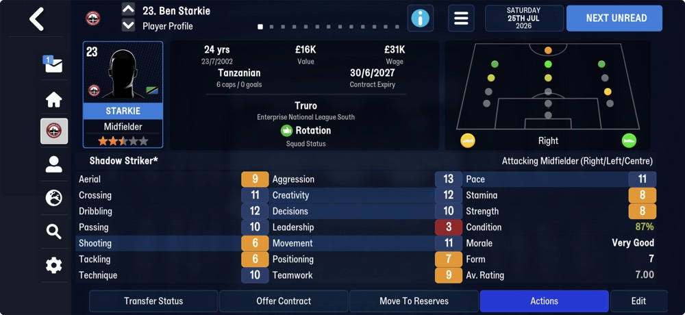
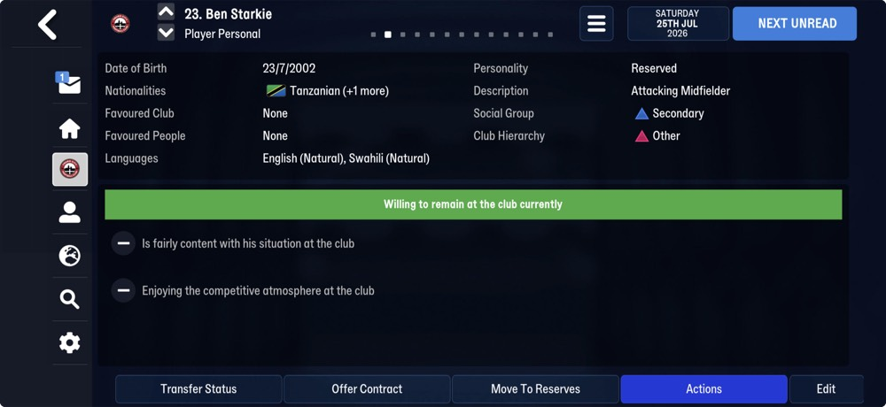
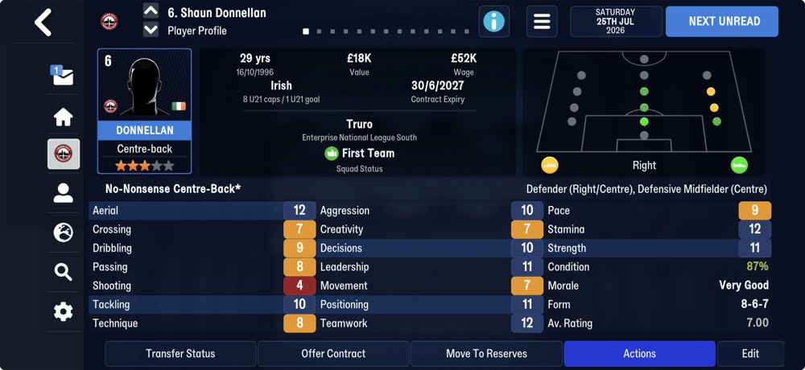
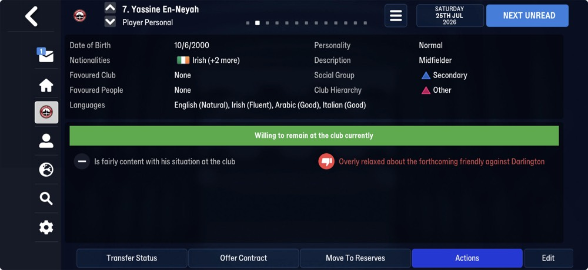
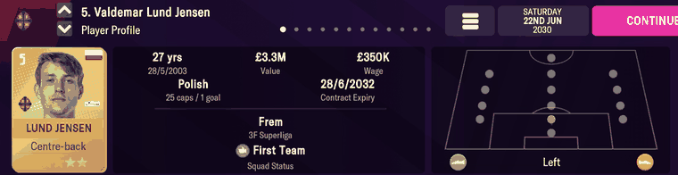
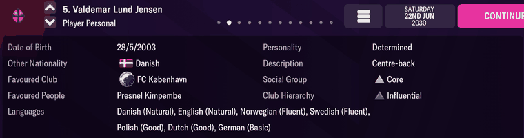
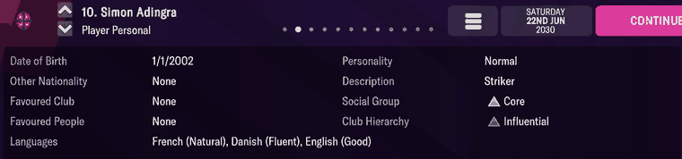
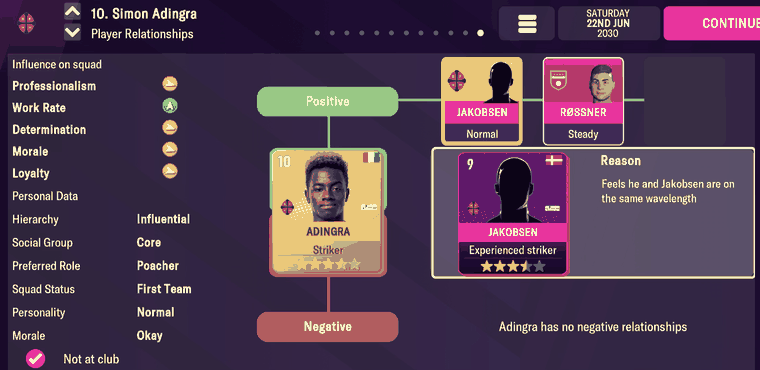

# person_info  ([`fmparser/tables/person_info.py`](../../fmparser/tables/person_info.py))

Every person in the database, players and staff alike: identity, nationality, club,
international record, personality, languages and the people and clubs they are linked to.
A count-framed table near the start of the file, `[≥ 8 × 0xFF][count u32][01]`, then the
records in tid order from 0, walked by declaration with `tid == slot index`. Variable-length
records. The count is a fixed pool, the same on every save of a career: 44,960 on Truro
(FMM27); on FMM22 32,966 on Frem, 34,312 on Bucaspor. FMM22 stores a different record under
the same frame (Layout, FMM22); `person_table(mm)` picks the declaration by the save's
declared version.

## Layout

`nyongrand/fmm-editor`'s FMM26 `People` record, field for field. Offsets after the
nationality list move by `2k`, where `k` is that person's number of other nationalities:

```
record  [26-byte head][other nationalities][42 B][13 B][5 or 7 B]
        [default languages][other languages][relationships]
```

Walked this way, all 44,960 records hold `tid == slot` on both Truro saves and the walk ends
on player_attributes' frame. The fields marked *(FMM22)* in the last column were checked
against screens on FMM22 (Evidence, FMM22) and are read at the shifted offset on FMM27; the
rest were checked on FMM27.

| offset | field | type | meaning | how we know |
|---|---|---|---|---|
| +0 | `tid` | u32 | the person id; equals the slot index | the walk's invariant |
| +4 | `uid` | u32 | database id | |
| +8 | `first_name_id` | u32 | → [names](names.md) | resolves to the name on screen |
| +12 | `last_name_id` | u32 | → [names](names.md) | |
| +16 | `common_name_id` | u32 | the nickname, → [names](names.md); `0xFFFFFFFF` = none | 1,583 people have one *(FMM22)* |
| +20 | `dob` | date `[day-of-year u16, 0-based][year u16]` | date of birth | Starkie's Player Profile; Lund Jensen's and Adingra's Player Personal *(FMM22)* |
| +24 | `nationality_id` | u16 | → [nations](nations.md) | Starkie Tanzanian, En-Neyah Irish; Adingra Ivorian, Lund Jensen Polish *(FMM22)* |
| +26 | `other_nationality_ids` | `[u16 k][k × nation u16]` | the other nationalities | Starkie `Tanzanian (+1 more)`, En-Neyah `Irish (+2 more)` |
| +28+2k | `ethnicity` | u8 | a small enum (fmm-editor's name) | |
| +29+2k | | 4 B | unnamed | |
| +33+2k | `type_flag` | u8 | 1 on every player; 0, 1 or 16 on a non-player | *(FMM22)* |
| +34+2k | `unknown_date` | date | unnamed | |
| +38+2k | `international_caps` | i16 | | Starkie `6 caps` |
| +40+2k | `international_goals` | i16 | | Starkie `0 goals` |
| +42+2k | `u21_caps` | u8 | | Donnellan `8 U21 caps` |
| +43+2k | `u21_goals` | u8 | | Donnellan `1 U21 goal` |
| +44+2k | `club_tid` | u32 | the club holding his registration; above `0xFFFF` → `0xFFFF` (no club) | 28 people at Truro's tid 3,125 |
| +48+2k | `joined_date` | date | when he joined `club_tid` | equals the contract's `start_date` for Adingra *(FMM22)* |
| +52+2k | | 2 B | unnamed | |
| +54+2k | `adaptability` … `temperament` | 8 × u8 | personality, 1–20, in this order: adaptability, ambition, determination, loyalty, pressure, professionalism, sportsmanship, temperament | seven managers' profiles, byte for byte (`tests/test_staff_records.py`) *(FMM22)* |
| +62+2k | `sid` | u32 (hex) | → the [player_attributes](player_attributes.md) slot; `ffffffff` = not a player | |
| +66+2k | `id2` | u32 | → the [staff](staff.md) slot; `0xFFFFFFFF` = not staff | |
| +70+2k | `coach_row`, `scout_row`, `physio_row` | 3 × u32 | a member of staff's rows in the [staff role](staff_roles.md) tables; `0xFFFFFFFF` = none. No official row: FMM27's official record holds the person's tid | every row of the three role tables pointed at exactly once; Yetton's and Whittaker's Staff Profiles ([staff_roles](staff_roles.md)) |
| +82+2k | | u8 | unnamed | |
| +83+2k | | u8, i32, then 2 B **only when the i32 is −1** (`core.Conditional`) | unnamed | 7 B on 8,148 people, 5 B on 36,812; the walk lands on the next table only this way |
| | `default_languages` | `[u8 n][n × (language_id u16, level u8)]` | → [languages](languages.md); level 0–10, `255` on 4% of entries *(FMM22)* | Starkie: English; En-Neyah: English |
| | `other_languages` | the same | | Starkie: Swahili; En-Neyah: Irish, Arabic, Italian |
| | `relationships` | `[u16 m][m × 8 B]` | clubs and people this person is linked to (below) | Starkie and En-Neyah: `None` / `None` favoured, 0 entries; Lund Jensen's favoured club and person *(FMM22)* |

No byte follows the relationships (fmm-editor reads an `Unknown21` byte there; on FMM27 the
next record's tid does).

A relationship is `[u8 unnamed][target_kind u8][target_id u32][u8 unnamed][u8 unnamed]`.
`target_kind` 1 is a club tid, 3 a person tid.

A player has a `sid` and a staff member an `id2`. 319 people on `frem-2030-06-22` have both
(player-coaches) and 2,427 have neither.

> **Lead:** `unknown_date` may be the last birthday: Starkie's reads 2026-07-23, his
> birthday, two days before the save.

### FMM22

A record is a 68-byte head, 17 bytes, then two counted lists. It departs from fmm-editor's
FMM26 `People` record in four places:

| FMM22 offset | FMM27 | FMM22 | how we know (FMM22) |
|---|---|---|---|
| +26 | `other_nationality_ids`, `[u16 k][k × u16]` | one `second_nationality_id` u16; `0` or `0xFFFF` = none (→ `None`). Offsets don't move per person | Lund Jensen: Other Nationality Danish |
| +38, +39 | caps, goals: i16, i16 | **u8, u8**. Every later head offset is FMM27's with `k = 0`, less 2: `u21_caps` +40, `u21_goals` +41, `club_tid` +42, `joined_date` +46, unnamed +50, personality +52, `sid` +60, `id2` +64 | Adingra and Lund Jensen 25 caps, 6 and 1 goals; Ullits 3 U21 caps, 0 goals |
| +68 | 3 row pointers | **4**: `coach_row`, `scout_row`, `physio_row`, `official_row` (→ [officials](officials.md)); `0xFFFFFFFF` = none (94–98% of people). Then an unnamed u8 (0 / 1) at +84, and no u8/i32 block | every pointer in range, no row pointed at twice: 1,969 / 558 / 816 / 622 on Frem, the tables' counts |
| +85 | two language lists | one, `languages` | Player Personal (Evidence, FMM22) |

## Evidence

`truro-2026-07-25`. Ben Starkie (tid 4353, record at 1,286,600), Shaun Donnellan (tid 6983,
at 1,593,944), Yassine En-Neyah (tid 8934, at 1,802,129):






| on screen | raw bytes | parsed |
|---|---|---|
| Starkie `23/7/2002`, `Tanzanian (+1 more)` | +20 `cb 00 d2 07 2b 00 01 00 8b 00` | `dob` 2002-07-23, `nationality_id` 43, `other_nationality_ids` [139] |
| Starkie `6 caps / 0 goals` | +40 `06 00 00 00` | `international_caps` 6, `international_goals` 0 (i16) |
| Starkie English (Natural), Swahili (Natural) | default `07 00 0a`; other `35 00 0a` | English 10; Swahili 10 |
| Donnellan `16/10/1996`, `Irish` | +20 `21 01 cc 07 a3 00 01 00 8b 00` | 1996-10-16, 163, others [139] |
| Donnellan `8 U21 caps / 1 U21 goal` | +44 `08 01` | `u21_caps` 8, `u21_goals` 1 |
| En-Neyah `10/6/2000`, `Irish (+2 more)` | +20 `a1 00 d0 07 a3 00 02 00 1d 00 96 00` | 2000-06-10, 163, others [29, 150] |
| En-Neyah English (Natural), Irish (Fluent), Arabic (Good), Italian (Good) | default English 10; other Arabic 5, Italian 5, Irish 9 | the screen sorts by level: Fluent is 9 here |
| Favoured Club / People `None` (both) | `00 00` | no relationships |

That makes nation 163 Ireland and 43 Tanzania; the [nation table](nations.md) names all
three, and 139 England. Tested by `tests/test_people_fmm27_evidence.py`.

### FMM22

`frem-2030-06-22`. Valdemar Lund Jensen (tid 10446), record at byte 1,679,979:




| on screen | raw bytes | parsed |
|---|---|---|
| `28/5/2003` | +20 `93 00 d3 07` | `dob` day 147 of 2003 |
| `Polish` | +24 `a1 00` | `nationality_id` 161 |
| Other Nationality `Danish` | +26 `8a 00` | `second_nationality_id` 138 |
| `25 caps / 1 goal` | +38 `19 01` | `international_caps` 25, `international_goals` 1 |
| Personality `Determined` | +52 `0b 0c 10 0f 0d 0f 0b 0a` | determination 16, the highest of the eight |
| Favoured Club `FC København` | relationship `03 01 58 01 00 00 01 64` | club tid 344 |
| Favoured People `Presnel Kimpembe` | relationship `01 03 6f 57 00 00 09 64` | person tid 22383 |
| Danish (Natural), English (Natural) | `1f 00 0a`, `07 00 0a` | Danish 10, English 10 |
| Norwegian (Fluent), Swedish (Fluent) | `15 00 08`, `1d 00 08` | 8, 8 |
| Polish (Good), Dutch (Good) | `11 00 05`, `06 00 05` | 5, 5 |
| German (Basic) | `0a 00 02` | 2 |
| (not shown) | `0e 00 00`, `17 00 00` | Italian 0, Spanish 0 |

Simon Adingra (tid 26552), record at 3,325,053:



| on screen | raw bytes | parsed |
|---|---|---|
| `1/1/2002` | +20 `00 00 d2 07` | day 0 of 2002 |
| Other Nationality `None` | +26 `ff ff` | `None` |
| French (Natural), Danish (Fluent), English (Good) | `03`, then `07 00 05`, `1f 00 07`, `09 00 0a` (stored English, Danish, French) | French 10, Danish 7, English 5 |
| Favoured Club / People `None` | `00 00` | no relationships |
| joined Frem | +46 `e3 00 ec 07` | `joined_date` 2028-08-15 |

The screen sorts languages by level and names the bands Natural (10), Fluent (7–8), Good
(5) and Basic (2). A level of 0 is not shown. Tested by `tests/test_people_evidence.py`.

## Quirks

> **Quirk:** a tid is a slot, not a person. The game gives a retired person's tid to a newgen:
> between `frem-2026-06-11` and `frem-2030-06-22`, 6,064 of the 32,966 tids changed occupant,
> and `dob` differed on every one. Key a person by `(tid, dob)` (`mart.dim_person`'s
> `person_id`), never by tid alone, or two careers splice into one.

> **Quirk:** the Player Relationships screen is not the relationship list. On FMM22, Adingra's
> screen shows a positive link with Adam Jakobsen and Røssner, but his list is empty. The list
> holds the Personal screen's Favoured Club and Favoured People, and more entries the screen
> doesn't show (Lund Jensen also lists Liverpool, Brøndby and three managers).
>
> 

> **Quirk:** `type_flag` is not the player/staff split. It is 1 on every player, but also (on
> FMM22) on 1,936 non-players. Decide by `sid` (`ffffffff` = not a player) and `id2`.

> **Quirk:** `nyongrand/fmm-editor` names the third personality byte Controversy for FMM26.
> FMM22's screens read it as Determination: Lund Jensen's profile says `Determined`, and +54
> (16) is his highest of the eight.

> **Dead end:** on FMM22, finding records by scanning for the "no nickname" `ffffffff` at +16,
> or for the staff `ffffffff` at +60, misses everyone with a nickname (1,583 people) and reads
> records out of alignment. The walk from the count frame reads all 32,966, with no empty
> slots.

## Output

`output/<label>/persons.json`: the head of every person, in tid order, loaded into
`raw.person_records`. The languages and relationships are read by the walk but not emitted.

On FMM27 the keys are the record's own, in file order: `other_nationality_ids` (a list) where
FMM22 has `second_nationality_id`, and no other difference in name (caps are wider, not
renamed). On FMM22 the head is the 68-byte head. Downstream reads `summary.json`'s
`save_format` to know which it has.
