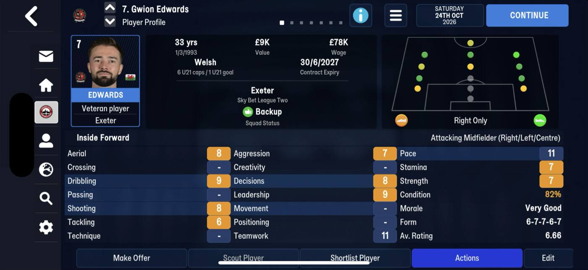
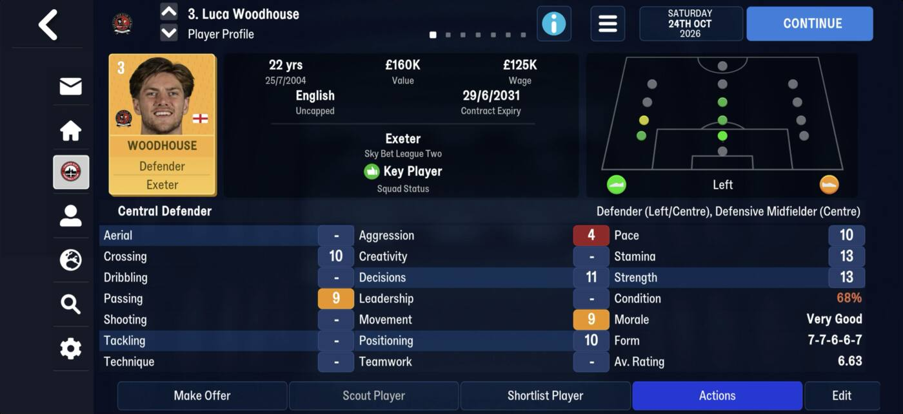
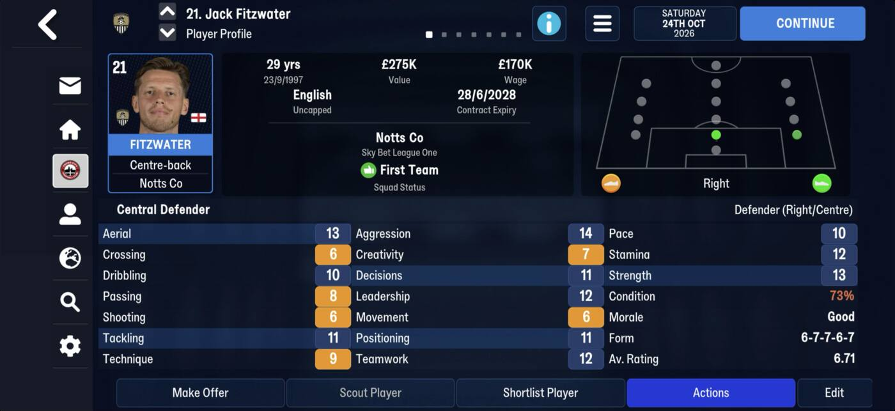
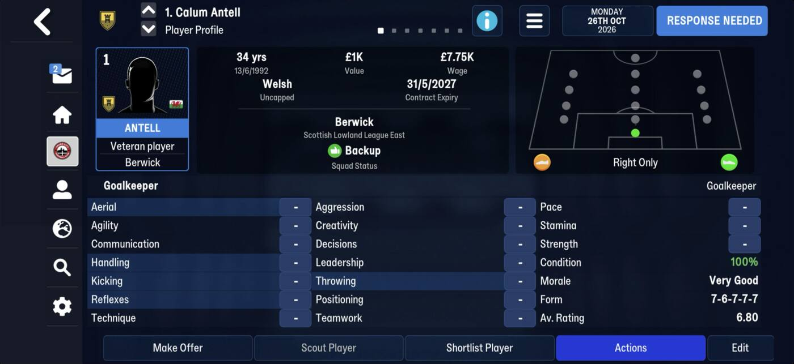

# person_stamps  ([`fmparser/tables/person_stamps.py`](../../fmparser/tables/person_stamps.py))

A **dated 4-byte row per person**, after [our matches](matches.md) and before the
[player lists](player_lists.md).

| | Truro (FMM27) | Frem (FMM22) | Bucaspor (FMM22) |
|---|---|---|---|
| rows (= persons − 1) | 44,959 | 32,965 | 34,311 |

## Layout

`[01][01][count u32]`, then row k = person tid k, for every tid but the last.

| offset | field | type | meaning | how we know |
|---|---|---|---|---|
| +0 | `knowledge` | u8 | how much of the person the user knows, 0–3 | four Player Profiles; 3 on every player of the managed club, every save |
| +1 | `day` | u16 | day of year | |
| +3 | `year_offset` | u8 | years after the database year: 2021 on FMM22, 2026 on FMM27 | |

Most rows hold day 203, offset 0: 22 July of the database year, the first day of both
careers. Rows that moved on hold the last rollover: day 180, offset 4 (29 June 2025) on
frem-2026-06-11, offset 2 on frem-2023-07-02.

**How it is found.** The only `[01][01][person count − 1]` between the training table and
the player lists. On FMM22 five u16 nation ids sit just in front, unread.

## Evidence

`knowledge` is how much of a player the user knows. Four Player Profiles taken on 24–26 Oct
2026, against the stamps on truro-2026-08-08 (the values may have moved in between; a save
from the screens' day pins them):

| player | `knowledge` on 8 Aug | attributes hidden on 24–26 Oct |
|---|---|---|
| Jack Fitzwater | 3 | 0 of 18 |
| Gwion Edwards | 2 | 6 |
| Luca Woodhouse | 1 | 8 |
| Calum Antell (tid 3611) | 0 | all 18 |

Structural and cross-table (`tests/test_world_lists_evidence.py`): the count is the person
count less one on every save; every player of the managed club reads `knowledge` 3 (26 at
Frem, 25 at Truro); the one person with no row, the last tid, is non-playing staff at the
managed club who joined on the career's first day: the user's own manager.

## Quirks

> **Lead:** a scout report should raise a player's `knowledge`; a save before and after one
> confirms it. Whether the date is when the knowledge was last refreshed is open.

## Output

`output/<label>/person_stamps.json`: `[{tid, knowledge, day, year_offset}]` in tid order. Not
loaded.
