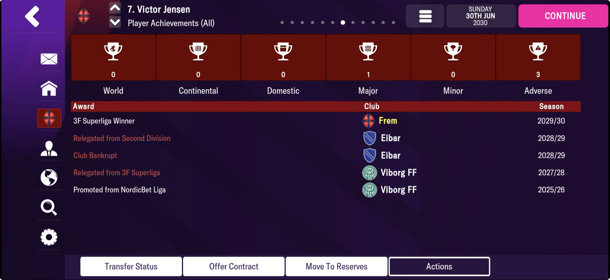
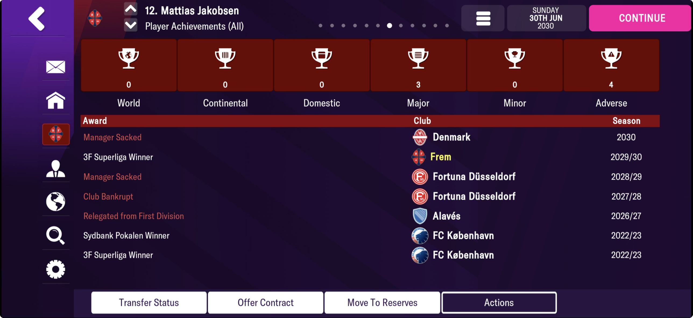
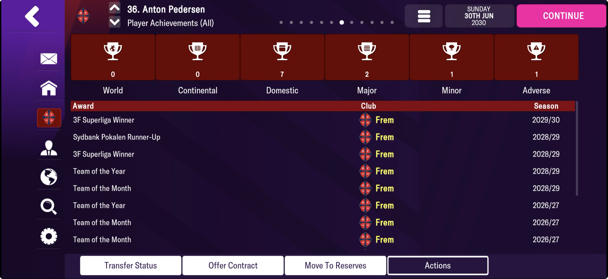
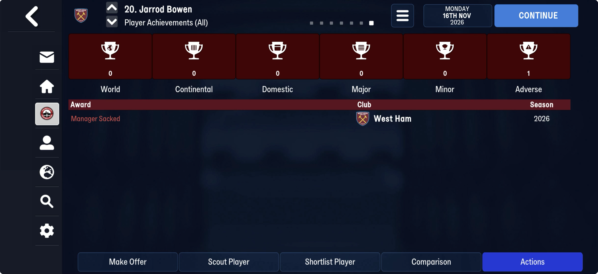
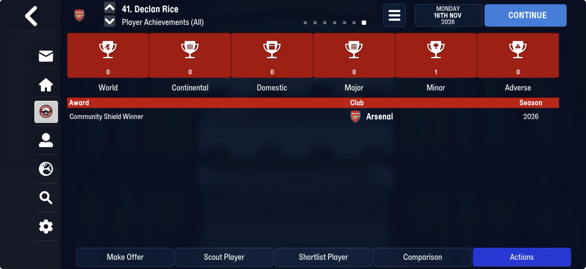
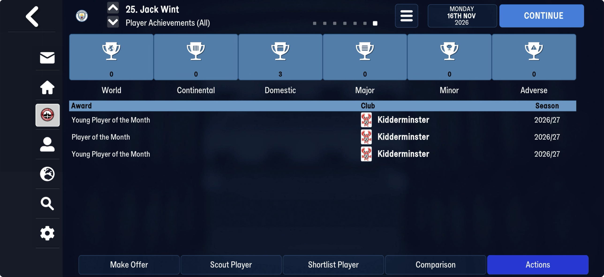
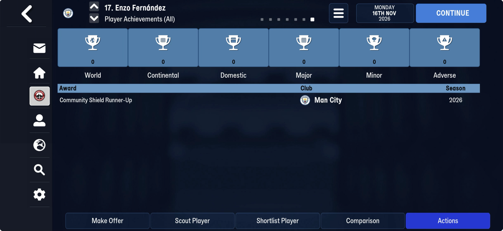
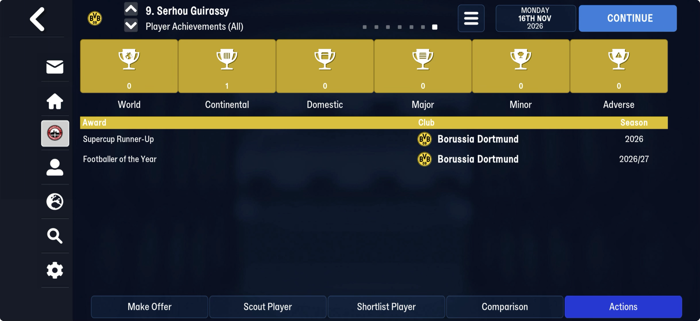

# player_achievements  ([`fmparser/tables/player_achievements.py`](../../fmparser/tables/player_achievements.py))

The last table of [the block after the club titles](unread/end_block.md) (its table 10). `extract.py` writes `player_achievements.json`, one row per used slot in slot order, with its `row`. FMM27 and FMM22 store it the same way. FMM27, at block offset 2,907,675
on truro-2026-11-16: `[u32 100,000][100,000 × 24 B]`, then one byte `00`, then the player
lists. 2.4 MB, most of it empty. **It is the Player Achievements screen**: one row per
achievement, every player's in one log.

| save | used slots |
|---|---|
| 22 Jul | 0 |
| 25 Jul, 8 Aug | 1 (the same row: Serhou Guirassy's African Footballer of the Year, Dortmund) |
| 16 Nov | 887 (866 players) |

FMM22: none on frem-2021-06-27 (the career's first day), 16,520 on frem-2023-07-02, 36,653 on
frem-2026-06-11, 54,291 on frem-2030-06-30, 11,407 on bucaspor-2023-04-01.

What follows the slots varies: one `00` on every save but frem-2030-06-30, where 53 bytes
name Frem's ground (`08 ffffffff`, "Valby Idrætspark", "Valby Stadion", `ffff`, two u32
100,000), unread. So the table is found by its own header between the club titles and the
player lists, not by counting back from the lists. History is kept: the
2026 Frem save still holds 2021's rows. **A retired player's rows are freed**, and their
slots reused: across Frem's 2030 rollover (frem-2030-06-22 → -06-30) 281 players lose
every row they had (1,178 rows) and no one loses only some; 270 of them are without a club
on 06-30 and all are 32–39, so retirement. The person record stays (279 of 281 keep their
uid and birth date). 71 of 237 new rows sit in a freed slot.

A capacity, not a count: 100,000 on every save. Rows fill from the front in the order the
achievements happen (the July super cups first, then the monthly awards), and a freed slot
is reused (93 empty slots among the used ones on frem-2023-07-02), so the row number is not
an id and the person tids are unsorted. An empty slot is
`00 ff ff ff ff 00 00 00 00 ff × 14 00`.

## Layout

| offset | field | type | meaning |
|---|---|---|---|
| +0 | `year` | u8 | years since 1970, the season's first year: `38` = 2026, shown "2026" on a one-off and "2026/27" on an award. 50–56 across the FMM22 saves (2020–2026) |
| +1 | `tid` | u32 | the player |
| +5 | `kind` | u32 | one bit: 1, 2, 4, 8, 16, 32, 64, 128 or 512 (below) |
| +9 | `cid` | u16 | the competition; `ffff` for an award with none (African Footballer of the Year) |
| +11 | | 2 B | `ffff` on every row |
| +13 | `club_tid` | u16 | his club at the time, not now |
| +15 | `award_id` | u32 | the award on a kind-128 row, else `ffffffff` |
| +19 | `next_row` | u32 | the row of the same player's next achievement; `ffffffff` on his last. Every link, on every save, is to a row of the same player, none reached twice; a reused slot can make one point back. Wint 92 → 182 → 183, Guirassy 0 → 70 |
| +23 | | u8 | 0 |

`kind` on truro-2026-11-16:

| kind | rows | screen text | checked |
|---|---|---|---|
| 2 | 45 | "Community Shield Winner" (Minor) | Declan Rice: Arsenal, English Community Shield. The other winners: PSG (UEFA Super Cup), Bayern (Franz Beckenbauer Supercup) |
| 1 | 38 | "Community Shield Runner-Up", "Supercup Runner-Up" | Enzo Fernández: Man City, Community Shield. Guirassy: Dortmund, Franz Beckenbauer Supercup. Also Aston Villa (UEFA Super Cup) |
| 32 | 629 | "Manager Sacked" (Adverse) | Jarrod Bowen: West Ham, whose manager went from Nuno Espírito Santo to Steven Schumacher. A row for every squad player of 21 clubs, 11 of them with a manager first seen on this save |
| 128 | 175 | the award's name (Domestic; Continental for Guirassy's African Footballer of the Year, season 2026/27) | Jack Wint's three rows are the screen's three lines, in order (Young Player, Player, Young Player of the Month, Kidderminster); Tom Tweedy and Harvey Greenslade one each (Player of the Month, Truro) |

FMM22's longer careers show the rest, screen-checked on frem-2030-06-30:

| kind | `kind_name` | screen text | checked |
|---|---|---|---|
| 4 | `league_won` | "3F Superliga Winner" (Major) | Anton Pedersen, Frem 2028/29 and 2029/30; Mattias Jakobsen, FC København 2022/23 |
| 8 | `promoted` | "Promoted from NordicBet Liga" | Victor Jensen, Viborg FF 2025/26; Pedersen, Frem 2023/24 |
| 16 | `relegated` | "Relegated from 3F Superliga" (Adverse) | Jensen, Viborg FF 2027/28 and Eibar 2028/29; Pedersen, Karlslunde 2021/22 |
| 64 | `club_bankrupt` | "Club Bankrupt" (Adverse) | Jensen, Eibar 2028/29; Jakobsen, Fortuna Düsseldorf 2027/28 |
| 512 | `global_team_of_the_year` | "Global Team of the Year" (World) | Alisson, Liverpool 2027/28 and 2028/29; no competition and no award id |
| 32 | `manager_sacked` | "Manager Sacked" | on national teams too: Jakobsen, Denmark 2030; Alisson, Brazil 2022, 2023, 2026, 2027 |

The season shows as "2029/30" for a club and "2030" for a national team; both are the
same `year` byte. Pedersen's thirteen lines and Jensen's and Jakobsen's lists are the
evidence test's second save.

Wint is 1st in `award_history` three times and 2nd once, and has three rows: a row is a
win, not a placing. The screen's category (World, Continental, Domestic, Major, Minor,
Adverse) and season text ("2026" for a one-off, "2026/27" for an award) are not stored; they
follow from the kind and the competition. No date is stored.

## Open

- Where a player's first row is found: something per person must point at the head of his
  chain. Not needed to read the table, which is read whole.
- What sits after the slots on frem-2030-06-30 (53 bytes naming Frem's ground).
- No save has reached the 100,000 capacity (55,232 at most, frem-2030-06-22): freeing
  retired players' rows keeps the log well short of it so far.
- Kind 256 is never seen (all ten local saves): a bit the game has, not yet earned.
