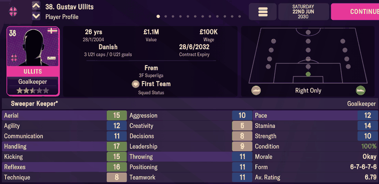

# player_attributes  ([`fmparser/tables/player_attributes.py`](../../fmparser/tables/player_attributes.py))

Every player's attributes, position ratings, feet, reputations, shirt number, height and
weight, and the head of his career-history chain. A count-framed table of fixed 78-byte
records, `[8 × 0xFF][count u32]`, between 3.8 and 6.6 MB, with `sid == slot index`. The
count is a fixed pool per career: 26,505 on Frem, 26,292 on Bucaspor. A person reaches his
record through `sid` ([person_info](person_info.md) +60). The [staff](staff.md) table
follows directly after it.

## Layout

Offsets from the record start. The code names the attribute bytes relative to `P` = +42,
the first position byte (`P-34` = +8).

| offset | field | type | meaning | how we know |
|---|---|---|---|---|
| +0 | `sid` | u32 (hex) | equals the slot index | all 26,505 slots |
| +4 | `history_head` | u32 | the first row of his chain in the [history](history.md) pool; `0xFFFFFFFF` = none (558 players) | Adingra's chain is his Player History screen |
| +8 … +41 | 34 attribute bytes | u8 | 18 stored as plain 1–20, 16 in a wrapped 0–255 encoding (the `_src` fields) | below |
| +42 | `positions` | 15 × u8 | rating 1–20 per position, in `POSITIONS` order (GK SW DL DC DR DMC ML MC MR AML AMC AMR ST DML DMR); the parse keeps values above 1 | Adingra's pitch (below) |
| +57 | `foot_left` | u8 | 1–20 | |
| +58 | `foot_right` | u8 | 1–20 | |
| +59 | `ca`, `pa` | 2 × u16 | current and potential ability; never shown (the immersion rule) | |
| +63 | `reputation` | u16 | home reputation | |
| +65 | `current_reputation` | u16 | | |
| +67 | `world_reputation` | u16 | | |
| +69 | `international_retired` | u8 | | |
| +70 | | u16 | unnamed | |
| +72 | `squad_number` | u8 | | Adingra 10, Ullits 38 |
| +73 | `preferred_squad_number` | u8 | | |
| +74 | `height_cm` | u16 | | goalkeepers average 188 cm, outfield players 181 |
| +76 | `weight_kg` | u16 | | 78 kg and 72 kg |

The 34 attribute bytes:

| kind | fields | screen |
|---|---|---|
| shown as stored | `pace_src` (+18), `strength_src` (+19), `stamina_src` (+20), `technique_src` (+21), `aggression_src` (+23), `leadership_src` (+26), `agility_src` (+37) | Pace, Strength, Stamina, Technique, Aggression, Leadership, Agility |
| combined | Teamwork = ⌊(`unselfishness_src` (+17) + `work_rate` (+33)) / 2⌋; Aerial (outfield) = ⌊0.3 × `heading_src` (+13) + 0.7 × `jumping` (+14) + 1⌋ | Teamwork, Aerial |
| hidden, plain 1–20 | `jumping`, `consistency`, `big_match`, `injury_prone`, `versatility`, `set_pieces`, `penalty`, `work_rate`, `flair` | not shown |
| wrapped 0–255 | `crossing_src`, `dribbling_src`, `tackling_src`, `finishing_src`, `long_shot_src`, `passing_src`, `decision_src`, `creativity_src`, `movement_src`, `positioning_src`, `handling_src`, `kicking_src`, `aerial_gk_src`, `reflexes_src`, `communication_src`, `throwing_src` | the rest of the screen, entangled with ability |

How the screen's other attributes are recovered from the wrapped bytes is modelling work, not
parsing: [`docs/ca-weighting.md`](../ca-weighting.md) and
[`docs/attribute-model.md`](../attribute-model.md). The exact screen values of our own
players are in [player_lists](player_lists.md).

## Evidence

`frem-2030-06-22`. Simon Adingra (sid 0x5122), record at byte 5,587,980:


```
22 51 00 00  5d 76 03 00                     sid 0x5122, history_head 226909
fb 1f cf 22 de 09 0b e6 f4 0b 11 0a 0c 10 06 0a 09 08 09 0d 07 0b de 2e ce 0f 10 a9 9c 0f a9 a9 9f b3
01 01 01 01 01 01 0d 01 01 0f 01 0b 14 01 01   positions
14 07                                         feet 20 / 7
…  00 0a d8 0a 00 af 00 44 00                 +69 …: squad number 10, 175 cm, 68 kg
```

| on screen | raw bytes | parsed |
|---|---|---|
| Pace 17, Strength 10, Stamina 12 | +18 `11`, +19 `0a`, +20 `0c` | `pace_src` 17, `strength_src` 10, `stamina_src` 12 |
| Technique 16, Aggression 10, Leadership 9 | +21 `10`, +23 `0a`, +26 `09` | 16, 10, 9 |
| Teamwork 13 | +17 `0b`, +33 `0f` | ⌊(11 + 15) / 2⌋ = 13 |
| Aerial 11 | +13 `09`, +14 `0b` | ⌊2.7 + 7.7 + 1⌋ = 11 |
| pitch: ST and AML green, ML and AMR yellow | +54 `14`, +51 `0f`, +48 `0d`, +53 `0b` | ST 20, AML 15, ML 13, AMR 11; every other position 1 |
| `Left Only` | +57 `14`, +58 `07` | `foot_left` 20, `foot_right` 7 |
| shirt `10` | +72 `0a` | `squad_number` 10 |

Gustav Ullits, a goalkeeper (sid 0x1A47, byte 4,492,626), and Valdemar Lund Jensen (sid
0x1A6F):



| on screen | parsed |
|---|---|
| Ullits Agility 12, Pace 12, Stamina 14, Strength 10, Technique 8, Leadership 9 | `agility_src` 12, `pace_src` 12, `stamina_src` 14, `strength_src` 10, `technique_src` 8, `leadership_src` 9 |
| Ullits Teamwork 11 | ⌊(11 + 11) / 2⌋ |
| Ullits `Right Only` | `foot_left` 7, `foot_right` 20 |
| Lund Jensen Teamwork 12, Aerial 14 | ⌊(10 + 15) / 2⌋; ⌊3.6 + 9.8 + 1⌋ |
| Lund Jensen `Left` | `foot_left` 20, `foot_right` 8 |

Tested by `tests/test_people_evidence.py`.

## Quirks

> **Quirk:** a goalkeeper's Aerial is not the outfield formula: Ullits shows 15 from
> `heading_src` 2 and `jumping` 11. It involves `aerial_gk_src` (wrapped), and is modelled,
> not parsed.

> **Quirk:** the foot label turns on the weaker foot: 7 reads "Only" (Adingra 20/7, Ullits
> 7/20), 8 doesn't (Lund Jensen 20/8, "Left").

> **Quirk:** the wrapped bytes hold the attribute itself, entangled with ability. At matched
> ability each one ranks positions as its name says (Finishing highest for strikers, the five
> goalkeeping bytes ~80 points higher for keepers), so the slot order is right. Treat them as
> inputs to the model, never as 1–20 values.

> **Quirk:** `history_head` is read at +4. Re-deriving the record start by hand from `P` is
> off by a multiple of 78 when it goes wrong, and returns a neighbouring player's career,
> which in a youth intake looks entirely plausible.

## Output

`output/<label>/attribute_records.json`, one row per record in table order (`positions` as
`{position: rating}`, feet as `foot_left`/`foot_right`), loaded into `raw.attribute_records`.
