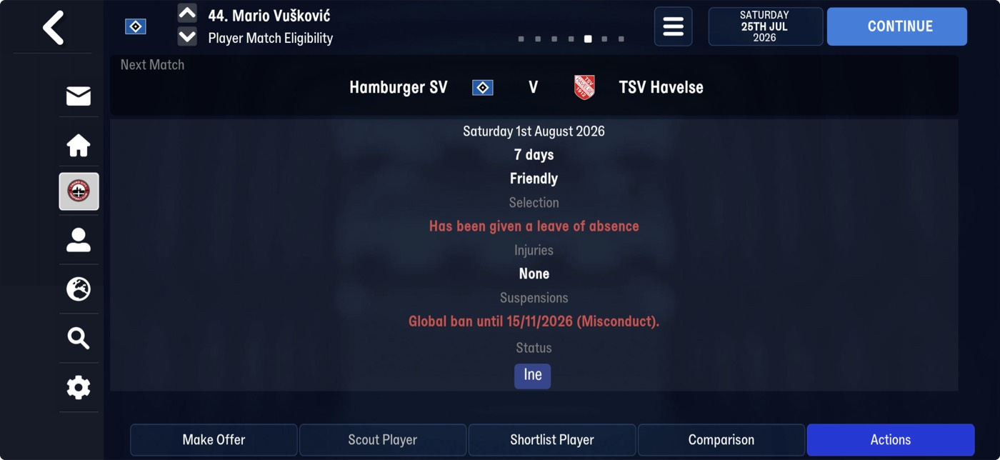
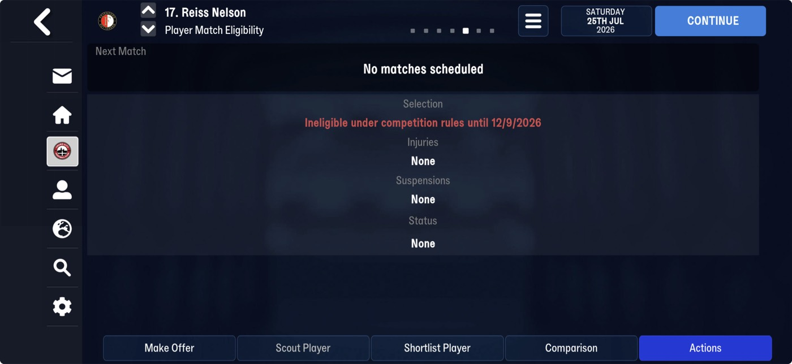
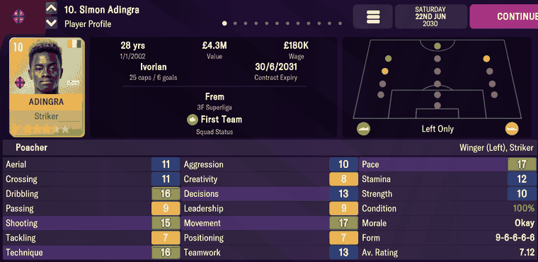

# player_attributes  ([`fmparser/tables/player_attributes.py`](../../fmparser/tables/player_attributes.py))

Every player's attributes, position ratings, feet, reputations, shirt number, height and
weight, the head of his career-history chain and, on FMM27, the spells he cannot play (bans,
ineligibility). A count-framed table, `[8 × 0xFF][count u32]`, framed between 3.8 and 6.6 MB,
with `sid == slot index`. The count is a fixed pool per career: 36,344 on Truro (FMM27); on
FMM22 26,505 on Frem, 26,292 on Bucaspor. A person reaches his record through `sid`
([person_info](person_info.md) +60). The [staff](staff.md) table follows directly after it.

Each record is a 78-byte head and a counted list of 19-byte unavailabilities, so rows are
82 bytes plus 19 per item. FMM22's record is the head alone, a fixed 78 bytes (Layout, FMM22).

## Layout

```
record  [78-byte head][n u32][n × 19-byte unavailability]
```

Offsets from the record start. The code names the attribute bytes relative to `P` = +42,
the first position byte (`P-34` = +8). The head's fields were checked against screens on
FMM22 (Evidence, FMM22); on FMM27 `sid == slot` holds on all 36,344 records of both
Truro saves, and the walk ends exactly on the staff frame.

| offset | field | type | meaning | how we know |
|---|---|---|---|---|
| +0 | `sid` | u32 (hex) | equals the slot index | every slot: 26,505 on Frem, 36,344 on each Truro save |
| +4 | `history_head` | u32 | the first row of his chain in the [history](history.md) pool; `0xFFFFFFFF` = none (558 players) | Adingra's chain is his Player History screen |
| +8 … +41 | 34 attribute bytes | u8 | 18 stored as plain 1–20, 16 in a wrapped 0–255 encoding (the `_src` fields) | below |
| +42 | `positions` | 15 × u8 | rating 1–20 per position, in `POSITIONS` order (GK SW DL DC DR DMC ML MC MR AML AMC AMR ST DML DMR); the parse keeps values above 1 | Adingra's pitch (below) |
| +57 | `foot_left` | u8 | 1–20 | |
| +58 | `foot_right` | u8 | 1–20 | |
| +59 | `ca`, `pa` | 2 × u16 | current and potential ability; never shown (the immersion rule) | |
| +63 | `reputation` | u16 | home reputation | |
| +65 | `current_reputation` | u16 | | |
| +67 | `world_reputation` | u16 | | |
| +69 | `international_retired` | u8 | | |
| +70 | | u16 | unnamed. FMM26's layout calls it always zero; here it is non-zero on all but one record, 75 distinct values, 38,918 on 4,444 (`frem-2030-06-22`), high byte one of `98`, `a8`, `88`, `c8`, `89` on most: a flags or enum shape | both careers |
| +72 | `squad_number` | u8 | | Adingra 10, Ullits 38 |
| +73 | `preferred_squad_number` | u8 | | |
| +74 | `height_cm` | u16 | | goalkeepers average 188 cm, outfield players 181 |
| +76 | `weight_kg` | u16 | | 78 kg and 72 kg |
| +78 | `unavailability` | `[u32 n][n × 19 B]` | spells the player cannot play: bans, ineligibility | 36,320 records hold 0, 24 hold 1; the Player Match Eligibility screens below |

The 34 attribute bytes:

| kind | fields | screen |
|---|---|---|
| shown as stored | `pace_src` (+18), `strength_src` (+19), `stamina_src` (+20), `technique_src` (+21), `aggression_src` (+23), `leadership_src` (+26), `agility_src` (+37) | Pace, Strength, Stamina, Technique, Aggression, Leadership, Agility |
| combined | Teamwork = ⌊(`unselfishness_src` (+17) + `work_rate` (+33)) / 2⌋; Aerial (outfield) = ⌊0.3 × `heading_src` (+13) + 0.7 × `jumping` (+14) + 1⌋ | Teamwork, Aerial |
| hidden, plain 1–20 | `jumping`, `consistency`, `big_match`, `injury_prone`, `versatility`, `set_pieces`, `penalty`, `work_rate`, `flair` | not shown |
| wrapped 0–255 | `crossing_src`, `dribbling_src`, `tackling_src`, `finishing_src`, `long_shot_src`, `passing_src`, `decision_src`, `creativity_src`, `movement_src`, `positioning_src`, `handling_src`, `kicking_src`, `aerial_gk_src`, `reflexes_src`, `communication_src`, `throwing_src` | the rest of the screen, entangled with ability |

How the screen's other attributes are recovered from the wrapped bytes is modelling work, not
parsing: [`docs/ca-weighting.md`](../ca-weighting.md) and
[`docs/attribute-model.md`](../attribute-model.md). The exact screen values of our own
players are in [player_lists](player_lists.md).

One unavailability (`UNAVAILABILITY`):

| offset | field | type | meaning | how we know |
|---|---|---|---|---|
| +0 | `type` | u8 | the kind: 11 a ban or an ineligibility; 14 on Eriksen and Blind | Vušković and Nelson 11 (Suspensions, Selection) |
| +1 | `start_day`, `start_month`, `start_year` | u16, u8 (0-based), u16 | from | Vušković 15 Nov 2022 |
| +6 | `end_day`, `end_month`, `end_year` | u16, u8 (0-based), u16 | until: the date the screen gives | Vušković "until 15/11/2026", Nelson "until 12/9/2026" |
| +11 | `club_uid` | i32 | the club it applies at, by uid; −1 none (a global ban) | the player's own club on 5 of the 6 set: Nelson 1013 = Feyenoord, Biton, Homawoo, King, Ba; Olatunji's is SK Beveren, not his club now |
| +15 | | i32 | unnamed; −1 on all but one | |

Walked this way the table ends exactly on the [staff](staff.md) frame (8,530,559 on
`truro-2026-07-25`). The 24 are the world's players already out when the database starts: Christian
Eriksen and Daley Blind (25 Jan 1972 → 27 Jan 2073), Mario Vušković, Reiss Nelson, Joachim
Andersen, Joshua King and eighteen more.

> **Quirk:** the 10 bytes after `type` are two dates on 22 of the 24 items (every year
> 2022–2027) but **not on type 14**: Eriksen's and Blind's items are byte-identical, with a
> zero month and "years" 1972 and 2073. Read as `[u16][u8][u16]` twice they are (25, 0,
> 1972) and (27, 0, 2073), more likely ids or codes than a span; the date fields carry the
> bytes as stored, and on type 14 they are not dates. Eriksen's screen shows Injuries "Virus
> (About 7 months)", so the illness and its length come from elsewhere (the running game's
> injuries are not located on FMM27 yet). Types 1, 5, 8 and 10 are not yet read against a
> screen; Truro's own players carry none.

> **Quirk:** `club_uid` is a club **uid**, not a tid and not a competition: 1013 is Feyenoord's
> uid, competition cid 1013 is SAFA KwaZulu Natal Division 2 and no competition has uid 1013.

### FMM22

The record is the 78-byte head alone, with no unavailability list: a fixed stride of 78.
`nyongrand/fmm-editor`'s FMM26 `Player` is the head and a u32 (`Unknown2`), always 0 in its
pre-game database; in an FMM27 save that u32 is the list's count. Read at 78 or 82 bytes a
record, an FMM27 table drifts at record 361, the first with an item.

## Evidence

`truro-2026-07-25`, the Player Match Eligibility screens of three of the 24:





| on screen | raw bytes (+78, the list) | parsed |
|---|---|---|
| Vušković (sid 2312, at 5,739,498): `Global ban until 15/11/2026 (Misconduct)` | `01 00 00 00` `0b` `0f 00 0a e6 07` `0f 00 0a ea 07` `ff ff ff ff` `ff ff ff ff` | type 11, 15 Nov 2022 → **15 Nov 2026**, −1 (global) |
| Nelson (sid 3366, at 5,826,021): `Ineligible under competition rules until 12/9/2026` | `01 00 00 00` `0b` `0a 00 0a e9 07` `0c 00 08 ea 07` `f5 03 00 00` `ff ff ff ff` | type 11, 10 Nov 2025 → **12 Sep 2026**, `club_uid` 1013 (Feyenoord) |
| Eriksen (sid 2484, at 5,753,621): `Virus (About 7 months)` | `01 00 00 00` `0e` `19 00 00 b4 07` `1b 00 00 19 08` `ff ff ff ff` `ff ff ff ff` | type 14; the payload is not two dates (Quirks) |

Both end dates are the screen's to the day, which also fixes the month as 0-based (`0a` is
November, `08` September). Vušković's Selection line, "Has been given a leave of absence", is
not in this list. Tested by `tests/test_reference_fmm27_evidence.py`.

### FMM22

`frem-2030-06-22`. Simon Adingra (sid 0x5122), record at byte 5,587,980:



```
22 51 00 00  5d 76 03 00                     sid 0x5122, history_head 226909
fb 1f cf 22 de 09 0b e6 f4 0b 11 0a 0c 10 06 0a 09 08 09 0d 07 0b de 2e ce 0f 10 a9 9c 0f a9 a9 9f b3
01 01 01 01 01 01 0d 01 01 0f 01 0b 14 01 01   positions
14 07                                         feet 20 / 7
…  00 0a d8 0a 00 af 00 44 00                 +69 …: squad number 10, 175 cm, 68 kg
```

| on screen | raw bytes | parsed |
|---|---|---|
| Pace 17, Strength 10, Stamina 12 | +18 `11`, +19 `0a`, +20 `0c` | `pace_src` 17, `strength_src` 10, `stamina_src` 12 |
| Technique 16, Aggression 10, Leadership 9 | +21 `10`, +23 `0a`, +26 `09` | 16, 10, 9 |
| Teamwork 13 | +17 `0b`, +33 `0f` | ⌊(11 + 15) / 2⌋ = 13 |
| Aerial 11 | +13 `09`, +14 `0b` | ⌊2.7 + 7.7 + 1⌋ = 11 |
| pitch: ST and AML green, ML and AMR yellow | +54 `14`, +51 `0f`, +48 `0d`, +53 `0b` | ST 20, AML 15, ML 13, AMR 11; every other position 1 |
| `Left Only` | +57 `14`, +58 `07` | `foot_left` 20, `foot_right` 7 |
| shirt `10` | +72 `0a` | `squad_number` 10 |

Gustav Ullits, a goalkeeper (sid 0x1A47, byte 4,492,626), and Valdemar Lund Jensen (sid
0x1A6F):


| on screen | parsed |
|---|---|
| Ullits Agility 12, Pace 12, Stamina 14, Strength 10, Technique 8, Leadership 9 | `agility_src` 12, `pace_src` 12, `stamina_src` 14, `strength_src` 10, `technique_src` 8, `leadership_src` 9 |
| Ullits Teamwork 11 | ⌊(11 + 11) / 2⌋ |
| Ullits `Right Only` | `foot_left` 7, `foot_right` 20 |
| Lund Jensen Teamwork 12, Aerial 14 | ⌊(10 + 15) / 2⌋; ⌊3.6 + 9.8 + 1⌋ |
| Lund Jensen `Left` | `foot_left` 20, `foot_right` 8 |

Tested by `tests/test_people_evidence.py`.

## Quirks

> **Decision:** the nine hidden attributes are named from `nyongrand/fmm-editor`'s `Player.cs`
> (`jumping`, `consistency`, `big_match`, `injury_prone`, `versatility`, `set_pieces`,
> `penalty`, `work_rate`, `flair`). The order holds against independently checked anchors, and
> the 18 slots FMM22 fills plainly are exactly the ability-independent attributes while the 16
> it leaves wrapped are the technical and goalkeeping values it computes from CA. Nothing
> derives from them and none is surfaced.

> **Quirk:** a goalkeeper's Aerial is not the outfield formula: Ullits shows 15 from
> `heading_src` 2 and `jumping` 11. It involves `aerial_gk_src` (wrapped), and is modelled,
> not parsed.

> **Quirk:** the foot label turns on the weaker foot: 7 reads "Only" (Adingra 20/7, Ullits
> 7/20), 8 doesn't (Lund Jensen 20/8, "Left").

> **Quirk:** the wrapped bytes hold the attribute itself, entangled with ability. At matched
> ability each one ranks positions as its name says (Finishing highest for strikers, the five
> goalkeeping bytes ~80 points higher for keepers), so the slot order is right. Treat them as
> inputs to the model, never as 1–20 values.

> **Quirk:** `history_head` is read at +4. Re-deriving the record start by hand from `P` is
> off by a multiple of 78 when it goes wrong, and returns a neighbouring player's career,
> which in a youth intake looks entirely plausible.

## Output

`output/<label>/attribute_records.json`, one row per record in table order (`positions` as
`{position: rating}`, feet as `foot_left`/`foot_right`), loaded into `raw.attribute_records`.
On FMM27 each row also carries `unavailability`, the list as stored (`[]` on most).
