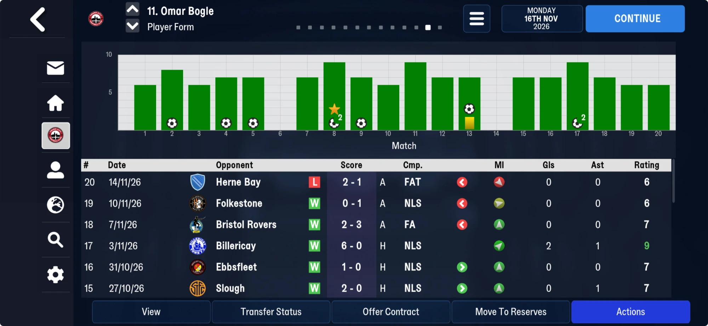

# player_form  ([`fmparser/tables/player_form.py`](../../fmparser/tables/player_form.py))

**The Player Form page**: one line per player of the managed club per competitive match.
FMM27 only; `extract.py` writes `player_form.json`. It sits in
[the block after the club titles](unread/end_block.md) (its table 4), at block offset 1,253:
`[u16 n][n × 26 B]`, then one byte `00`.

| save | lines |
|---|---|
| 22 Jul, 25 Jul | 0 (friendlies only so far) |
| 8 Aug | 27: the league opener, both squads |
| 16 Nov | 548: 20 competitive matches |

## Known

For every competitive match (league and cups, not friendlies), a line for **every player
in the managed club's squad that day**, played or not (about 28 a match, loanees
included); not opponents, not the rest of the world. **It is the Player Form page**: Omar
Bogle has 20 lines, the 20 matches of his form page in order, and every column agrees
(below).

| offset | type | what |
|---|---|---|
| +0 | u32 `tid` | the player |
| +4 | u16 `opponent_tid` | the opponent |
| +6 | u8 | 2 or 3 |
| +7 | u24 `match_id` | counting up through the season (`dc d4 0f` = 1,037,532 for 8 Aug) |
| +10 | u16 `home_tid` | the home side: the opponent away, Truro at home (548 of 549 lines) |
| +12 | 6 B | 0 on most lines; a byte 1 or 8 at +14 on a few |
| +18 | u8 `morale` | morale at the match, 1–20: the form page's MI arrow (equal to `player_status.morale` on 8 Aug for all 27) |
| +19 | u8 `rating` | 1–10 the match rating; 0 not involved; 11, 12, 15 status codes on lines of players outside the matchday squad (35, 18 and 2 lines on 16 Nov; injured? ineligible?) |
| +20 | u8 `goals` | goals, or goals conceded on a goalkeeper's line |
| +21 | u8 `assists` | |
| +22 | u8 `player_of_match` | 1 = player of the match (the chart's star) |
| +23 | u8 `yellow_cards` | |
| +24 | u8 | 0 on lines measured |
| +25 | u8 `substitution` | 9 came on (green arrow), 10 went off (red arrow); 4 once (Bogle at Dover, with a yellow and a goal) and 16 once (Love-Holmes, a yellow and off) |

**Example** (16 Nov, Truro at Herne Bay on 14 Nov, lost 1-2): En-Neyah rating 7, goals 1;
Greenslade rating 8, assists 1; Lavercombe rating 6, conceded 2; Love-Holmes yellow 1, went
off; Jephcott, Bell and Matthews came on (9); Bogle and Harrison went off (10).

**Bogle's form page, 16 Nov** (matches 15–20 on screen, the chart for 1–20): Herne Bay
rating 6, off (10), morale 6 (red arrow); Folkestone 6, off, 14 (yellow); Bristol Rovers 7,
off, 20 (green); Billericay 9, 2 goals 1 assist, 17; Ebbsfleet 7, came on (9), 20; Slough 7,
1 assist, came on, 20. Matches 6 and 14 (no bar) read rating 0; match 8, the starred bar,
reads 2 goals and player of the match; match 13, the yellow card, reads 1 at +23.

**Against the match table** (an independent table), joined on player, opponent and
meeting: every line rated 1–10 of a player in that match's 16 agrees on rating, goals
(conceded for keepers), assists and yellow cards, 309 of 309 on 16 Nov.

These are separate bytes from the [match table](matches.md) (which ends before the person
stamps) and hold less: a summary of what it already reads in full.

## How it is found

`locate_player_form`: from the [club titles](club_titles.md)' end, three 50-slot pools
(each count ≤ 50), then the u16 count; the walk must land on a `00` and a u32 N whose N
72-byte rows have strictly ascending tids ([player rows](player_rows.md)), and every
line's tid must be a person. On truro-2026-07-22 and -07-25 the table is located and empty.

## Evidence

[`tests/test_player_form_evidence.py`](../../tests/test_player_form_evidence.py): Bogle's
form page (the six matches on screen and the chart's 20) and the match-table check.

### FMM22

Not located: FMM22's block after the club titles is not mapped past its first pool.

## Next

Name +6 (2 or 3: not home/away, not the competition), +12–17 (a byte 1 or 8 at +14 on a
few lines) and +25's 4 and 16 (a red card? an injury?). Then read it as a table: it gives
the form page of every player who played against us too.
