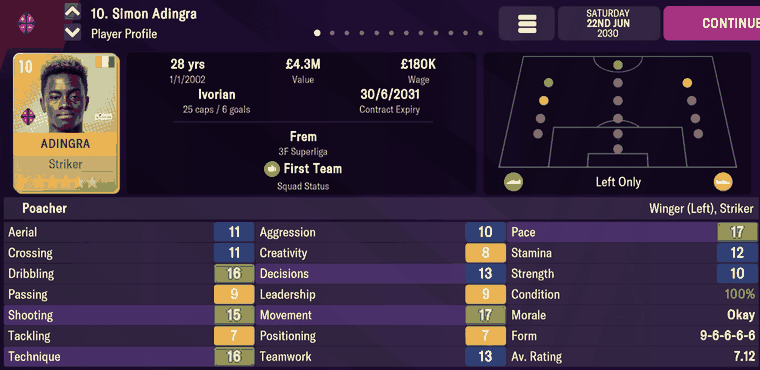

# player_lists  ([`fmparser/tables/player_lists.py`](../../fmparser/tables/player_lists.py))

The pools behind the World Best XI and Manager's Best Eleven screens, season by season and
all-time. Each entry is a player's Scrapbook Profile as he was on the entry's date: name,
club, all 23 screen attributes as shown, positions, value, wage and that season's numbers.
66 preallocated lists of 100 entries at ~61 MB, on every save of both careers, day one
included. No count frame; variable-length entries.

```
region   66 × list
list     [100 × entry][trailer, 14 B]
entry    [8 × PString][tail, 168 B]
```

## Layout

The 66 lists by index:

| lists | pool | filled on `frem-2030-06-22` |
|---|---|---|
| 0–30 | World Best XI, one per season of the career: 100 players the screen picks its eleven from | 0–7 (2021/22 … 2028/29) and 8, the season in progress |
| 31–61 | Manager's Best Eleven, one per season: everyone who played for the manager that season, first team, reserves and loanees, including players who have since left | 31–38 and 39, in progress (36 entries) |
| 62–65 | the all-time pools: 62 and 64 World Best XI - All-Time, 63 and 65 Manager's Best Eleven - All-Time; one of each pair holds this season's entries, the other the pool as of last season | all four |

An entry's eight strings: full name, first name, last name, `""`, last name, the club's short
name, `""`, the competition. An unused entry has eight empty strings and a fixed tail with
`player_tid` `0xFFFFFFFF`, exactly 200 bytes.

The tail, from the end of the strings:

| offset | field | type | meaning |
|---|---|---|---|
| +0 | `colour_1`, `colour_2` | 2 × u16 | the club's colours, RGB555 |
| +4 | | 4 B | unnamed |
| +8 | `scrapbook_day`, `scrapbook_year` | 2 × u16 | the entry's last write, day of the year 0-based |
| +12 | | 8 B | unnamed |
| +20 | `age` | u8 | on the entry's date |
| +21 | `role` | u8 | the profile's role: the [training](training.md) Focus Role on the entry's date |
| +22 | | 6 B | unnamed |
| +28 | `attr_*` | 23 × u8 | the screen's 23 attributes at the indices of `ATTRIBUTES` (0 Aerial … 23 Strength) |
| +52 | `condition`, `morale` | 2 × u8 | percent; 1–20 (20 = Superb) |
| +54 | `form_1` … `form_5` | 5 × u8 | the last five match ratings, most recent last; `255` = none |
| +59 | `avg_rating` | f32 | |
| +37, +63 | | u8 | unnamed (block indices 9 and 35) |
| +64 | `pos_*` | 15 × u8 | position ratings, [player_attributes](player_attributes.md) order |
| +79 | `player_tid` | u32 | |
| +83 | | 4 B | unnamed |
| +87 | `club_tid` | u16 | the club holding his registration |
| +89 | `loan_club_tid` | u16 | the club he is on loan to; `0xFFFF` = not on loan |
| +91 | `value` | u32 | transfer value, £ |
| +95 | | 4 B | unnamed |
| +99 | `wage` | u32 | weekly wage, £ |
| +103 | | 5 B | unnamed |
| +108 | `caps`, `intl_goals`, `u21_caps`, `u21_goals` | 4 × u8 | on the entry's date |
| +112 | `apps`, `goals`, `conceded`, `assists`, `yellows` | 5 × u8 | the season to the entry's date, competitive first-team matches |
| +117 | | 3 B | unnamed |
| +120 | `foot_left`, `foot_right` | 2 × u8 | |
| +122 | | 46 B | unnamed |

A list's trailer: `season` u16 at +1, the season's end year, written when the season ends;
`0xFFFF` while it is in progress.

`club_tid` and `loan_club_tid` together are the four-byte club marker: `[club][ffff]` for a
player the club owns, `[parent][club]` for one on loan there.

## Evidence

`frem-2030-06-22`. List 39 is the Manager's Best Eleven pool of the season in progress.
Simon Adingra's entry (slot 26, byte 62,031,769, last written 1 Sep 2029) against his Player
Profile, all 17 attributes it shows:



| on screen | parsed |
|---|---|
| Aerial 11, Crossing 11, Dribbling 16, Passing 9, Shooting 15, Tackling 7, Technique 16 | `attr_aerial` 11, `attr_crossing` 11, `attr_dribbling` 16, `attr_passing` 9, `attr_shooting` 15, `attr_tackling` 7, `attr_technique` 16 |
| Aggression 10, Creativity 8, Decisions 13, Leadership 9, Movement 17, Positioning 7, Teamwork 13 | 10, 8, 13, 9, 17, 7, 13 |
| Pace 17, Stamina 12, Strength 10 | 17, 12, 10 |
| Poacher | `role` 18 |
| `Left Only` | `foot_left` 20, `foot_right` 7 |
| Wage £180K | `wage` 3,500 a week |

Gustav Ullits' entry (slot 16, last written 1 Mar 2030) matches the 17 attributes
his profile shows, the seven goalkeeping ones included; Valdemar Lund Jensen's (slot 18, 1 May
2030) matches his, along with his 25 caps and 1 goal. Tested by
`tests/test_people_evidence.py`.

## Quirks

> **Quirk:** this is the only place a player's 23 attributes are stored exactly as shown.
> [player_attributes](player_attributes.md) stores 16 of them entangled with ability.
> Our own squad's exact attributes come from the latest entry in the Manager's Best Eleven
> pools; an opponent's are modelled.

> **Quirk:** an entry is frozen at its last write, and the dates differ by player: Adingra's
> last write is 1 Sep 2029 and Lund Jensen's 1 May 2030, on the same list. Its caps, value,
> form and season numbers are as of that date (Adingra's entry has 20 caps; he has 25
> today), not today's.

> **Quirk:** the Manager's Best Eleven pools follow the manager, not the club. A player who
> has left stays in the season's pool.

> **Dead end:** the region has no count frame. `locate_player_lists` finds an empty list (100
> template entries, `14 01 00 0a 00` at 200-byte gaps), then walks forward list by list and
> backward by reading each entry's strings from their end. A string holds no control bytes,
> which is what makes the backward read exact.

## Output

`output/<label>/player_scrapbook.json`: every used entry, list by list, with its `list`, the
list's `season` (`list_season`, `0xFFFF` in progress) and its `slot`, loaded into
`raw.player_scrapbook`.
