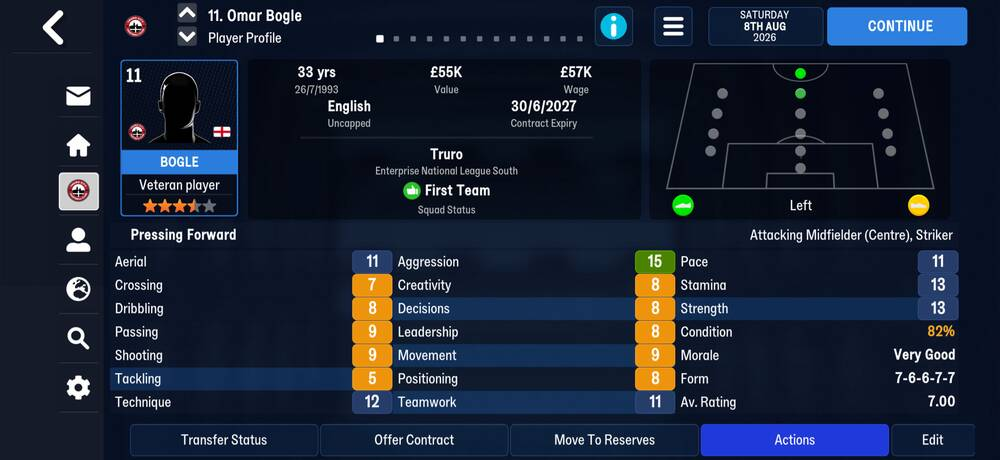
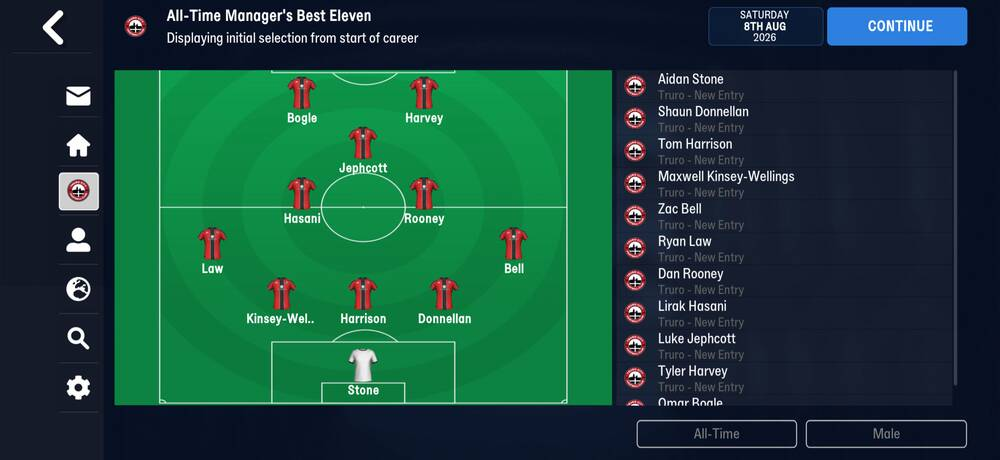
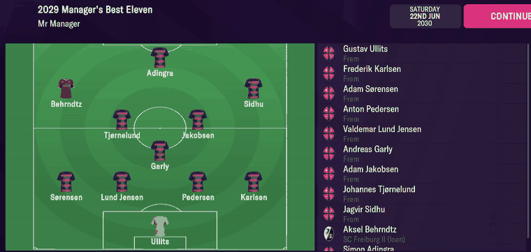
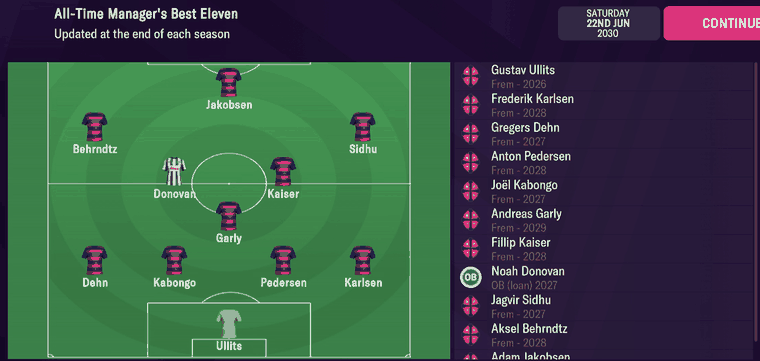

# player_lists  ([`fmparser/tables/player_lists.py`](../../fmparser/tables/player_lists.py))

The pools behind the World Best XI and Manager's Best Eleven screens, season by season and
all-time. Each entry is a player's Scrapbook Profile as he was on the entry's date: name,
club, all 23 screen attributes as shown, positions, value, wage and that season's numbers.
132 preallocated lists of 100 entries from ~66 MB (66,236,284 on `truro-2026-07-25`), day one
included. No count frame; variable-length entries. FMM22 has 66 lists and a shorter tail
(Layout, FMM22).

```
region   132 × list
list     [100 × entry][trailer, 14 B]
entry    [8 × PString][tail, 192 B]
```

## Layout

The lists by index:

| lists | pool | filled on `truro-2026-07-25` |
|---|---|---|
| 0–30 | World Best XI, one per season of the career: 100 players the screen picks its eleven from | none yet |
| 31–61 | Manager's Best Eleven, one per season: everyone who played for the manager that season, first team, reserves and loanees, including players who have since left | none yet |
| 62–65 | the all-time pools: 62 and 64 World Best XI - All-Time, 63 and 65 Manager's Best Eleven - All-Time; one of each pair holds this season's entries, the other the pool as of last season | 62 and 64: 100 each (Barella, Haaland, …); 63 and 65: Truro's 26 |
| 66–131 | a second set of 66, probably women's football's (unproven) | none |

The meanings of 0–65 were read off the Best Eleven screens on FMM22 (Evidence, FMM22).

An entry's eight strings: full name, first name, last name, `""`, last name, the club's short
name, `""`, the competition. An unused entry has eight empty strings and a fixed tail with
`player_tid` `0xFFFFFFFF`, exactly 224 bytes; the template carries `00 01 00 0a 00` at tail
`+123`, which the locator keys on.

The tail, from the end of the strings. Fields through `+107` were checked on FMM22 screens
and read the same on Truro (Bogle: role 24 = his training focus role, ST rating 20, tid 6588,
club 3125); the rest is placed on FMM27's values:

| offset | field | type | meaning | how we know |
|---|---|---|---|---|
| +0 | `colour_1`, `colour_2` | 2 × u16 | the club's colours, RGB555 | |
| +4 | | 4 B | unnamed | |
| +8 | `scrapbook_day`, `scrapbook_year` | 2 × u16 | the entry's last write, day of the year 0-based | |
| +12 | | 8 B | unnamed | |
| +20 | `age` | u8 | on the entry's date | |
| +21 | `role` | u8 | the profile's role: the [training](training.md) Focus Role on the entry's date | |
| +22 | | 6 B | unnamed | |
| +28 | `attr_*` | 23 × u8 | the screen's 23 attributes at the indices of `ATTRIBUTES` (0 Aerial … 23 Strength) | |
| +52 | `condition`, `morale` | 2 × u8 | percent; 1–20 (18 and 20 both show Superb) | |
| +54 | `form_1` … `form_5` | 5 × u8 | the last five match ratings, most recent last; `255` = none | |
| +59 | `avg_rating` | f32 | | |
| +37, +63 | | u8 | unnamed (block indices 9 and 35) | |
| +64 | `pos_*` | 15 × u8 | position ratings, [player_attributes](player_attributes.md) order | |
| +79 | `player_tid` | u32 | | |
| +83 | | 4 B | unnamed | |
| +87 | `club_tid` | u16 | the club holding his registration | |
| +89 | `loan_club_tid` | u16 | the club he is on loan to; `0xFFFF` = not on loan | |
| +91 | `value` | u32 | transfer value, £ | |
| +95 | | 4 B | unnamed | |
| +99 | `wage` | u32 | weekly wage, £ | |
| +103 | | 5 B | unnamed | |
| +108 | `caps` | u16 | international caps, on the entry's date | Kane 121, Barella 70 |
| +110 | `intl_goals` | u16 | | Kane 85, Barella 10 |
| +112 | `u21_caps`, `u21_goals` | 2 × u8 | | Kane 14 and 8 |
| +114 | `apps`, `goals`, `conceded`, `assists`, `yellows` | 5 × u8 | the season to the entry's date, competitive first-team matches | all 0 on this save: placed by the two-byte shift, not yet seen non-zero |
| +119 | | 3 B | unnamed | |
| +122 | `foot_left`, `foot_right` | 2 × u8 | | Haaland and Palmer left-footed (20), Kane 16 / 20 |
| +124 | | 68 B | unnamed | |

A list's trailer: `season` u16 at +1, the season's end year, written when the season ends;
`0xFFFF` while it is in progress.

`club_tid` and `loan_club_tid` together are the four-byte club marker: `[club][ffff]` for a
player the club owns, `[parent][club]` for one on loan there.

### FMM22

66 lists (0–65, as above), at ~61 MB, and a 168-byte tail, so an unused entry is 200 bytes
and the template mark is `14 01 00 0a 00` at tail `+121`. The tail is FMM27's through `+107`;
then:

| offset | field | type |
|---|---|---|
| +108 | `caps`, `intl_goals`, `u21_caps`, `u21_goals` | 4 × u8 |
| +112 | `apps`, `goals`, `conceded`, `assists`, `yellows` | 5 × u8 |
| +117 | | 3 B |
| +120 | `foot_left`, `foot_right` | 2 × u8 |
| +122 | | 46 B |

## Evidence

`truro-2026-07-25`: Omar Bogle's entry (list 63, slot 0) and Harry Kane's (list 62) are tested
by `tests/test_career_fmm27_evidence.py`. Pending: a save later in the season to see the
season numbers non-zero.

`truro-2026-08-08`, Omar Bogle's Player Profile and the All-Time Manager's Best Eleven.
Tested by `tests/test_screens_fmm27_evidence.py`.



Bogle has two entries: list 63 slot 0 (19 July, the career's first day, age 32) and list 31
slot 13 (1 August, age 33). Both carry the profile's seventeen attributes exactly: Aerial 11,
Crossing 7, Dribbling 8, Passing 9, Shooting 9, Tackling 5, Technique 12, Aggression 15,
Creativity 8, Decisions 8, Leadership 8, Movement 9, Positioning 8, Teamwork 11, Pace 11,
Stamina 13, Strength 13. Role 24 is "Pressing Forward" (FMM27's role codes,
[training](training.md#evidence)); position ratings AMC 15 and ST 20 are "Attacking Midfielder
(Centre), Striker"; `foot_left` 20 and `foot_right` 10 are "Left". `wage` 1,100 is £ a week:
× 52 = £57,200, the profile's £57K. `value` is the entry's own day's (53,820 on 1 August; the
profile shows today's £55K), and so are `form_*` (1 August: `ff ff 7 6 6`, the first three of
the profile's 7-6-6-7-7) and `avg_rating`.



Every one of the eleven is in list 63, Truro's 26 as of 19 July: lists 63 and 65 are the
Manager's Best Eleven - All-Time pool on FMM27 too. List 31, the first season's
Manager's Best Eleven, fills by 1 August with 27 entries, loanee Caleb Roberts (Plymouth)
and Louie Cayless (Exeter) among them. The screen's **Male** button sits beside All-Time:
a men's/women's switch, which fits lists 66–131 being women's football's, unproven until a
women's selection is read.

### FMM22

`frem-2030-06-22`. List 39 is the Manager's Best Eleven pool of the season in progress.
Simon Adingra's entry (slot 26, byte 62,031,769, last written 1 Sep 2029) against his Player
Profile, all 17 attributes it shows:


| on screen | parsed |
|---|---|
| Aerial 11, Crossing 11, Dribbling 16, Passing 9, Shooting 15, Tackling 7, Technique 16 | `attr_aerial` 11, `attr_crossing` 11, `attr_dribbling` 16, `attr_passing` 9, `attr_shooting` 15, `attr_tackling` 7, `attr_technique` 16 |
| Aggression 10, Creativity 8, Decisions 13, Leadership 9, Movement 17, Positioning 7, Teamwork 13 | 10, 8, 13, 9, 17, 7, 13 |
| Pace 17, Stamina 12, Strength 10 | 17, 12, 10 |
| Poacher | `role` 18 |
| `Left Only` | `foot_left` 20, `foot_right` 7 |
| Wage £180K | `wage` 3,500 a week |

Gustav Ullits' entry (slot 16, last written 1 Mar 2030) matches the 17 attributes
his profile shows, the seven goalkeeping ones included; Valdemar Lund Jensen's (slot 18, 1 May
2030) matches his, along with his 25 caps and 1 goal.

The Best Eleven screens draw from these pools. The 2029 Manager's Best Eleven is eleven
entries of list 38 (2029). Aksel Behrndtz is shown as `SC Freiburg II (loan)`: his entry's
club marker is `[2079][346]`, owned by Freiburg II, on loan at Frem. The All-Time Manager's
Best Eleven is lists 63 and 65; each player's year on screen is his entry's `scrapbook_year`
(Ullits 2026, Dehn 2027, Garly 2029; Noah Donovan `OB (loan) 2027`, marker `[371][346]`), on
both lists.




The World Best XI for 2029 is list 7; the All-Time one is lists 62 and 64, every year shown
matching (Singo Torino 2023, Davies FC Bayern 2024, Havertz Chelsea 2029). Locatelli's line
reads `New Entry` and his entry is from 2029, this season. Dominic Calvert-Lewin's Scrapbook
Profile (1/3/2029), his list-7 entry: all 17 attributes, condition 76%, form 7-8-9-7-9, av.
rating 7.80, 48 caps / 30 goals, value £59M (58,998,540), wage £9M a year (`wage` 175,000 a
week), Poacher (`role` 18), Right (8 / 20). Tested by
`tests/test_people_evidence.py`.

## Quirks

> **Quirk:** this is the only place a player's 23 attributes are stored exactly as shown.
> [player_attributes](player_attributes.md) stores 16 of them entangled with ability.
> Our own squad's exact attributes come from the latest entry in the Manager's Best Eleven
> pools; an opponent's are modelled.

> **Quirk:** an entry is frozen at its last write, and the dates differ by player: Adingra's
> last write is 1 Sep 2029 and Lund Jensen's 1 May 2030, on the same list. Its caps, value,
> form and season numbers are as of that date (Adingra's entry has 20 caps; he has 25
> today), not today's.

> **Quirk:** the Manager's Best Eleven pools follow the manager, not the club. A player who
> has left stays in the season's pool.

> **Dead end:** the region has no count frame. `locate_player_lists` finds an empty list (100
> template entries, `14 01 00 0a 00` at 200-byte gaps), then walks forward list by list and
> backward by reading each entry's strings from their end. A string holds no control bytes,
> which is what makes the backward read exact.

## Output

`output/<label>/player_scrapbook.json`: every used entry, list by list, with its `list`, the
list's `season` (`list_season`, `0xFFFF` in progress) and its `slot`, loaded into
`raw.player_scrapbook`.
