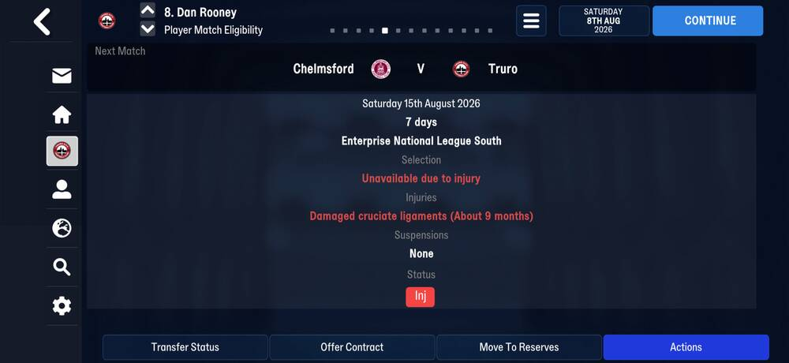
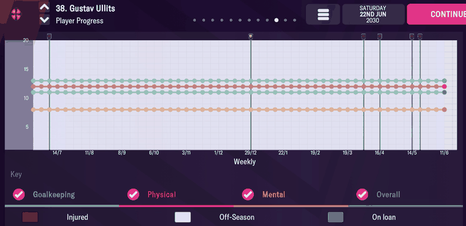
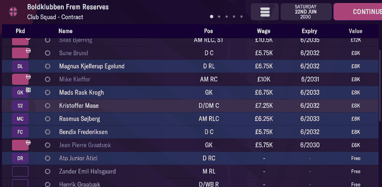
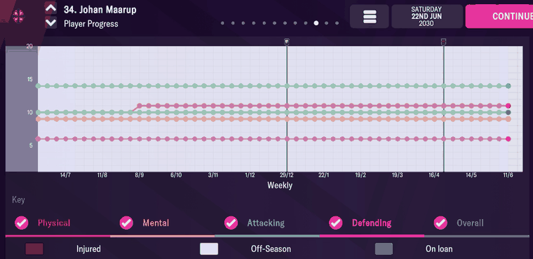
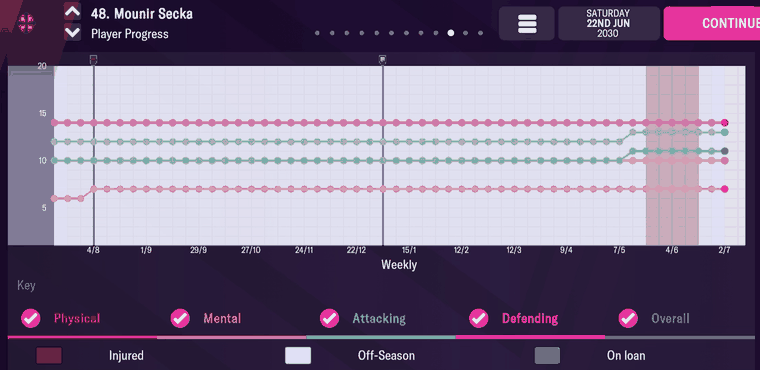

# player_progress  ([`fmparser/tables/player_progress.py`](../../fmparser/tables/player_progress.py))

The Player Progress graph: one row per tracked player per week, with the graph's skill
lines and a status bitfield (injured, on loan, and the graph's event markers). A fixed pool
of 62,400 rows of 70 bytes at ~52.5 MB, the same size on every save of all three careers,
with no count in front of it. The players tracked are the managed club's first team and
reserves, from their first week at the club: 25 on `truro-2026-07-25` (one row each, the
save's own week), 38 on `frem-2030-06-22`, exactly the two squad arrays. The row is the same
on both versions; the unused-row template's year differs (Layout, FMM22).

## Layout

The lines and status bits were read off Player Progress graphs on FMM22 (Evidence, FMM22).

| offset | field | type | meaning | how we know |
|---|---|---|---|---|
| +0 | `player_tid` | u32 | `0xFFFFFFFF` = an unused row | |
| +4 | `line_0` | u16 | Physical, 1–20 | four graphs (below) |
| +6 | `line_1` | u16 | Mental | |
| +8 | `line_2` | u16 | Goalkeeping; `0xFFFF` for an outfield player | |
| +10 | `line_3` | u16 | Attacking; `0xFFFF` for a goalkeeper | Maarup's and Secka's graphs |
| +12 | `line_4` | u16 | Defending; `0xFFFF` for a goalkeeper | |
| +14 | `line_5` | u16 | Overall | |
| +16 | `status` | u16 | bitfield (below) | |
| +18 | | u16 | 0 on every used row | |
| +20 | `day` | u16 | day of the year, 0-based | |
| +22 | `year` | u16 | `0x07E9` (2025) on an unused row: the year before the game's first season | |
| +24 | | 23 × u16 | 1–20 or `0xFFFF`: 17 filled for an outfield player, 6 for a goalkeeper; unread | |

`status` bits:

| bit | value | meaning | how we know |
|---|---|---|---|
| 0–1 | 1, 2, 3 | injured that week | Secka's Injured band covers exactly his five rows with bits 0–1 (10 May – 2 June 2030); twelve 2021/22 injury spells matched the same way |
| 5 | 32 | out on loan | the seven players marked unavailable on the reserves' Contract screen are exactly the seven whose latest week has bit 5 |
| 3, 4, 6, 7 | 8, 16, 64, 128 | a vertical marker on the graph, one per row: 16 draws a yellow icon, 64 and 128 a red one, 8 a white shield | Ullits, Maarup, Secka and Fredrik Bak: every row with one of these bits is a marker, and every marker is such a row |
| 2 | 4 | not identified (1 row) | |

An unused row is one fixed template: tid, lines, day and the +24 block all `0xFF`, +18 zero,
the template year. `locate_player_progress` finds two of them in a row, then walks both ways
while each row is unused or dated (+18 zero, a day of the year, a year from the template's to
the year after the save's date). The walk must come out at 62,400 rows: at 52,553,450 on
`truro-2026-07-25`. `truro-2026-07-22` holds no used row.

### FMM22

The template year is `0x07E4` (2020), so the locator takes the template year by format.

## Evidence

`truro-2026-07-25`: two rows carry injury bits, Jack Stretton (9271) and Dan Rooney (8501),
both status 1. Tested by `tests/test_career_fmm27_evidence.py`.

`truro-2026-08-08`, Rooney's Player Match Eligibility. Tested by
`tests/test_screens_fmm27_evidence.py`.

Rooney's rows read status 1 in every week from 25 July to 8 August: the injury bits, as on
FMM22. Stretton's read 1 on 25 July, 2 on 1 August and 0 on 8 August, the day he was a
named substitute against Maidenhead ([matches](matches.md#evidence)). The injury's name and
length are not in this table, nor in the player record's unavailability list (that list is
the database's bans); where the running game keeps them is not found.

### FMM22

`frem-2030-06-22`. Gustav Ullits' Player Progress, 2029/30:

| on screen | parsed (every week of 2029/30) |
|---|---|
| Goalkeeping (blue) at 13 | `line_2` 13 |
| Physical (red) at 12 | `line_0` 12 |
| Overall (green) at 11 | `line_5` 11 |
| Mental (orange) at 8 | `line_1` 8 |
| markers near 7/7, 7/4, 21/4, 19/5, 26/5 | `status` 64 on 2029-07-07, 2030-04-07, 04-21, 05-19, 05-26 |
| the marker at 29/12, with a different icon | `status` 16 on 2029-12-29 |

The reserves' Contract screen marks seven players unavailable (red, with a minus sign):
Ravn, Fredeløkke, Minerba, Bjerring, Brund, Kieffer and Graabæk. Their rows for the week of
16 June 2030 all read `status` 32; Liburd's and Kjellerup Egelund's read 0.

Johan Maarup and Mounir Secka, both outfield players, 2029/30:

| on screen | parsed |
|---|---|
| Maarup: Attacking (blue) 14, Defending (magenta) 6, Mental 9, Overall 10 | `line_3` 14, `line_4` 6, `line_1` 9, `line_5` 10, every week |
| Maarup: Physical steps from 10 to 11 in early September | `line_0` 10, then 11 from 2029-09-08 |
| Maarup: markers at 29/12 (yellow) and late April (red) | `status` 16 on 2029-12-29, 64 on 2030-04-28 |

| on screen | parsed |
|---|---|
| Secka: Defending steps from 6 to 7 in early August, at a red marker | `line_4` 7 from 2029-08-02, `status` 64 that day |
| Secka: Attacking 12 to 13 and Overall 10 to 11 in early May | from 2030-05-05 |
| Secka: the Injured band, mid-May to early June | `status` 1 on 10, 12, 19 and 26 May, 2 on 2 June |

Tested by `tests/test_people_evidence.py`.

## Quirks

> **Quirk:** bit 4 (16) is not "the off-season week". It falls on 60 rows in 29 different
> weeks across the year, and the graph draws it as a marker. Three of the four players on
> these screens carry it on 29 December. What the markers stand for is not yet read off the
> screen.

> **Quirk:** rows are not always a week apart. Bak's first months have rows 3–5 days apart,
> and Secka has rows on both 10 and 12 May 2030.

> **Quirk:** a week can have more than one row. 159 of 6,691 player-weeks on this save have
> two to five, in slots anywhere in the pool (the game reuses rows), and the copies can
> disagree on the status bits and the lines. The parse hands every row over as stored; the
> mart decides.

> **Decision:** loans out are read from bit 5, not from the [training](training.md) row's
> +39 (`unknown_39`), which does not track them. Filter a squad on +39 and real regulars
> drop out.

## Output

`output/<label>/player_progress.json`: every used row in pool order (`tid, week, status,
line_0 … line_5`, `week` an ISO date, a line `None` where it reads `0xFFFF`), loaded into
`raw.player_progress`. `mart.fact_injury_spell` and `mart.fact_loan_spell` are built from it.
