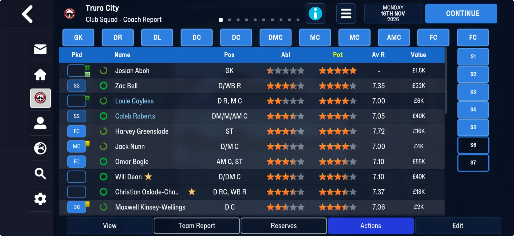
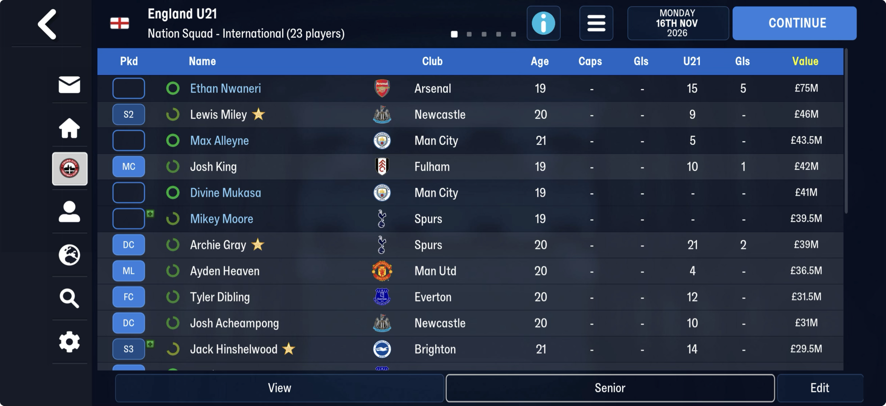
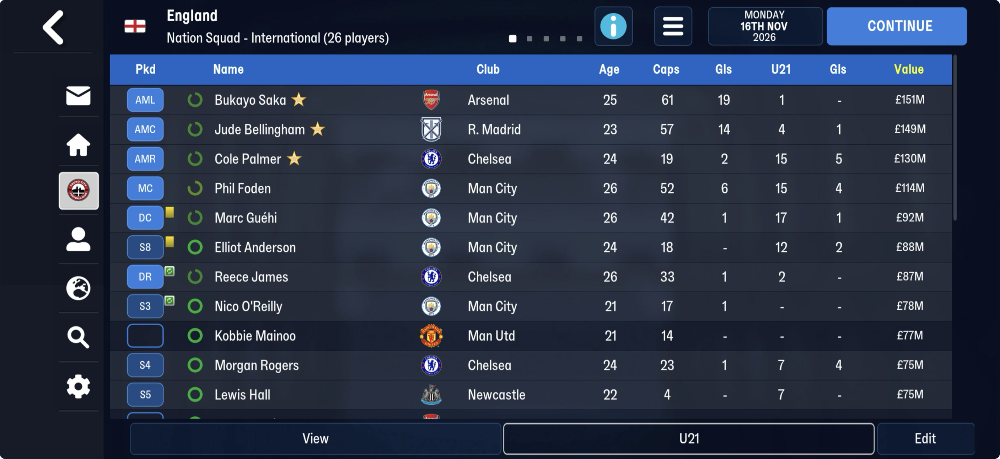

# player_rows  ([`fmparser/tables/player_rows.py`](../../fmparser/tables/player_rows.py))

**One 72-byte row per player**: his ability on his league's scale (`league_ability`) and
engine working state. FMM27 only; `extract.py` writes `player_rows.json` (tid,
league_ability). Tables 5 and 6 of [the block after the club titles](unread/end_block.md),
straight after the [player form](player_form.md) lines. FMM27, at block offset 15,504 on
truro-2026-11-16: `[u32 n][n × 72 B]`, ascending by tid; then table 6, `[u32 1][1 × 72 B]`,
the same shape for one more person.

| save | rows | table 6's person |
|---|---|---|
| 22 Jul, 25 Jul, 8 Aug | 36,343 | 37304 Kimika Forbes |
| 16 Nov | 36,345 | 37304 Kimika Forbes |

The rows run tid 401 to 44,958 and are 2.6 MB, the block's biggest table.

## Known

| offset | type | what |
|---|---|---|
| +0 | u32 | the player's tid, ascending |
| +4 | 4 × u32 | four player-table indexes (0–36,202); each column is a **random permutation** of the players |
| +20 | u16 `league_ability` | **ability on the player's league's scale**: within a league it tracks current ability (median r = 0.95 over 100 leagues; 0.954 in Truro's, 595 players), across leagues not at all (r = -0.04). Moves when ability moves (r = 0.75 between 8 Aug and 16 Nov). 0–190 |
| +22 | u16 | an age-group score, probably (below); set only on young players: every player aged 21 or under, part of the 22-year-olds, nobody older (born 18 Jul 2004 or later; 12,063 players on 16 Nov); up to 238; `ffff` otherwise |
| +24 | 6 × u32 | `ffff…` on 28,856 players, 100 on 7,389 (the whole Truro squad and its league), a few other values (74, 93, 57: percentages?) |
| +48 | 6 × u32 | two player-table indexes, two 100s, then two indexes again |

- **The four indexes at +4 are not people that belong with the player.** Read as player-table
  indexes, a column holds every player exactly once; no attribute orders it (ability,
  reputation, age, height and club all rise as often as they fall); and they reshuffle
  almost completely between saves (under 1% unchanged in 17 days). Engine working state,
  most likely: random pairings the game draws each day.
- **The u16 at +20** looked unrelated to ability over the whole world (|r| < 0.05), because each
  league has its own scale: within one league it is ability, r = 0.95. In Truro's squad
  it rose for exactly the players whose ability rose between 8 Aug and 16 Nov (Greenslade
  52→59, Tweedy 60→66, Matthews 42→45) and stayed for the rest. A league-relative rating:
  close to what the site's Level %ile computes, and a candidate for the stars a profile
  shows. Derived from ability, so presentation should treat it as the Level %ile is
  treated (`[immersion]`).
- **+22** (young players only) is not days to the next birthday (r = 0.002), not a growth
  allowance (its change between saves does not follow ability's, r = 0.02; Tweedy's fell
  90→22 as he improved, Matthews's rose 66→75), and not potential on the league's scale
  (median r = 0.38).

## Examples (truro-2026-11-16): whole rows

| bytes | Ben Starkie | Omar Bogle | Maxwell Kinsey-Wellings | Lewis Colwell |
|---|---|---|---|---|
| +0 tid | 4353 | 6588 | 29417 | 31086 |
| +4 four indexes | 12789, 27004, 35446, 26491 | 15085, 20934, 33148, 21144 | 6421, 30424, 6393, 29581 | 11642, 34137, 11772, 33983 |
| +20 u16 | 61 | 74 | 53 | 39 |
| +22 u16 | `ffff` | `ffff` | **87** | **20** |
| +24 six u32 | 100 × 6 | 100 × 6 | 100 × 6 | 100 × 6 |
| +48 six u32 | 12777, 26491, 100, 100, 12777, 26491 | 15075, 20135, 100, 100, 15075, 20135 | 6393, 29581, 100, 100, 6393, 29581 | 11642, 33871, 100, 100, 11772, 33871 |

Kinsey-Wellings, raw: `e9 72 00 00 | 15 19 00 00 d8 76 00 00 f9 18 00 00 8d 73 00 00 | 35 00 |
57 00 | 64 00 00 00 × 6 | f9 18 00 00 8d 73 00 00 64 00 00 00 64 00 00 00 f9 18 00 00 8d 73 00 00`.

The +48 indexes are drawn from the four at +4 (Kinsey-Wellings's are his third and fourth,
Colwell's his first and third) or sit close to them, so +48 is part of the same working
state. Greenslade's +48 holds his own row (19204). The fields that look like player data
are +20 and +22. (A "Seckie" was asked for; no Truro player has that name, so Ben Starkie
stands in.)

## Lined up: Truro and its league (truro-2026-11-16)

`--` = `ff` (empty). The +4 and +48 indexes (working state) are left out.

| player | club | +20 | +22 | +24 (six u32) | +56/+60 |
|---|---|---|---|---|---|
| Ben Starkie | Truro | 61 | -- | 100 × 6 | 100/100 |
| Omar Bogle | Truro | 74 | -- | 100 × 6 | 100/100 |
| Will Dean | Truro | 71 | -- | 100 × 6 | 100/100 |
| Luke Jephcott | Truro | 67 | -- | 100 × 6 | 100/100 |
| Harvey Greenslade | Truro | 59 | -- | 100 × 6 | 100/100 |
| Josiah Aboh | Truro | 35 | **106** | 100 100 -- -- 100 100 | --/-- |
| Maxwell Kinsey-Wellings | Truro | 53 | **87** | 100 × 6 | 100/100 |
| Jack Nunn | Truro | 53 | **83** | 100 × 6 | 100/100 |
| Jack Matthews | Truro | 45 | **75** | 100 × 6 | 100/100 |
| Tylor Love-Holmes | Truro | 46 | **37** | 100 × 6 | 100/100 |
| Tom Tweedy | Truro | 66 | **22** | 100 × 6 | 100/100 |
| Luca Barrington | Torquay | 88 | **117** | 100 × 6 | 100/100 |
| Jordan Archer | Torquay | 87 | -- | 100 × 6 | 100/100 |
| Charlie Casper | Chesham | 65 | **118** | 100 × 6 | 100/100 |
| Harry Barbrook | Chelmsford | 58 | **95** | 100 × 6 | 100/100 |
| Andy Carroll | Dagenham & Redbridge | 67 | -- | 100 × 6 | 100/100 |
| Jet Dyer | Dagenham & Redbridge | 32 | **38** | 100 × 6 | 100/100 |
| Essa Jadama | Dover | 27 | **55** | 100 × 6 | 100/100 |
| Jaye Long | Slough | 33 | **66** | 100 × 6 | 100/100 |

**Against the Coach Report** (16 Nov): the ability stars of the players still at Truro order
exactly by `league_ability`: 3.5 stars at 59, 61, 65, 71 and 74; 2.5 stars at 53 and 53;
Josiah Aboh, the mid-season youth intake, half a star at 35. Potential stars do not order by
+22 (Nunn 83 shows 4 stars, Kinsey-Wellings 87 shows 3.5).

**+22 is an age-group score (lead).** Within a birth year it follows ability for players born
2007 or later (r = 0.89–0.92 per year, on 8 Aug and 16 Nov alike) and not for those born
2004–2006 (r ≈ -0.1); within **nation and birth year** it follows ability for both (median
0.88 and 0.77). The split is by birth year, not by age on the save's date, as youth
international eligibility is. A score a nation's youth coach would pick an age-group squad by
(two schemes: U19-ish born 2007+, U21-ish 2004–2006) fits that, the batch updates, and the
drop at a birthday.

**England U21, 16 Nov** (the Nation Squad screen): the eleven players on screen rank 1, 4, 5,
7, 8, 12, 18, 25, 29, 32 and 60 among England's 2,430 young players by +22 (Josh King of
Fulham first, 238). Of the others in the top ten, Nico O'Reilly (229) and Kobbie Mainoo (211)
are in the senior squad, Myles Lewis-Skelly (233) probably too: the best go up, the U21
coach picks from the rest. A youth international selection score, very probably; values run
to 238 (118 is only the top in Truro's league).

**+22 over four saves.** Unchanged for every young player from 22 to 25 Jul; 70% unchanged
from 25 Jul to 8 Aug; nearly all changed by 16 Nov, up and down. Not tied to the club having
played. A birthday in between pulls it down on average (-31 against -16) but not cleanly:
Tweedy (born 15 Sep) 92, 92, 90, 22; Matthews 66, 66, 66, 75; Nunn 76, 76, 76, 83;
Kinsey-Wellings 79, 79, 79, 87; Love-Holmes 61, 61, 61, 37. Updated in batches, on a schedule
not yet found. Aboh, the youth intake, has two of +24's six slots and +56/+60 empty.

## How it is found

`locate_player_rows`: where the Player Form lines end, a `00`, the u32 count, then the rows;
the form table is located only when every row's tid rises. Evidence in
[`tests/test_player_form_evidence.py`](../../tests/test_player_form_evidence.py): the Coach
Report's star order and the within-league check (median r > 0.9).

### FMM22

Not located: FMM22's block after the club titles has no 72-byte row per player.

## Tried

- The four columns as person tids (random people at unrelated clubs) and as sort orders
  (monotonic test above): neither.
- The +20 number against every player field read and against condition, morale and
  appearances on the 25 Jul Club Squad screen.

## Next

1. +22: what young-player number this is. Not ability or potential (|r| < 0.04). A screen
   that shows a number for youngsters only (development? a youth rating?) is the lead.
2. Pin +20's scale: what makes 100 (the league's best?) and whether it is the profile's
   star rating.
3. Table 6's one person (Kimika Forbes, tid 37304): what puts that row in a list of its own.

## Evidence that would help

For +20: a player's star rating (ability) on his profile, for a few players of one league,
with the save the same day. For +22: any screen giving youngsters (21 and under) a number.
Not the Individual Training screen's progress bar (the training table's fields are 2 and
84 on all nine players shown there).
