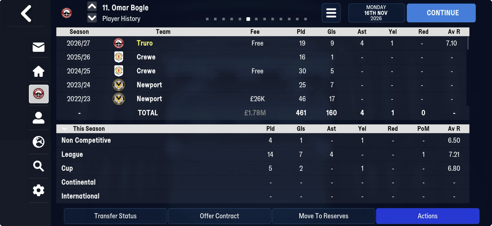
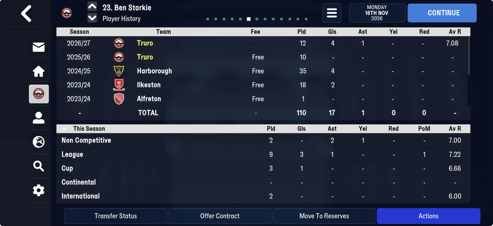
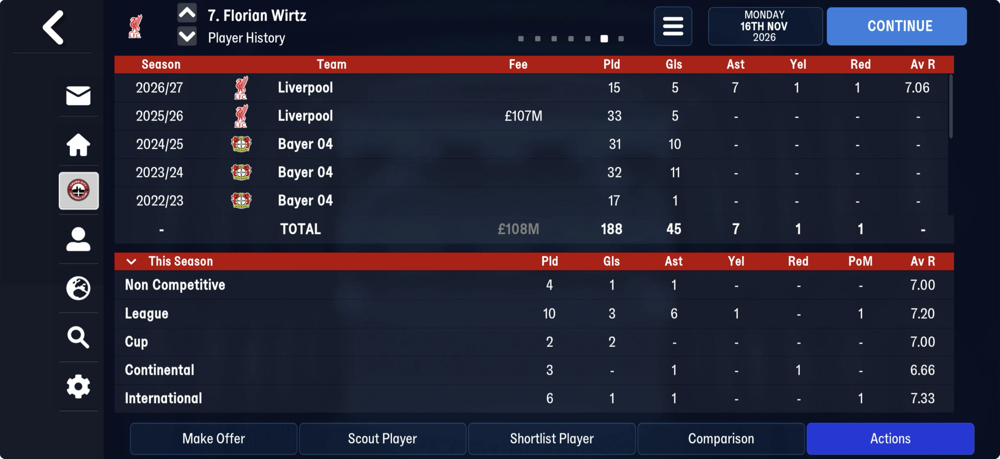

# player_season_stats  ([`fmparser/tables/player_season_stats.py`](../../fmparser/tables/player_season_stats.py))

**The Player History screen's "This Season" panel, for every player in the world**:
appearances, goals, assists, goals conceded (goalkeepers), cards, player-of-the-match awards
and the rating total, split by kind of competition. Straight after the
[nickname id-table](names.md), in front of the [career-history pool](history.md). FMM27 and
FMM22 store it the same way. `extract.py` writes `player_season_stats.json`: one entry per
non-empty row, with its `sid` and `block`.

| save | players | span | non-empty rows |
|---|---|---|---|
| truro-2026-07-22 | 36,344 | 1.96 MB | 6,202 |
| truro-2026-07-25 | 36,344 | 1.96 MB | 10,021 |
| truro-2026-08-08 | 36,344 | 1.96 MB | 24,389 |
| truro-2026-11-16 | 36,344 | 1.96 MB | 92,461 |
| frem-2021-06-27 (day one) | 26,505 | 1.43 MB | 1,496 (1,023 international: Euro 2021) |
| frem-2026-06-11 | 26,505 | 1.43 MB | 65,874 |
| frem-2030-06-22 → -06-30 | 26,505 | 1.43 MB | 50,019 → 20,934 |
| bucaspor-2023-04-01 | 26,292 | 1.42 MB | 68,758 |

## Layout

No count and no frame: six blocks of one 9-byte row per
[player-attribute](player_attributes.md) record, so **row `block × players + k` belongs to
attribute record k** (the `sid`, the order of `player_attributes` and
[`player_status`](player_status.md)). Nothing points at a row; its position is the key.

| block | `block` | the screen's line |
|---|---|---|
| 0 | `club_season` | the history list's current-season line (2026/27 Truro): league + cup + continental, plus matches for a club's B team |
| 1 | `league` | League |
| 2 | `cup` | Cup: every domestic cup summed (FA Cup and FA Trophy) |
| 3 | `continental` | Continental |
| 4 | `non_competitive` | Non Competitive: friendlies and reserve matches |
| 5 | `international` | International |

| offset | field | type | meaning |
|---|---|---|---|
| +0 | `apps` | u8 | Pld |
| +1 | `goals` | u8 | Gls |
| +2 | `assists` | u8 | Ast |
| +3 | `conceded` | u8 | goals conceded, goalkeepers (Aidan Stone 11 in 15 league games); 0 for the rest |
| +4 | `rating_total` | u16 | the match ratings summed; Av R is `rating_total / apps`, **truncated** to two places (20 / 3 shows 6.66) |
| +6 | `yellows` | u8 | Yel |
| +7 | `reds` | u8 | Red |
| +8 | `player_of_match` | u8 | PoM |

A row with no appearances is all zero. The panel is the current season only; earlier seasons
are the history pool's lines (the screen's TOTAL is those plus block 0). Rows clear at the
season's end, nation by nation: frem-2030-06-22 → -06-30 crosses Denmark's rollover and keeps
20,934 of 50,019 rows. No xG here: the league screen's xG is still to find (TODO #10a).

## Evidence

truro-2026-11-16. Omar Bogle (tid 6588, sid 2,812), Ben Starkie (tid 4353, sid 779) and
Florian Wirtz (Liverpool, tid 23281: every block filled, a red card in Europe), and
every Truro player's league line in our 33 matches (all 25 match block 1 field for field).

| player | block | raw bytes | on screen |
|---|---|---|---|
| Bogle | 0 | `13 09 04 00 87 00 01 00 01` | 2026/27 Truro: 19, 9, 4, 1 yel, 7.10 (135 / 19) |
| Bogle | 1 | `0e 07 04 00 65 00 00 00 01` | League: 14, 7, 4, PoM 1, 7.21 |
| Bogle | 2 | `05 02 00 00 22 00 01 00 00` | Cup: 5, 2, 1 yel, 6.80 |
| Bogle | 4 | `04 01 00 00 1a 00 01 00 00` | Non Competitive: 4, 1, 1 yel, 6.50 |
| Starkie | 0 | `0c 04 01 00 55 00 00 00 01` | 2026/27 Truro: 12, 4, 1, 7.08 (9 league + 3 cup; his 2 caps are not in it) |
| Starkie | 2 | `03 01 00 00 14 00 00 00 00` | Cup: 3, 1, 6.66 |
| Starkie | 5 | `02 00 00 00 0c 00 00 00 00` | International: 2, 6.00 |
| Wirtz | 0 | `0f 05 07 00 6a 00 01 01 01` | 2026/27 Liverpool: 15, 5, 7, 1 yel, 1 red, 7.06 (10 + 2 + 3; not his 6 caps) |
| Wirtz | 3 | `03 00 01 00 14 00 00 01 00` | Continental: 3, 0, 1, **Red 1**, 6.66 |
| Wirtz | 5 | `06 01 01 00 2c 00 00 00 01` | International: 6, 1, 1, PoM 1, 7.33 |

**Reds**: Wirtz's Continental red is byte +7 of his block 3 row. Jahrel McKoy's one
sending-off in our match table (59th minute, English Reserves Group 11, 21 Oct) is the 1 in his block 4 row
`09 00 01 00 3b 00 00 01 00`, and nowhere else; that also puts reserve matches in Non
Competitive.

`tests/test_player_season_stats_evidence.py` pins all of this to the bytes.

## How it is found

The nickname id-table's end is block 0's first row. The six blocks, sized by the
player-attribute count, must end before the history pool's count, and the locator refuses
them unless every non-empty row has `apps <= rating_total <= 10 × apps` and, on every player,
block 0 is at least blocks 1 + 2 + 3 field by field. Both hold on all ten saves measured, both
games. Block 0 equals the sum except for 1–2% of players, all at B teams (Valladolid B,
Atlético Madrid B, VfB Stuttgart II): none of them transferred or went on loan.

## What follows: unread

Between the six blocks and the history pool: 197 KB on truro-2026-11-16 (171 KB on 25 Jul) and
85 KB on frem-2026-06-11, not read. On FMM27 it is three sub-tables, each with its own page:
[125 variable records](unread/sst_records.md) (~97 KB; FMM22's 85 KB is described there),
[grouped 14-byte tid rows](unread/sst_tid_groups.md) (~41 KB) and
[inline-named records](unread/sst_named.md) (58 KB).
