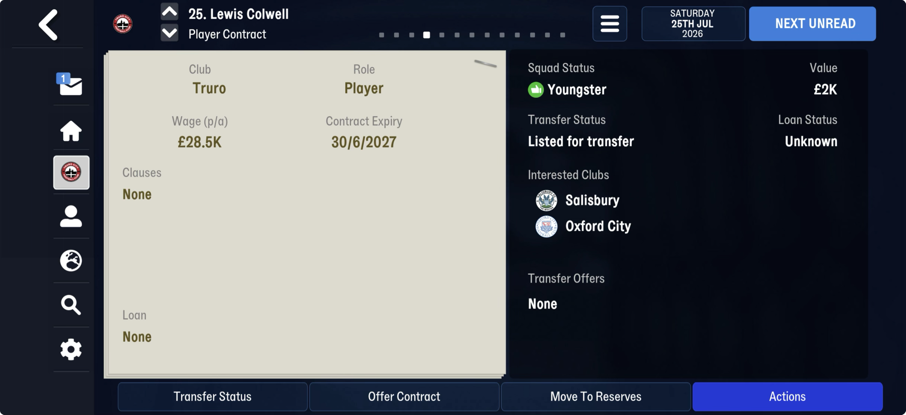
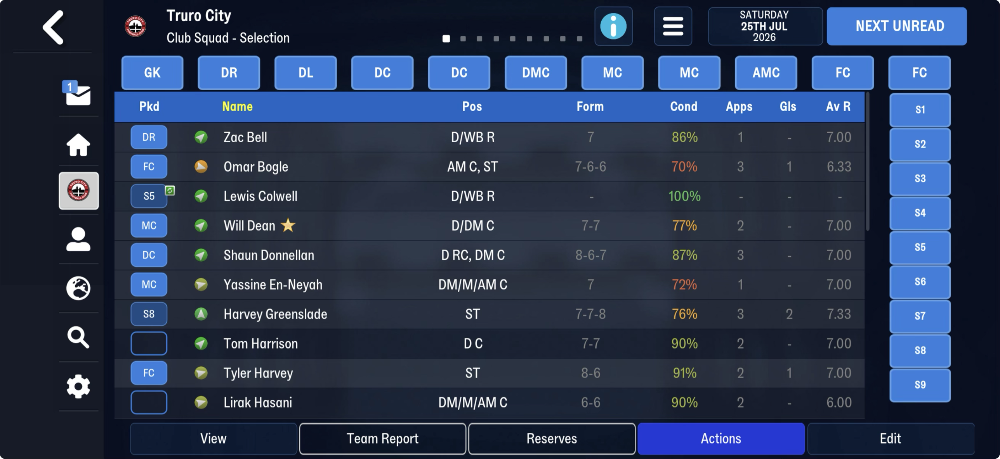
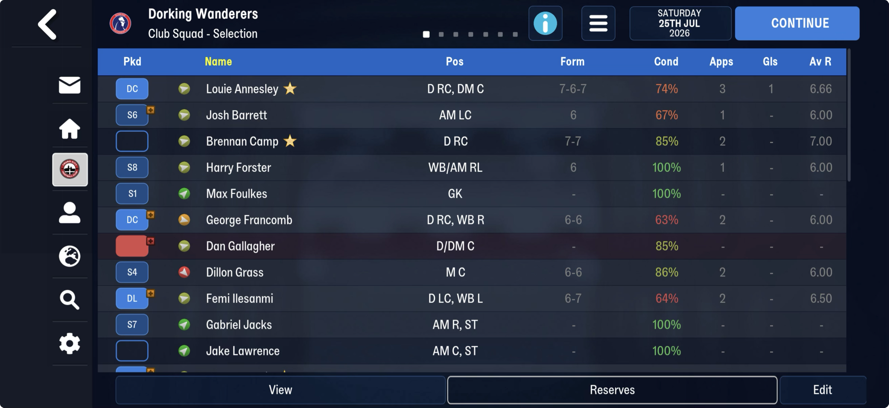

# player_status  ([`fmparser/tables/player_status.py`](../../fmparser/tables/player_status.py))

**One block per player: the clubs interested in him, his morale and his form.** The fourth
link of the chain after the languages ([person_index](person_index.md) → [staff_rows](staff_rows.md)
→ [club_rows](club_rows.md) → this), straight after the club rows. Read on FMM27; FMM22
stores the same block in a different shape whose walk is not proved yet, so an FMM22 save
writes no `player_status.json`.

| | Truro (FMM27) |
|---|---|
| blocks (= player attribute records) | 36,344 |
| span | 4.33 MB (22 Jul) → 4.34 MB (8 Aug) → read on 16 Nov too |
| with an interested club | 798 (22 Jul), 1,385 (25 Jul), 1,023 (8 Aug) |
| with an event record | 27, 34, 68 (summer); 597 event records on 16 Nov |

## Layout

`[count u32 = the player-attribute count]`, no `0xFF` frame, then block k = attribute record
k (`player_status.json` carries that record's `sid`):

| offset | field | type | meaning |
|---|---|---|---|
| +0 | | 6 B | 0, but +5 reads 0, 3 or 4 |
| +6 | `interested_club_tids` | 7 × u16 | clubs interested in him; `ffff` empty |
| +20 | `morale` | u8 | 1–20, the Club Squad screen's arrow |
| +21 | `form` | 5 × u8 | the last five match ratings, most recent last; `ff` = no match (`null`) |
| +26 | | 8 B | `ff` on every block measured |
| +34 | `event_count` | u8 | how many event records follow: 0 or 1 in the summer, up to 2 on 16 Nov |
| +35 | | n × 22 / 46 B | the event records (below) |
| then | | `[n u8][n × 5 B]` | items: `[0][a][0][b][c]`, a mostly 22–40 |
| then | | 83 B | a u32, 15 B, a date (+19) unset on every block, a byte, a second date (+24), 55 B |

A plain block is 119 bytes, plus 5 per item: 35,494 of 36,344 on 25 July.

**The event record.** 22 bytes, or 46 when its byte +21 is 1: two u16 (`ffff` or small),
a u16, a kind byte (0, 2 or 4), two bytes, a 2025/26 date, then kind-dependent bytes; the
46-byte form holds a second dated record. Its count grows through the summer (27 → 68), and
its dates are recent: a transfer or contract event, not yet matched to a screen.

**Morale bands** seen on 25 Jul 2026: green, straight up at 20; green, up and right 15–17;
yellow, flat 12–14; orange 10–11; red 7.

**Not here:** appearances, goals, average rating. Greenslade (3 apps, 2 goals) and Bogle
(3, 1) show no such numbers in their blocks; the season's stats are elsewhere (TODO #10a).

## How it is found

`locate_player_status`: where the club rows end, a u32 equal to the player-attribute count;
each block's length follows from `has_event`, the event's byte +21 and the item count, and
**every block's tail must hold a date at its fixed place**, so a misread length fails on the
block where it happens.

**The tail's dates.** Dates in the save are `[u16 day of year][u16 year]` (person_info's
birth dates). The field at tail +19 reads `01 00 d0 07`, day 1 of 2000, on every summer
block: a field the game has not set. On truro-2026-11-16 one block reads `39 03 ea 07`
(825, 2026), not a day of the year, so the locator checks only its year half. The second, at +24, reads day 0 of 2026 (unset)
on most blocks, and on 8 Aug 2026 holds a day in late August or early September for ~400
players, followed by `04` and a u16 where the rest have `ff`: an expected return date
(injury? suspension?), not yet checked on a screen. The walk must end before the rule files on a u16 `n`
followed by `n` 4-byte slots (1,706, all `ff`, on the three Truro saves), the next link.

> **Quirk: where a block starts.** The rows of this link start four bytes after its count
> and end with two zero bytes, so the u16 that opens the next link sits flush against the last
> block. Read the other way (a u16 count and blocks two bytes earlier), the chain needs a
> two-byte gap at its end.

## Evidence

`truro-2026-07-25`:

- **Interested clubs.** Lewis Colwell (tid 31086): slots `ee 11 2b 09` = Salisbury (4590) and
  Oxford City (2347), the two clubs his Player Contract screen lists under Interested Clubs.
- **Form.** All ten Truro players on the Club Squad screen and three of Dorking Wanderers'
  read as the Form column (Bogle 7-6-6, Donnellan 8-6-7, Greenslade 7-7-8, Colwell none).
- **Morale.** Fourteen players' values fall in their arrow's band, including Greenslade 20
  (straight up), Bogle 11 and Francomb 11 (orange), Dillon Grass 7 (red).

Checked by [`tests/test_person_chain_evidence.py`](../../tests/test_person_chain_evidence.py):
the raw slot bytes, the clubs by name, form and morale band per player, joined on tid.

### FMM22

The same fields in a 59-byte plain block (6 B head, the seven slots, morale, form, then
`[flag][n][items][u32][15 B][date]`, the null date last), items of 5 bytes or 7 when their
first byte is 1, and a different event layout. Its walk is not proved:
[what is known](unread/person_chain.md).
