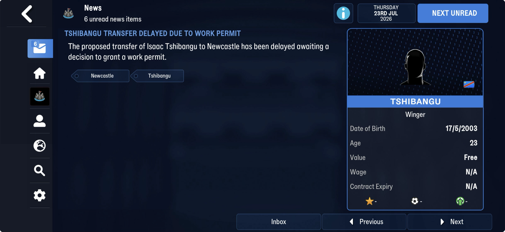
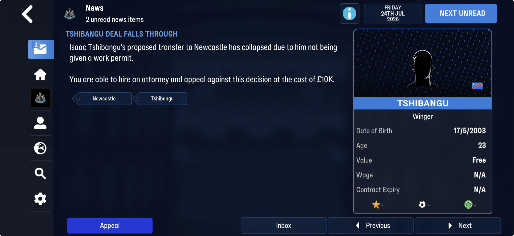
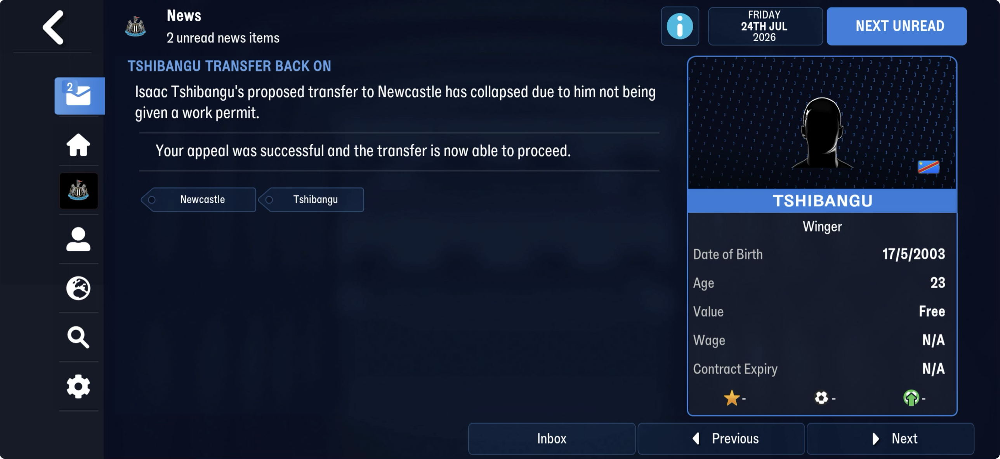
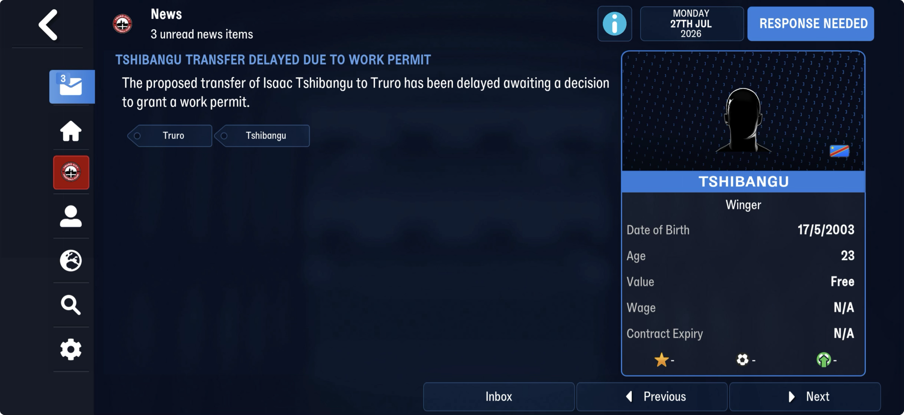
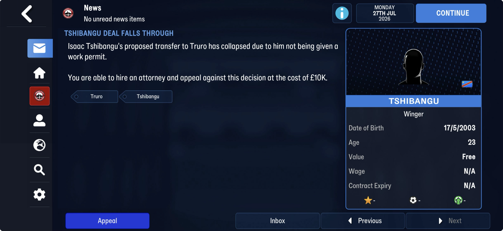

# rule_files  ([`fmparser/tables/rule_files.py`](../../fmparser/tables/rule_files.py))

The game's library of competition rules: one rule file per competition plus each nation's
competition list, reserve list and rules, and on FMM27 each continent's rules, men's and
women's. 782 rule files on both Truro saves (FMM27); 667 on FMM22. They make up the **data
dictionary**, a 3.3 MB region at ~16.7–20.0 MB (measured on FMM22) in the reference half
([savefile map](savefile-map.md)), in the same tagged format as the archive's
[comp_rules](comp_rules.md) members but without their 54-byte header. Each file is a
count-framed block, `[u32 n][n tagged fields]`. The files are byte-identical in every save of
a career (on FMM22, 27 of 667 differ between the Frem and Bucaspor careers); the bytes
between them change. FMM22's files name their folder in `SubF` and have no continents' files
(Layout, FMM22).

## Layout

```
region    the densest cluster of the `comp` tag, padded 60 KB before and 300 KB after (find_region)
file      [u32 n][n tagged fields]      a rule file: its top level has `ftye` and `file`
per nation, in order:
          [dated record][u32 n][n fields]                    the nation's merged <nat>_rules (bare)
          [separator][u32 k] k × ([01 0a][u32 n][n fields])  a group of k containers:
                     <nat>_comps, <nat>_reserve_comps, <nat>_rules, then its competitions
```

A file names its source in `file` (`dan_prem_3_6_euro_teams`), and closes with the trailer
`XSvC EdBr EdDt` the archive members also end with. A nation's three files carry `PLgn`: an
unnamed int, 0 on 246 files and 1 on 57, absent on one `_reserve_comps`. The tagged format is
specified in `fmparser/core/types.py` (`read_tree`).

Six schemas, chosen per file by `schema_for_fmm27` (`RULE_FILES_TABLE_FMM27`). Kept to what
`team_counts()` needs; the rest is carried unread. The file counts are FMM22's.

| schema | files (FMM22) | carries |
|---|---|---|
| `comp_rules.FILE` | 453 | a competition's stage list (`stgs`): the same declaration the archive members read with |
| `NATION_COMPS_FMM27` | 53 | `<nat>_comps`: division levels (`dvlv`), competitions (`cmps`), team-count rules (`retm`) |
| `NATION_RESERVE_COMPS_FMM27` | 53 | `<nat>_reserve_comps`: reserve and youth competitions |
| `NATION_RULES_FMM27` | 106 | `<nat>_rules`, twice per nation: in its group, and the merged bare copy that also carries its `_comps` and `_reserve_comps` tags |
| `CONTINENT_RULES_FMM27` | — | a continent's rules, men's and women's: `afr`, `wmn_afr`, `asi`, `wmn_asi`, `wmn_eur`, `nam`, `wmn_nam`, `oce`, `wmn_oce`, `sam`, `wmn_sam`, stored bare like a merged `<nat>_rules` |
| `STAGELESS_COMP_FMM27` | 2 | `wal_cymru`, `wal_cymru_main`: a competition configured without a stage list; on FMM27 any file with neither a nation suffix nor `PLgn` |

| tag | field | meaning |
|---|---|---|
| `file` | `file` | the file's name |
| `PLgn` | `plgn` | unnamed, 0 or 1 |
| `ftye` | `file_type` | |
| `retm` | `team_rules` | a nation's team-count rules: `{comp, ntms, nxss}` |
| `retm[].comp` | `comp_uid` | the competition's **uid**, as a u32 or a `{id 'comp', comp <uid>}` container; absent on a rule about a team or a nation |
| `retm[].ntms` | `teams` | teams in the competition (on 18% of rules, every FMM22 save) |
| `wkpm` | `work_permits` | a nation's work-permit rules ([Work permits](#work-permits)); `work_permits()` |
| `wkFT` | `work_permits_wkft` | a second set of the same shape, on the UK nations' files only |
| `retm[].nxss` | `nxss` | 0 or 1, unnamed: on FMM22 1 on 51 rules, the same 51 on all seven saves of both careers (Chile's 5250792 carries a 17-team rule at 0 and a 16-team rule at 1) |

FMM27 adds tags on every schema (team rules: `FBkt`, `ReTT`, `DbSt`, `DbEd`, `ifmh`; the
competition files' stage and round lists: `cdes`, `gtct`, `tmor`, …), listed unread.

`team_counts()` reads every `_comps` rule that names a competition and carries `ntms` with
`nxss` 0: **256 competitions** on FMM27, written to `competition_team_counts.json`. Most
rules name a uid that is not in the competition table: 97 of the 256 resolve (FMM22: 70 of
190).

**How it is checked.** `tiling()` accounts for the span from the first file to the last, and
`framing_problems()` checks that each group's `k` equals the containers that follow and that
every bare file is a `_rules` or a continent's rules. On FMM27 both fail (Lead, below); the
FMM22 numbers are under Layout, FMM22.

> **Lead:** two groups don't frame as FMM22's do: FMM27 puts small 2-field tagless containers
> (`ourc`, `inuc`) inside a group, ahead of its rule files, so `framing_problems` reads a
> wrong count (`declares 8,655,361 files`), and `tiling` counts their 587 bytes as unread
> blocks. The audit FAILs on both; not worth decoding while nothing uses the region.

> **Decision:** the region is found by the `comp` tag's densest cluster, padded, and bounded
> by the files themselves (count-framed blocks that read to their declared count), not by a
> fixed window. The pad is slack: the first file opens ~66 bytes before the cluster's first
> `comp`, the last closes ~170 bytes after its last.

### FMM22

667 files, read with `RULE_FILES_TABLE` and `schema_for`: the same schemas without the
`_FMM27` suffix, five of them (no continents' rules).

- **`SubF` in place of `PLgn`**: `source_path`, the file's folder (`.\europe\dan\leagues\`),
  and the trailer is `XSvC EdBr EdDt SubF`.
- No continents' rule files; `STAGELESS_COMP` is the two Welsh files only.
- None of FMM27's added tags.
- `team_counts()` gives **190 competitions**, 70 of which resolve.

The checks pass: on frem-2030-06-22 the span is 3,269,072 bytes, 3,242,194 of them (99.18%) in
the 667 files, no other count-framed block (a file that failed to read would show up as
fragments here; the test requires zero), and 26,878 bytes unread. `framing_problems()` finds
nothing on any save.

> **Quirk:** the unread 0.8% is the part that is state. Between frem-2026-03-28 and
> frem-2030-06-22 all 667 files are byte-identical while 227 of the 666 gaps between them
> differ (87 between frem-2026-03-28 and frem-2026-06-11). Neither the separator (`ffffffff`-led
> u16 entries ending `01`) nor the dated record before each merged `_rules` (u16 day-of-year,
> u16 year pairs) is decoded. TODO, "The data dictionary's state between the rule files".

## Work permits

A nation's `_rules` file carries its work-permit rules in `wkpm`, read with `WORK_PERMITS`
on both games. `work_permits()` gives one row per rule, written to `work_permit_rules.json`.
They are **national** rules: the Premier League's Rules screen (Loan Rules, Financial
Regulations) shows none of them, and no competition-level set is non-empty except
`swe_second_2018`'s.

```
wkpm  {id 'wkpm', wopm RULE, wtpm RULE, ctrn RULE, stWP RULE, appe RULE}   each rule optional
RULE  {id <its code>, type <scheme>, info <int | {id 'info', cash, curr}>, decd,
       wpca {id 'wpca', cash}, wpcc, wpdw, wpaf}
```

Most nations' sets are empty (`{id 'wkpm'}` alone): Germany, Spain, Italy, France, the
Netherlands and 30-odd more. **Thirteen files carry rules** (FMM27, truro-2026-07-25):

| file | rules (`rule`: `scheme`/`info`) |
|---|---|
| `eng_rules` | wopm 21/0 fee 20,000 · wtpm 21/0 · ctrn 21/0 · stWP 20 · appe 23/0 fee 5,000 |
| `sco_rules` | wopm 21/0 · wtpm 21/0 · ctrn 21/0 · stWP 20 · appe 22/2,900 |
| `wal_rules`, `nir_rules` | wopm 21/0 · wtpm 21/0 · ctrn 21/0 · stWP 20 (`wpdw` 120) |
| `wmn_eng_rules` | England's, with `wpdw` 120 |
| `dan_rules` | wopm, wtpm, ctrn, stWP: 1 with cash 7,211 (`curr` 6) |
| `aut_rules` | wopm, wtpm, ctrn, stWP: 1 with cash 662 (`curr` 7) |
| `irl_rules` | wopm, wtpm, ctrn: 1 with cash 342 (`curr` 7) |
| `swe_second_2018` | wopm, wtpm, ctrn: 24 with cash 3,575 (`curr` 21) |
| `nor_rules` | wopm 5 · wtpm 3/50 · ctrn 3/50 |
| `aus_rules` | wopm 4/70 · wtpm 4/70 · ctrn 3/70 |
| `rsa_rules` | wopm 0/40 · wtpm 3/70 · ctrn 3/75 · appe 2/90 |
| `swi_rules` | wopm 25/1 |

The four UK nations and `wmn_eng_rules` also carry `wkFT`: wopm, wtpm, ctrn 6/0 and appe 7/0,
all with `wpdw` 120.

**What is established.** That this is the work-permit block: the tag, and that `type`
groups nations the way real permit regimes do. **Scheme 21 is on exactly the four UK nations**
(and the English women's file), the one regime they share: the points-based Governing Body
Endorsement. Scheme 1 carries a cash amount (Denmark, Austria, Ireland), which reads as a
salary threshold; schemes 3 and 4 a small number (Norway 50, Australia 70, South Africa
40-90), which reads as a percentage.

**`appe` is the appeal**, on screen (Evidence, "Work permits"): a refused permit can be
appealed, at a cost, and the appeal can succeed. Only England, Scotland and South Africa
carry an `appe` rule.

**What is not established:**
- The other rule codes. `wopm` probably a new work permit, `ctrn` a contract renewal, `stWP`
  perhaps a student or youth permit, `wtpm` unknown.
- The appeal's cost against what is stored. The appeal costs **£10K** at both Newcastle
  (Premier League) and Truro (National League South), for the same player: a flat cost,
  not one derived from the club or its division. England's `appe` `wpca` is 5,000 and its
  `wopm` `wpca` 20,000; neither is £10K as stored, so `cash` is not plain pounds or the
  game derives the cost from one of them (2 × 5,000, or half of 20,000).
- `decd` (0-4). Not days to a decision: at Truro the delay and the refusal came the same
  day (27 July), at Newcastle a day apart, where England's `wopm` has `decd` 3.
  `wpcc` (1), `wpdw` (120), `wpaf` (1, a reference) are unknown.

**Who needs one, from the data (inferred, not on a screen).** Measured across
truro-2026-07-25 and truro-2026-11-16 (the summer window between them):
- **England: a free transfer never gets a permit.** Of 1,474 foreign free agents with no
  UK history (nationality and second nationality outside the UK and Ireland, no youth club
  or career line in England, Scotland or Wales), 348 signed somewhere and **none** in
  England; free agents with UK history did (44 of 78 who signed). The 20 such players who
  joined English clubs were all permanent transfers for a fee, the smallest £79,000
  (Sprekelmeyer to Cambridge United); caps and reputation did not decide it (Jang Jung-Woo,
  0 caps, to Wrexham). That fits `wopm` `wpca` 20,000 as a **minimum fee**, but no fee
  between £1 and £79,000 was paid, so "a fee of at least £20,000" and "any fee" are not
  separated. Tshibangu was a free agent: refused at both clubs.
- **Scheme 1 reads as a minimum wage, weekly, in the nation's currency.** Austria and
  Ireland share `curr` 7 and both use the euro, so `curr` is a currency code of its own (7
  euro; 6 and 21 then the Danish and Swedish krone). At the save's exchange rates the floors
  are Denmark 7,211 DKK = £829 a week (£43.1K a year), Austria €662 = £569 (£29.6K),
  Ireland €342 = £294 (£15.3K), Sweden's second division 3,575 SEK = £275 (£14.3K).
  On truro-2026-11-16 no non-European player (nationality and second nationality outside
  Europe) at a club in those four nations earns below his league's floor; Europeans do in
  all four (EU players exempt). Weak evidence: almost every wage clears these floors anyway.
- `curr`: 6, 7 and 21 are not [currency](currencies.md) uids (the Danish Krone is 23); and
  so whether Denmark's 7,211 is in kroner, pounds or something else.
- What selects `wkpm` or `wkFT` for a nation.
- Which players need a permit at all. That is per-player: his nationality against the
  [unions](unions.md) (EU, EEA ...), whose membership is not found yet.

**FMM22 differs.** frem-2030-06-30 has ten files with rules: no Sweden, Switzerland or
English women's set, and **England's has no fee and no appeal** (wopm 21/0 `wpdw` 120, wtpm,
ctrn, stWP 20), with a `wkFT` set like Scotland's. Denmark's is `info` 750, an int, on wopm,
wtpm and ctrn, and `{cash 750}` with no `curr` on stWP: `work_permits()` gives `info` 750 on
the first three and `cash` 750 on the fourth.

> **Lead:** screens tie the rest down. Buying a non-UK player with no UK history for a fee
> under £20,000, and another over it, tests the minimum fee; a contract renewal's permit
> message would name `ctrn`; a Danish signing's would test the wage floor. TODO, "Work permits".

## Evidence

`truro-2026-07-25`: 782 rule files read with FMM27's schemas and `team_counts()` gives 256
competitions, tested by `tests/test_reference_fmm27_evidence.py`. No in-game screen is tied
to a rule file yet.

**Work permits.** Three news items from a Newcastle United career (FMM27, in-game 23-24 July
2026), a save that is **not in the bucket**: the bytes are not checked, and the figures
compared are truro-2026-07-25's `eng_rules`, which every save of a game's database shares
unless its rule files differ (on FMM22, 27 of 667 differ between careers). The player is
Isaac Tshibangu, a DR Congo winger: a nation in no union with the UK, under scheme 21.

1. 23 July, "Tshibangu transfer delayed due to work permit": the transfer awaits "a
   decision to grant a work permit".
2. 24 July, "Tshibangu deal falls through": refused, and "You are able to hire an attorney
   and appeal against this decision at the cost of £10K", with an Appeal button. This is
   `appe`; the £10K matches neither `wpca` (5,000 on `appe`, 20,000 on `wopm`).
3. 24 July, "Tshibangu transfer back on": "Your appeal was successful and the transfer is
   now able to proceed".





The same player at **Truro** (the career's own club, a save after truro-2026-07-25), 27 July
2026: delayed awaiting a work permit, then refused the same day, with the appeal again at
**£10K**: the cost does not change with the club or its division.




### FMM22

`frem-2030-06-22`. Denmark's group is `dan_rules` (bare), then `dan_comps`, `dan_reserve_comps`,
`dan_rules`, `dan_prem`, `dan_prem_3_6_euro_teams`, `dan_first`, `dan_second`, `dan_cup`,
`dan_series`, `dan_third`. `dan_comps` runs from byte 16,971,525 to 16,972,641; its `retm`
(at 16,971,955) holds `{comp 6, ntms 12}`, `{comp 7, ntms 12}` and `{comp 8, ntms 12}`: the 3F
Superliga, NordicBet Liga and 2. Division, 12 clubs each, as their tables show.

The 3F Superliga's archive member `comp_6.dat` names `dan_prem_3_6_euro_teams`, and its stage
list is the file's ([comp_rules](comp_rules.md)); the same holds for all 73 configured members.

Pending: an in-game rules screen for the Superliga (teams, promotion and relegation places,
split rounds) to tie the unread tags to what the game shows.

## Output

`output/<label>/competition_team_counts.json`, `{uid: teams}` from `team_counts()`, loaded
into `raw.competition_team_counts`.

`output/<label>/work_permit_rules.json`, one row per work-permit rule from `work_permits()`:
`{file, set ('wkpm' | 'wkFT'), rule, scheme, info, cash, curr, fee, decd, wpcc, wpdw, wpaf}`.
64 rows on truro-2026-07-25, 53 on every FMM22 save measured. Not loaded yet. The rule files' stage lists are not extracted: the
archive members carry the same for the loaded competitions ([comp_rules](comp_rules.md)).
