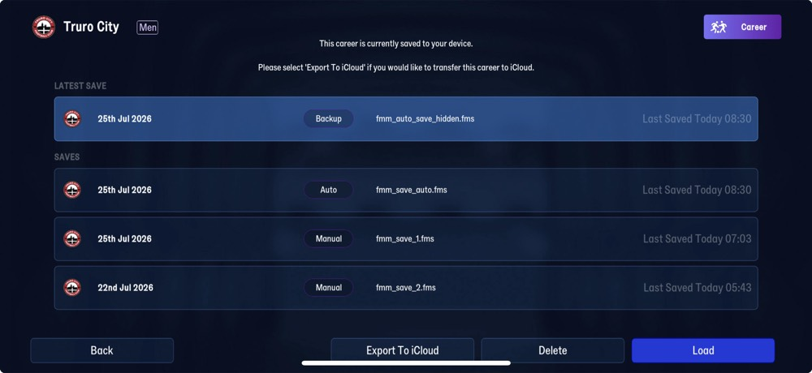

# save_header  ([`fmparser/tables/save_header.py`](../../fmparser/tables/save_header.py))

The save slot's header, at offset 0: the only table with a fixed offset, and the first step
`extract.py` runs. On FMM27 it is length-prefixed strings around fixed blocks, among them the
in-game date; FMM22 stores a single title string instead (Layout, FMM22). `save_format`
returns the version the save declares: the first `fmm<NN>-` length-prefixed string in its
first 0x200 bytes (FMM27's channel, `fmm27-rel-staging`). FMM22 declares no version anywhere
near its header, so a save that declares none is FMM22; a declared version with no reader
(`fmm26`) reads no date, and `extract.py` stops naming it. `read_save_header` returns the same
`{title, date, manager, nickname}` for both. `save_header_end` is where the first table may
start, which `extract.py` uses as its starting cursor.

## Layout

Length-prefixed strings (`[len u32][bytes]`) around fixed blocks. Offsets are from the
Truro City saves; the blocks follow the strings, so they move with the club name's length.

| offset | width | field | meaning | how we know |
|---|---|---|---|---|
| 0x00 | pstring | `club` | `"Truro City"` | read |
| 0x0e | pstring | `name_2` | `"Truro"`: short name or nickname, not yet told apart | read |
| 0x17 | pstring | `name_3` | `"Truro"`: the other of the two | read |
| 0x20 | 64 | stamp | `FMM27_STAMP`, below | |
| 0x60 | pstring | `build` | `"27.0.0-d+2495469"` | read |
| 0x74 | pstring | `channel` | `"fmm27-rel-staging"` | read |
| 0x89 | 1 | unknown | `00` | |
| 0x8a | pstring | `build_2` | `"27.0.0+2495469"` | read |
| 0x9c | pstring | `channel_2` | `"fmm27-rel-staging"` | read |
| 0xb1 | 14 | `FMM27_VERSIONS` | u32 27,000,034 twice, then u16 2,706, 2,700, 2,026 | |
| 0xbf | pstring | `channel_3` | `"fmm27-rel-staging"` | read |
| 0xd4 | pstring | `build_3` | `"27.0.0+2495469"` | read |
| 0xe6 | | not declared | `[u16 5][5 × 3 B]`-shaped, then `3e 00 00 00` at 0xfa; where the header ends is not proved | |

The stamp, relative to its start (0x20 on Truro):

| +off | width | field | meaning | how we know |
|---|---|---|---|---|
| +0 | u32 | unknown | 3,125 on both saves: perhaps the managed club's tid, unconfirmed until the club table reads | |
| +28 | 4 | `date` | in-game date, `[day u16][year u16]` (`ymd`) | Load Game screen (below): 22nd / 25th Jul 2026 |
| +35 | u32 | `written_at` | real-world write time, Unix seconds | 05:43:32 / 07:03:35 on 2026-11-11: the screen's "Last Saved" and the files' write times |
| +47 | u8 | `written_hour` | the same moment, local hour | Load Game screen: 05 / 07 |
| +48 | u8 | `written_minute` | local minute | Load Game screen: 43 / 03 |
| +50 | u32 ×2 | unknown | 27,000,034: the client version, encoded? | the build strings say 27 |

FMM27 declares its version three more ways, unread so far: the build strings
(`27.0.0+2495469`), the u32 27,000,034 (stamp +50, +54 and `FMM27_VERSIONS`), and the u16s
2,706 / 2,700 (likely database versions; FMM21's database folder is named `2111`) before
2,026.

The FMM27 header carries no manager name, so `manager` and `nickname` are `None` and `title` is
the club name.

### FMM22

The header is one string:

| offset | width | field | meaning | how we know |
|---|---|---|---|---|
| 0 | 250 | `title` | `"<d/m/yy> - <manager> (<club nickname>)"`, UTF-8, NUL-padded | read on every save; matches the Load Game screen (below) |

`read_save_header` splits the title with `^(\d{1,2})/(\d{1,2})/(\d{2}) - (.*) \(([^()]*)\)$`
into `date` (ISO, year `2000 + yy`), `manager` and `nickname`. When the title doesn't match
that pattern, or the date isn't a real calendar date, those three are `None` and `title` is
still returned.

## Evidence

The Truro City saves, Load Game screen. The game lists a save by the in-game date and the time
it was last saved; it shows no manager or nickname, and the header holds none.

| save | on screen | raw bytes (stamp +28, +47) | parsed |
|---|---|---|---|
| `fmm_save_1.fms` | `25th Jul 2026` · `Last Saved Today 07:03` | `cd 00 ea 07` · `07 03` | `date` = `2026-07-25` (day 205 of 2026), `written_hour:minute` = 7:03 |
| `fmm_save_2.fms` | `22nd Jul 2026` · `Last Saved Today 05:43` | `ca 00 ea 07` · `05 2b` | `date` = `2026-07-22` (day 202), 5:43 |

The `Men` tag beside the club name (FMM27 has men's and women's careers) is not yet located.

Tested by `tests/test_world_evidence.py` (needs the save) and, without a save,
`tests/test_save_header_unit.py`.

### FMM22

`frem-2030-06-22`, Load Game screen. The highlighted row is the slot this file came from:

| on screen | raw bytes @ 0 | parsed |
|---|---|---|
| `22/6/30` | `32 32 2f 36 2f 33 30` | `date` = `2030-06-22` |
| `Mr Manager` | `… 20 2d 20 4d 72 20 4d 61 6e 61 67 65 72` (` - Mr Manager`) | `manager` = `Mr Manager` |
| `Frem` | `20 28 46 72 65 6d 29 00 …` (` (Frem)` then NULs) | `nickname` = `Frem` |

## Quirks

> **Decision:** the header date is the snapshot's identity (`phase`), never the date of the
> last match: a player often plays on for weeks past the last fixture before saving. Which campaign it
> belongs to is the career's rollover rule, applied by the loader (`careers.campaign`), never
> by the parser.

> **Quirk:** on FMM22, the slot label (`(Auto)`, `(#2)`) isn't in the title. Several saves can
> carry the same title (the screenshot shows three `22/6/30` slots), so a save's file name, not
> its title, is what tells two of them apart. Name files `<career>-<YYYY-MM-DD>[-<tag>].fms`.

## Output

Not a file of its own: `extract.py` writes `save_date` and `save_title` into
`output/<label>/summary.json`, and the loader takes the snapshot's `phase` from `save_date`.
