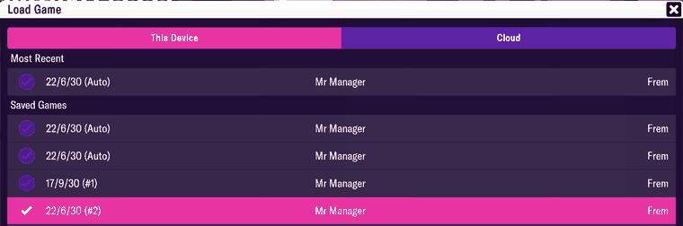

# save_header  ([`fmparser/tables/save_header.py`](../../fmparser/tables/save_header.py))

The save slot's title: the first 250 bytes of the file, NUL-padded text. It is the only
table with a fixed offset, and the first step `extract.py` runs.

## Layout

| offset | width | field | meaning | how we know |
|---|---|---|---|---|
| 0 | 250 | `title` | `"<d/m/yy> - <manager> (<club nickname>)"`, UTF-8, NUL-padded | read on every save; matches the Load Game screen (below) |

`read_save_header` splits the title with `^(\d{1,2})/(\d{1,2})/(\d{2}) - (.*) \(([^()]*)\)$`
into `date` (ISO, year `2000 + yy`), `manager` and `nickname`. When the title doesn't match
that pattern, or the date isn't a real calendar date, those three are `None` and `title` is
still returned.

## Evidence

`frem-2030-06-22`, Load Game screen. The highlighted row is the slot this file came from:

| on screen | raw bytes @ 0 | parsed |
|---|---|---|
| `22/6/30` | `32 32 2f 36 2f 33 30` | `date` = `2030-06-22` |
| `Mr Manager` | `… 20 2d 20 4d 72 20 4d 61 6e 61 67 65 72` (` - Mr Manager`) | `manager` = `Mr Manager` |
| `Frem` | `20 28 46 72 65 6d 29 00 …` (` (Frem)` then NULs) | `nickname` = `Frem` |

Tested by `tests/test_world_evidence.py` (needs the save) and, without a save,
`tests/test_save_header_unit.py`.

## Quirks

> **Quirk:** the slot label (`(Auto)`, `(#2)`) isn't in the title. Several saves can carry the
> same title (the screenshot shows three `22/6/30` slots), so a save's file name, not its
> title, is what tells two of them apart. Name files `<career>-<YYYY-MM-DD>[-<tag>].fms`.

> **Decision:** the header date is the snapshot's identity (`phase`), never the date of the
> last match: a player often plays on for weeks past the last fixture before saving. Which campaign it
> belongs to is the career's rollover rule, applied by the loader (`careers.campaign`), never
> by the parser.

## Output

Not a file of its own: `extract.py` writes `save_date` and `save_title` into
`output/<label>/summary.json`, and the loader takes the snapshot's `phase` from `save_date`.
