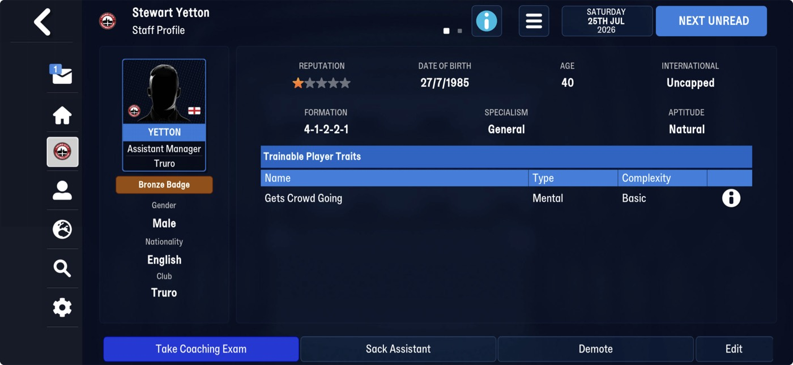
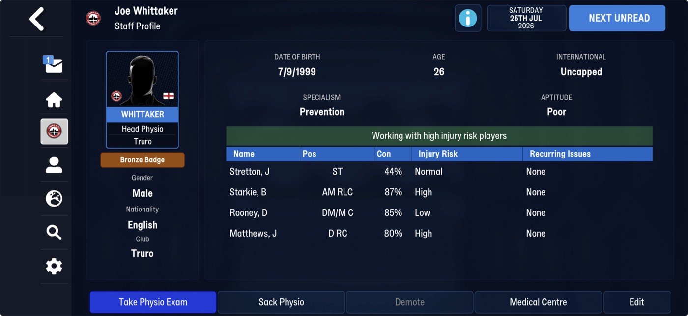
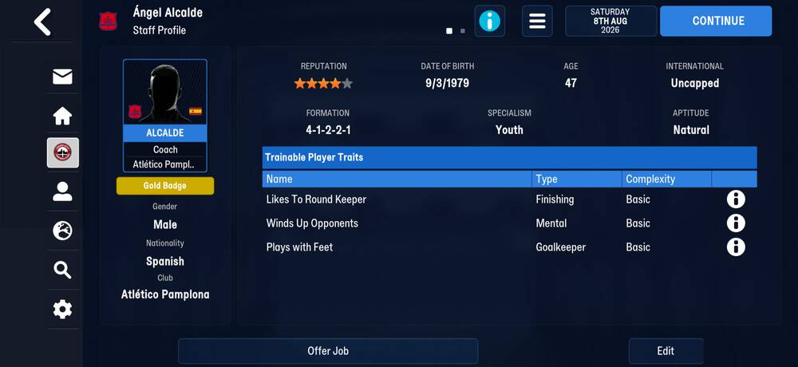
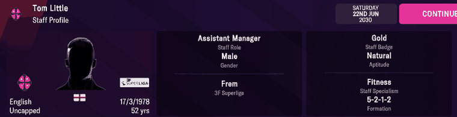
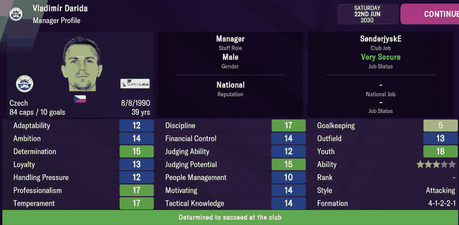
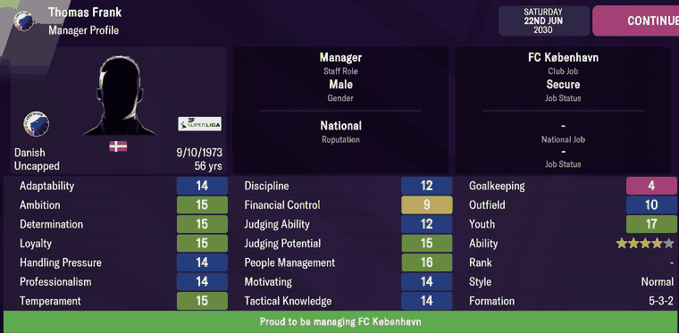
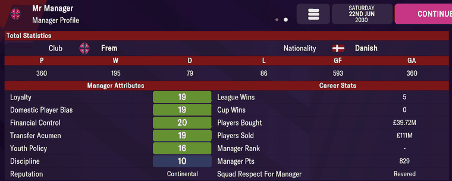

# staff  ([`fmparser/tables/staff.py`](../../fmparser/tables/staff.py))

Every staff member's coaching attributes, reputations and a manager's three formations
(preferred, attacking, defensive). A count-framed table of fixed 39-byte records,
`[8 × 0xFF][count u32]`, directly after [player_attributes](player_attributes.md), with
`id2 == slot index`. The count is a fixed pool per career: 6,212 on Truro (FMM27); on FMM22
4,642 on Frem, 5,697 on Bucaspor. A person reaches his record through `id2`
([person_info](person_info.md) +64). The module also reads the formation catalog
(`formation_catalog`), the 21 shapes the formation fields index. The record is the same on
both versions (fmm-editor's FMM26 `NonPlayer` is 39 bytes too); the catalog's order differs
(Layout, FMM22).

## Layout

The fields were checked against managers' profiles on FMM22 (Evidence, FMM22). On FMM27
`id2 == slot` holds on all 6,212 records of both Truro saves, every field sits in the same
range with the same median as on Frem (`formation_*` up to 20, the catalog's last index), and
Yetton's formation and reputation match his profile (Evidence).

| offset | field | type | meaning | how we know |
|---|---|---|---|---|
| +0 | `id2` | u32 | equals the slot index | every slot: 4,642 on Frem, 6,212 on each Truro save |
| +4 | `ca`, `pa` | 2 × u16 | ability; never shown (the immersion rule) | |
| +8 | `home_reputation` | u16 | | |
| +10 | `current_reputation` | u16 | | |
| +12 | `world_reputation` | u16 | sets the profile's Reputation: Regional, National, Continental. The code cuts at 3,000 and 5,900 (`reputation_tier`); the second edge is bracketed, not measured (Quirks) | nine managers |
| +14 | `attacking_intent` | u8 | hidden 1–20; sets the profile's Style: ≤ 7 Defensive, 8–13 Normal, ≥ 14 Attacking (`style`) | fourteen managers, both band edges |
| +15 | `financial_control` | u8 | 1–20 | seven managers |
| +16 | `outfield_coaching` | u8 | | |
| +17 | `goalkeeping_coaching` | u8 | 1–20, but 51–99 on 43 records of `frem-2030-06-22`, carried as stored (Quirks) | |
| +19 | `discipline` | u8 | | |
| +21 | `judging_ability` | u8 | | |
| +22 | `judging_potential` | u8 | | |
| +23 | `people_management` | u8 | | |
| +25 | `motivating` | u8 | | |
| +29 | `tactical_knowledge` | u8 | | |
| +30 | `youth_coaching` | u8 | | |
| +18, +20, +24, +26, +27, +28 | `hidden_s18` … `hidden_s28` | u8 | hidden 1–20, not identified; `hidden_s27` reads 1–4 on 96% of staff, the most distinctive of the six | |
| +31 | `formation_preferred` | u8 | index into its own save's formation catalog (FMM27: 2 = 4-1-2-2-1, 6 = 4-2-3-1, 13 = 4-4-2) | seven managers (FMM22); Yetton (FMM27) |
| +32 | `formation_attacking` | u8 | | |
| +33 | `formation_defensive` | u8 | | |
| +34 | | 5 × u8 | unnamed; values 0–19, near-unique per person, identical across saves | |

The formation catalog: 21 templates of 1,262 bytes, found by the marker `76 b9 f4 07` (the
name is ASCII at +20 of each). `formations.json` lists the names in catalog order. On FMM27
the order is alphabetical (0 3-4-3, 2 4-1-2-2-1, 6 4-2-3-1, 13 4-4-2, …), so a formation
index means something only against its own save's catalog, as `formations.json` provides.

The locator starts from player_attributes' last record (`player_attributes_end`), not from
`count × 78`, so it finds the end of FMM27's variable-length player_attributes table.

The profile's Specialism and Aptitude are not in this record: they are in the
[staff role](staff_roles.md) tables that follow it, reached from the person record.

### FMM22

The same 39-byte record. The formation catalog holds the same 21 shapes in another order:
0 4-4-2, 5 4-2-3-1, 17 5-2-1-2.

## Evidence

`truro-2026-07-25`. Stewart Yetton, Truro's assistant manager (tid 2832, `id2` 2368, staff
record at byte 8,622,923), and Joe Whittaker, the head physio (tid 38349):




| on screen | raw bytes | parsed |
|---|---|---|
| Yetton `Formation 4-1-2-2-1` | +31 `02 02 02` | `formation_preferred` 2 → catalog "4-1-2-2-1" (attacking and defensive the same) |
| Yetton Reputation ★ | +12 `60 04` | `world_reputation` 1120 → Regional (under 3,000) |
| Yetton `27/7/1985`, Whittaker `7/9/1999` | the person records | `dob` 1985-07-27, 1999-09-07 |
| Whittaker, a physio: no formation, no reputation | person `id2` `ff ff ff ff` | no staff record, as for a physio on FMM22 |

`truro-2026-08-08`, Ángel Alcalde, a coach at Atlético Pamplona with a Gold Badge (tid 29623,
`id2` 5443). Tested by `tests/test_screens_fmm27_evidence.py`.



| on screen | parsed |
|---|---|
| `9/3/1979`, Spanish, Atlético Pamplona | person `dob` 1979-03-09, `nationality_id` 170 (Spain), `club_tid` 907 |
| Formation `4-1-2-2-1` | `formation_preferred` 2 → catalog "4-1-2-2-1" |
| Reputation 4 stars (Yetton's 1) | `world_reputation` 5100 (Yetton 1120) |
| Gold Badge, Specialism Youth, Trainable Player Traits | not placed |

FMM27 shows the reputation as stars where FMM22 named a tier; two profiles do not fix the
star bands. The badge, the specialism and the trainable traits (Likes To Round Keeper,
Winds Up Opponents, Plays with Feet, each Basic) are not in the staff record's named fields.

### FMM22

The seven Danish Superliga managers' profiles of 25 Nov 2024, against `frem-2024-11-22`:
preferred formation, reputation tier and all ten coaching attributes exact for 7 of 7, and
the eight personality values on their [person_info](person_info.md) records byte for byte.
Seven more managers' Style was predicted from `attacking_intent` on `frem-2026-07-02`
before reading it in game, chosen to sit on the band edges: Peter Pedersen at 8 reads
Normal and Jon Dahl Tomasson at 14 reads Attacking. All seven matched. Both sets are the data in
`tests/test_staff_records.py`.

| manager (2024) | Style on screen | `attacking_intent` | Formation on screen | `formation_preferred` |
|---|---|---|---|---|
| Radoslav Látal (OB) | Defensive | 7 | 4-2-3-1 | 5 |
| Jesse Marsch (FCM) | Normal | 13 | 4-4-2 | 0 |
| Jess Thorup (FCK) | Attacking | 15 | 4-1-2-2-1 | 2 |

On `frem-2030-06-22`, Frem's Tom Little (Adingra's Training Report names him Assistant
Manager) has `id2` 3137, record at byte 6,157,665:

```
41 0c 00 00  6e 00 b4 00  f8 11 f8 11 fc 08  03 06 03 02 0e 0f 0d 0a 0a 05 0a 0c 13 08 12 04 08  11 11 11  0e 0a 11 07 02
```

`attacking_intent` 3 (Defensive), formations 17 / 17 / 17 (5-2-1-2), world reputation
2,300 (Regional). His Staff Profile shows Formation 5-2-1-2, born 17/3/1978, English:



Jens-Jakob Sørensen's shows 4-1-2-2-1 (`formation_preferred` 2). Two managers' full profiles:




| on screen | Darida (tid 9069) | Frank (tid 9140) |
|---|---|---|
| Discipline, Financial Control, Judging Ability, Judging Potential | 17, 14, 12, 15 | 12, 9, 12, 15 |
| People Management, Motivating, Tactical Knowledge | 10, 14, 14 | 16, 14, 14 |
| Goalkeeping, Outfield, Youth | 5, 13, 18 | 4, 10, 17 |
| Style | Attacking (`attacking_intent` 20) | Normal (12) |
| Formation | 4-1-2-2-1 (`formation_preferred` 2) | 5-3-2 (19; attacking 4-2-3-1, defensive 5-3-2) |
| Reputation | National (`world_reputation` 4,996) | **National** (5,857) |
| Adaptability … Temperament (on [person_info](person_info.md)) | 12 14 15 13 12 17 17 | 14 15 15 15 14 14 15 |
| Czech, 84 caps / 10 goals, 8/8/1990 | nationality 137, caps 84, goals 10 | Danish, uncapped, 9/10/1973 |

Every value on both screens matches.

## Quirks

> **Decision:** the six hidden staff attributes stay named by offset (`hidden_s18` …): fmm-editor
> has no `Staff.cs` to borrow an order from, and there is no ground truth of our own. Guessing a
> name is how a Style candidate was once picked wrongly.

> **Quirk:** Style is derived, not stored. The record's 39-byte extent leaves no room for a
> three-valued field, and the bands on `attacking_intent` predicted fourteen managers'
> Style. `corr(attacking_intent, world_reputation)` is +0.12 on `frem-2030-06-22`, so it is not
> quality in disguise.

> **Quirk:** the club record's staff array lists the coaches but not the manager. The manager
> is the club's staff member missing from it ([clubs](clubs.md)); Frem has none in the list
> because we manage it.

> **Quirk:** 43 records on `frem-2030-06-22` read 51–99 at +17 (`goalkeeping_coaching`). They
> belong to retired goalkeepers such as Ben Foster and Tom Heaton, most of them free agents.
> The extract keeps every record and carries the value as stored, so `staff_records.json`
> holds all 4,642 records. +17 may mean something else for these 43; that is not named yet.
> Don't read their 51–99 as a 1–20 coaching rating.

> **Dead end:** formation and Style are not in the person record or anywhere near it. Exact,
> nibble and single-bit searches for 16 managers' Style, and for 9 managers' formations as an
> index, a name or an 11-slot position vector, found nothing within ±20,000 bytes. They are
> in this separate table, reached by `id2`.

> **Quirk:** the National/Continental edge is bracketed, not measured. Thomas Frank reads
> 5,857 and his profile says National; Thorup (2024) read 5,974 and said Continental. The edge
> lies in 5,858–5,974 and the code cuts at 5,900, so the eleven staff on `frem-2030-06-22`
> between 5,858 and 5,974 may be one tier out. A profile in that band would pin it.

> **Dead end:** the user's own manager's attributes are not in his staff record. Mr Manager's
> profile shows Loyalty 19, Domestic Player Bias 19, Financial Control 20, Transfer Acumen 19,
> Youth Policy 16; his staff record and personality block read 10 throughout. Only Discipline
> (10) and the Continental reputation (6,964) match.
>
> 

> **Dead end:** Job Status and the manager Rank are not located.

## Output

`output/<label>/staff_records.json`: one row per record in table order (the derived
`reputation_tier` and `style` are left out), loaded into `raw.staff_records`.
`output/<label>/formations.json`: the 21 catalog names, loaded into `raw.formations`.
