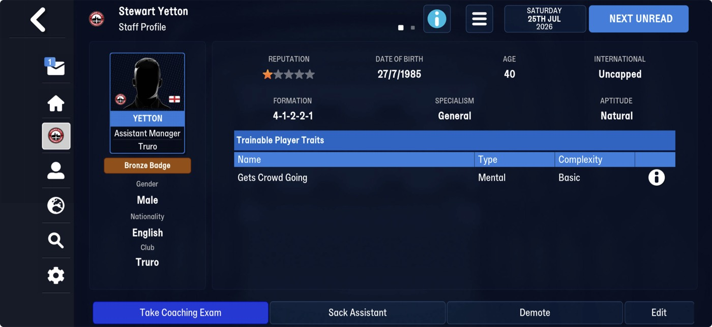
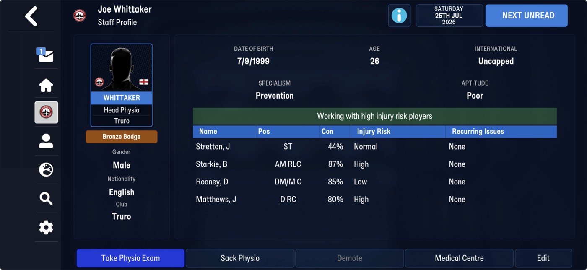

# staff_roles  ([`fmparser/tables/staff_roles.py`](../../fmparser/tables/staff_roles.py))

A member of staff's role record: his **Specialism** and **Aptitude**, as the Staff Profile
shows them. Three tables, one per role (coaches, scouts, physios), stored straight after
[staff](staff.md) and before [officials](officials.md), each count-framed,
`[>= 8 × ff][count u32]`, with `id == slot index`. The same 7-byte record on FMM22 and
FMM27 (fmm-editor's FMM26 `Coach`):

| | Frem | Bucaspor | Truro (FMM27) |
|---|---|---|---|
| coaches | 1,971 | 2,603 | 2,841 |
| scouts | 560 | 560 | 772 |
| physios | 816 | 796 | 1,157 |

## Layout

| offset | field | type | meaning | how we know |
|---|---|---|---|---|
| +0 | `id` | u32 | equals the slot index | every row, three careers |
| +4 | `specialism` | u8 | a code per role: coach 1 General; physio 2 Prevention. Coaches use 1–7, scouts 1–4, physios 1–2 | two Staff Profiles |
| +5 | | u8 | unnamed, 1–3; 1 on both Bronze Badge profiles, so probably the badge | two profiles, both Bronze |
| +6 | `aptitude` | u8 | 1 Poor, 3 Natural (2 not yet seen on screen); 255 on the user | two Staff Profiles |

**The link is the person's.** The [person record](person_info.md) holds `coach_row`,
`scout_row` and `physio_row` (FMM22 also `official_row`), `0xffffffff` when he has none.
Every pointer is in range and no row is pointed at twice; on Truro every row has its person,
on Frem two coach and two scout rows have none. An AI club's manager has no coach row; the
user has one.

**How it is found.** From the staff table's end (`locate_staff`), three frames in a row
(`after_frame`), and the walk must read each declared count.

## Evidence

`truro-2026-07-25`. Stewart Yetton (tid 2832), Truro's assistant manager, and Joe Whittaker
(tid 38349), its head physio:

| on screen | the person's pointers | the row | parsed |
|---|---|---|---|
| Yetton `General`, `Natural`, Bronze Badge | `coach_row` 868 | coaches 868: `64 03 00 00 01 01 03` | `specialism` 1, `aptitude` 3 |
| Whittaker `Prevention`, `Poor`, Bronze Badge | `physio_row` 943 | physios 943: `af 03 00 00 02 01 01` | `specialism` 2, `aptitude` 1 |

Torquay's staff, against its Staff screen: Darren Way, Kenny Griffiths and Heiko Plischke
have coach rows, Michael MacNeill a scout row, Regan Miles a physio row; the manager, Jimmy
Ball, none. Tested by `tests/test_reference_fmm27_evidence.py`.

## Quirks

> **Lead:** the other specialism codes (coach 2–7, scout 1–4, physio 1) and aptitude 2 are
> to name from more Staff Profiles; one with a Silver or Gold Badge would name +5.

## Output

`output/<label>/staff_roles.json`, `{coaches, scouts, physios}`: each a list of rows in slot
order, `{id, tid, specialism, aptitude}`, where `tid` is the person who points at the row
(`null` when nobody does). Not loaded yet.
