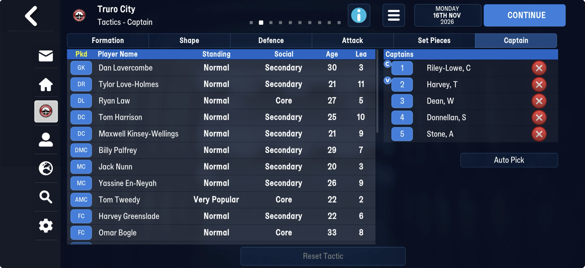

# team_selections  ([`fmparser/tables/team_selections.py`](../../fmparser/tables/team_selections.py))

**Every team's matchday squad**: the XI in its formation's slot order, the substitutes and,
on FMM27, the captains. One slot per team, slot k = team tid k, both games. `extract.py`
writes `team_selections.json`: every team with a place filled, its `team_tid`, the u8 in
front (`unknown_0`) and `places`, None for an empty one.

| save | slots | filled |
|---|---|---|
| truro-2026-07-22 / 07-25 / 08-08 / 11-16 | 17,804 × 105 B | 581 / 652 / 696 / 1,362 |
| frem-2021-06-27 / 2023-07-02 / 2026-06-11 / 2030-06-22 / 2030-06-30 | 14,506 × 589 B | 567 / 1,228 / 1,375 / 1,415 / 1,317 |
| bucaspor-2023-04-01 | 15,288 × 589 B | 1,428 |

Straight after the [formations](formations.md), up to a 3.9 KB [tail](unread/rf_tail.md)
before the [contract grid](contracts.md). Most of what FMM22's save map called 9 MB of filler
is this table's empty slots.

## Layout

`[u16 count][count × slot]`:

| | FMM27 | FMM22 |
|---|---|---|
| slot | 105 B = `[u8][26 × u32 tid]` | 589 B = `[u8][147 × u32 tid]` |

`ffffffff` is an empty place; a team that has not picked a side has every place empty.

**FMM27's 26 places:**

| places | what |
|---|---|
| 0–10 | the starting XI in the tactic's slot order: place i stands at the formation's position code i ([formations](formations.md)) |
| 11–15 | the five substitutes |
| 16–19 | four more: empty for Truro, set on most teams' slots; not named |
| 20–25 | the captains: the captain on the pitch, then the Captain screen's five in order |

**FMM22's 147**: filled slots hold 14, 18 or 20 tids at the front (226, 132 and 85 slots on
frem-2026-06-11), a few a single tid further in. Not checked against a screen.

The u8 in front: 14 on Truro's slot; 0, 2, 6, 8, 15, 16, 17 across others. Not named.

The slot does not say which formation the team plays. The opposing manager's preferred
formation is in [staff](staff.md) (`formation_preferred`, an index into the formations);
whether a team's current tactic is stored elsewhere is open.

## Evidence

truro-2026-11-16, Truro's slot against the Tactics – Captain screen: the eleven starters and
five substitutes in the screen's order, the four empty places, then Bogle (on the pitch) and
the five captains in order. Placed at their tactic's codes, the full-backs stand on the right
side (Love-Holmes, a right-back, at `0804`; Law, a left-back, at `0084`). 1,321 of the 1,362
filled slots that day hold only players in team k's squad array ([clubs](clubs.md)), the rest
a player who has since left (1,331 of 1,375 on frem-2026-06-11).
`tests/test_team_selections_evidence.py` pins the slot's bytes.

## How it is found

The u16 straight after the last [formation](formations.md) is the count. The locator
refuses the pool unless every place of every slot is empty or a u16-sized tid (people
created during a career have tids above the person index's count: 13 places on
bucaspor-2023-04-01), and the slots end before the contract grid. The count is fixed for a
career.

## Next

1. A team's lineup screen on the day of a save: confirm the order for another club, the
   inside lanes, and what places 16–19 hold.
2. FMM22's 147 places against a Frem screen.
3. Load it: each opponent's likely XI by position for scouting (TODO).
