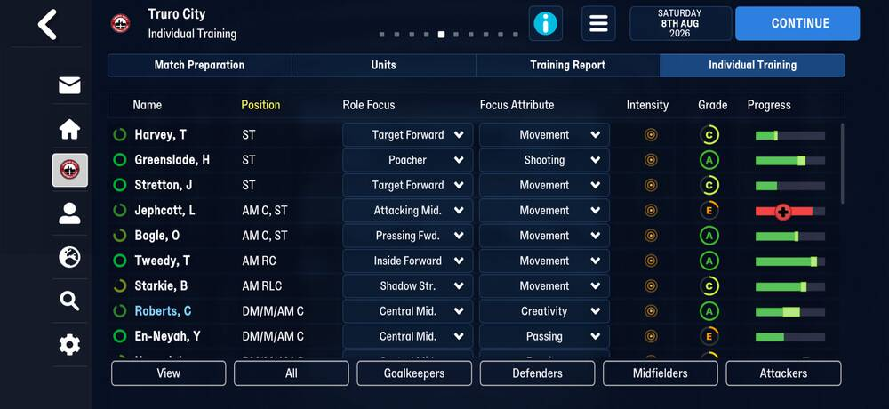
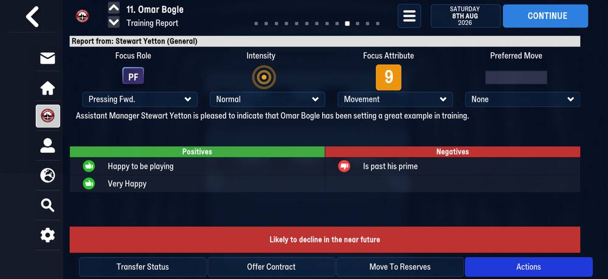
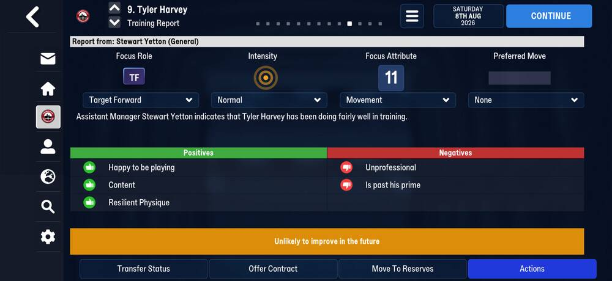
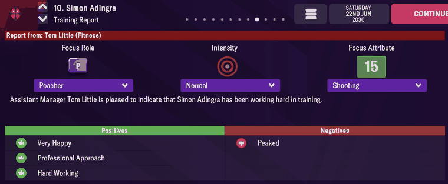
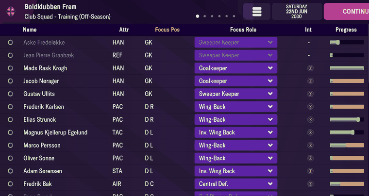
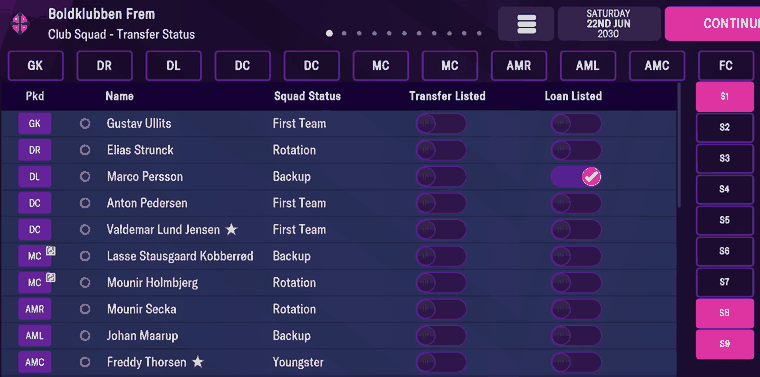

# training  ([`fmparser/tables/training.py`](../../fmparser/tables/training.py))

Every player's training focus (role, position, attribute, intensity), plus a contract flag
and an unnamed byte at +39 (`unknown_39`; it is not the squad status). One fixed 61-byte row per person, `[count u32][rows]`, ~1.03 MB
after the [player_progress](player_progress.md) pool (57,955,534 on `truro-2026-07-25`). The
count is the person count, the same as [person_info](person_info.md)'s (44,960 on Truro), and
row k belongs to tid k: 36,250 player rows on Truro. The row is the same on both versions.

## Layout

The fields were read off Training screens on FMM22 (Evidence, FMM22). On FMM27 every field
reads where FMM22 has it (Evidence); that the role and attribute codes mean the same is not
yet checked on an FMM27 screen.

| offset | field | type | meaning | how we know |
|---|---|---|---|---|
| +0 | `tid` | u32 | equals the row index; `0xFFFFFFFF` = an unused row (1,973 on `frem-2030-06-22`) | |
| +4 | `uid` | u32 | | equals the person's uid |
| +8 | | u8 | unnamed | |
| +9, +13 | | 2 × u32 | unnamed (Adingra: 100,000 and 95,094) | |
| +17 | | u32 | unnamed; not the Progress bar's green fill (Strunck's and Liburd's bars are green and read 0) | |
| +21 | `intensity` | u16 | 3 high (the red icon), 2 normal; 1 and 0 also occur | the Training list, 37 of 37 rows |
| +23 | `focus_role` | u16 | Focus Role, a role id (`seeds/roles.csv`); `0xFFFF` on staff | 37 of 37 |
| +25 | | u16 | 0 on a player, `0xFFFF` on staff | |
| +27 | `focus_attribute` | u16 | the Attr column, a code (`seeds/training_attributes.csv`) | 37 of 37 |
| +29 | `focus_band`, `focus_column` | 2 × u8 | Focus Pos, the pitch pair the match slots use (`core.primitives.pitch_position`) | 37 of 37 |
| +31 | | 6 B | unnamed: three u16 | |
| +37 | `contracted` | u8 | `0x87` on a player under contract; 0 on a free agent and on every member of staff | |
| +38 | | u8 | 0 on every row read | |
| +39 | `unknown_39` | u8 | unnamed: **not** the squad status (Quirks). 171 on most of Frem's squad; 164, 136 and 125 on others | the Transfer Status screen |
| +40 | | 21 B | unnamed; from +49, three `[day-of-year u16][year u16]` dates | |

### FMM22

The same row. The count is 32,966 on Frem and 34,312 on Bucaspor, and the table sits
758,222 bytes after the progress pool on every Frem save.

## Evidence

`truro-2026-07-25`: Omar Bogle (6588) has intensity 2, focus role 24, attribute focus 13,
Focus Pos ST and `contracted` `87`; his scrapbook entry's role is also 24
([player_lists](player_lists.md)). Staff rows (Stewart Yetton, 2832) have role `ffff`.
Tested by `tests/test_career_fmm27_evidence.py`.

`truro-2026-08-08`, Individual Training and two training reports. Tested by
`tests/test_screens_fmm27_evidence.py`.





| on screen | parsed `focus_role`, `focus_attribute`, `intensity` |
|---|---|
| Harvey, Stretton: Target Forward, Movement | 20, 13, 2 |
| Greenslade: Poacher, Shooting | 19, 4, 2 |
| Jephcott: Attacking Mid., Movement | 33, 13, 2 |
| Bogle: Pressing Fwd., Movement | 24, 13, 2 |
| Tweedy: Inside Forward, Movement | 13, 13, 2 |
| Starkie: Shadow Str., Movement | 27, 13, 2 |
| Roberts: Central Mid., Creativity | 14, 11, 2 |
| En-Neyah: Central Mid., Passing | 14, 3, 2 |

Every row shows Normal intensity: `intensity` 2. **The attribute codes are FMM22's**
(`seeds/training_attributes.csv`: 3 PAS, 4 SHO, 11 CRE, 13 MOV). **The role codes are not.**
Against `seeds/roles.csv` (FMM22) each is one higher from Inside Forward to Shadow Striker
(FMM22 12 IF, 13 CM, 18 Poacher, 19 TF, 23 PF, 26 SS) and Attacking Midfielder is two higher
(31 → 33): FMM27 has a role before Inside Forward and another between Shadow Striker and
Attacking Midfielder that FMM22 lacks. Which roles those are needs a screen of a defender's
or a wide player's focus role, and an FMM27 role seed.

### FMM22

`frem-2030-06-22`. Simon Adingra's Training Report; his row (tid 26552) at byte 54,923,658:



```
b8 67 00 00  5d dd 35 77  1d  a0 86 01 00  76 73 01 00  00 00 00 00
02 00  12 00  00 00  04 00  40 02  a4 00 ab 00 c3 00  87  00  ab  …
```

| on screen | raw bytes | parsed |
|---|---|---|
| Focus Role `Poacher` | +23 `12 00` | `focus_role` 18 = Poacher |
| Intensity `Normal` | +21 `02 00` | `intensity` 2 |
| Focus Attribute `Shooting` | +27 `04 00` | `focus_attribute` 4 |
| (his position, striker) | +29 `40 02` | `focus_position` ST |
| (under contract) | +37 `87`, +39 `ab` | `contracted`, `unknown_39` 171 (not the squad status, see Quirks) |

Frem's whole Club Squad → Training list (37 rows, reserves and loanees included). Every row's
Attr, Focus Pos, Focus Role and intensity is what the row stores; the two red intensity icons
(Kobberrød and Thorsen) are `intensity` 3. A loanee's intensity shows `-` and stores 2.



The Focus Role is the role a [player_lists](player_lists.md) entry carries:
Adingra's entry for this season reads role 18, Lund Jensen's 6 (Ball Playing Defender) and
Ullits' 1 (Sweeper Keeper), the roles their profiles show. Tested by
`tests/test_people_evidence.py`.

## Quirks

> **Quirk:** +39 (`unknown_39`) is not the squad status, so it is named by its offset. Club Squad → Transfer Status
> lists First Team (Ullits, Pedersen, Lund Jensen), Rotation (Strunck, Holmbjerg, Secka),
> Backup (Persson, Kobberrød, Maarup) and Youngster (Thorsen): all ten read 171. The players
> who read something else (Mattias Jakobsen 136, Victor Jensen 125, Jagvir Sidhu 164) all
> signed in 2030. The field is renamed `unknown_39` through raw, stg and
> `mart.fact_player_state_scd` / `fact_player_snapshot`. Where the squad status is stored is
> open in TODO as "Squad status is not located".
>
> 

> **Quirk:** `unknown_39` is not a loan flag either. Frem's seven players out on loan (marked
> unavailable on the reserves' Contract screen and flagged in [player_progress](player_progress.md))
> read 164 on six rows and 171 on Mike Kieffer, the same 171 as First Team. On
> `bucaspor-2022-06-19` six loaned-out reserves read 65 (`LOAN_STATUS`, tested by
> `tests/test_ground_truth.py`), but the code does not carry across saves. Loans come from
> [player_progress](player_progress.md).

> **Quirk:** `seeds/training_attributes.csv` names only the codes read off the Training list:
> 1, 3–6, 8, 9, 11–14 and 17–19 (4 SHO, 12 DEC and 13 MOV hold 1,725, 985 and 5,053 players
> on this save). Codes 0, 2, 10 and 15 are stored but not yet named (TODO, "Training table: the unread bytes and codes").

> **Decision:** staff rows (no Focus Role) and unused rows are dropped by `scrape_training`;
> every player's row is kept, our squad's or not.

## Output

`output/<label>/training.json`: one row per player in tid order (`tid, intensity,
focus_role, focus_attribute, focus_position, contracted, unknown_39`), loaded into
`raw.training`.
