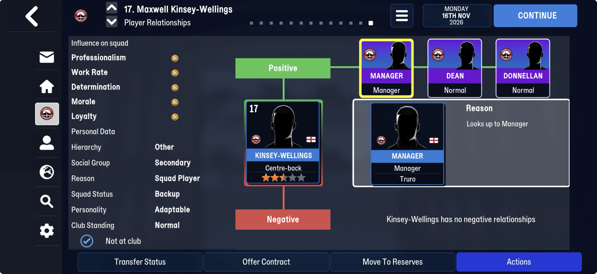
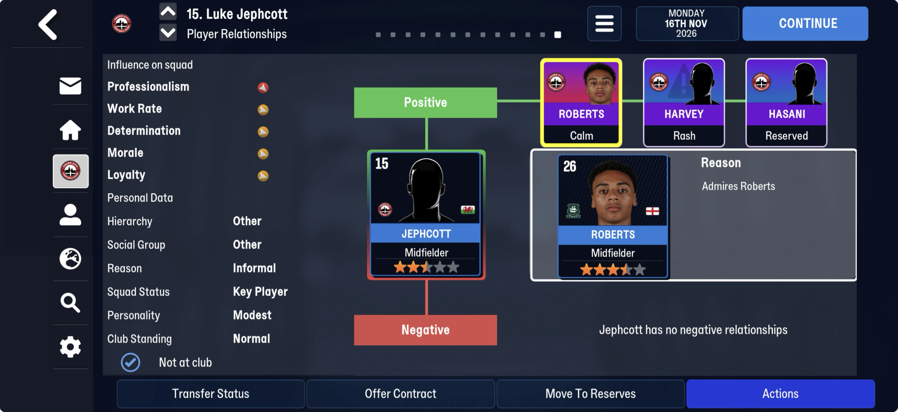

# The user's club block (around the tactic history and club titles)

The tables [tactic history](../tactic_history.md), [club seasons](../club_seasons.md) and
[club titles](../club_titles.md) sit in a block that belongs to the user's club, after the
[person stamps](../person_stamps.md). Two parts of that block are unread.

## 1. In front of the tactic history

| | size |
|---|---|
| FMM22 | 148 B (60 + 4 + 6 × 14) |
| FMM27 | 64 B (60 + 4, no entries) |

- **60 bytes**: the first byte 0 or 1 (0 on frem-2021-06-27 and Bucaspor, 1 on every Truro
  save and later Frem ones); on Frem `03 01 01 01` at
  +9 where Truro has zeros; `ff` × 27–30; and at +40 a u64 that is money-sized
  (38,400,000,000 Truro, 18,240,000,003 Frem). A budget in some unit is the guess.
- **`[u32 n][n × 14 B]`**: 6 entries on Frem, 3 on Bucaspor, none on Truro. Each is a person's
  tid and 10 bytes; Frem's tids include 9328, 29576, 10404, with a small number each (3, 9, 0,
  12, 7, 5). The Tactics screen's **Set Pieces** and **Captain** tabs are the lead: takers and
  captains are people, set per tactic.

**Next:** screenshots of the Set Pieces and Captain tabs on a day a save is taken.

## 2. After the club titles

Now its own page: [the block after the club titles](end_block.md), ten framed tables on FMM27.

## Found on truro-2026-11-16 (first mid-season FMM27 save)

- **The 14-byte entries in front of the tactic history** hold 17 Truro players, each
  `[tid u32][0][position u8][0][6][6 × 0]`, the position code being his best (rated 20) one:
  DC 3, DMC 5, MC 7, AMC 10, AMR 11, ST 12, as the training table spells them. Not the
  takers, the captains or the training focus (keepers, full-backs, Nunn and Jephcott are
  missing). Open.
- **Per-player match lines of our matches**: read: [player_form](../player_form.md).
- **Relationships** (the screens below) are not found yet: Kinsey-Wellings's Manager, Dean
  and Donnellan and Jephcott's Roberts, Harvey and Hasani do not sit together as tids
  anywhere obvious.

