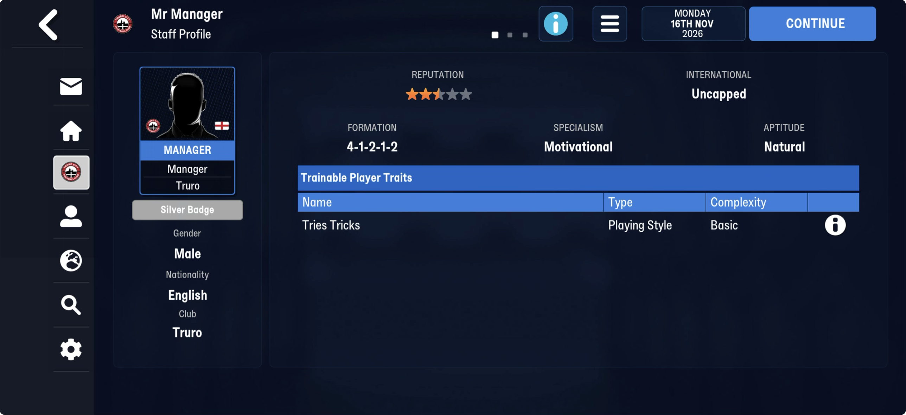
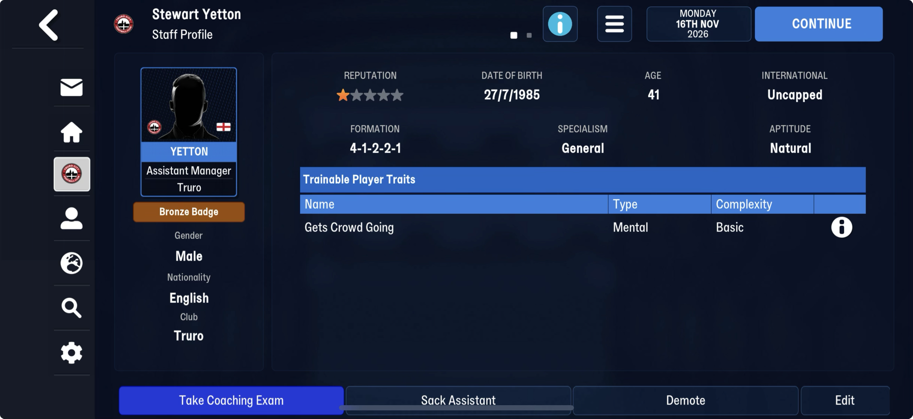
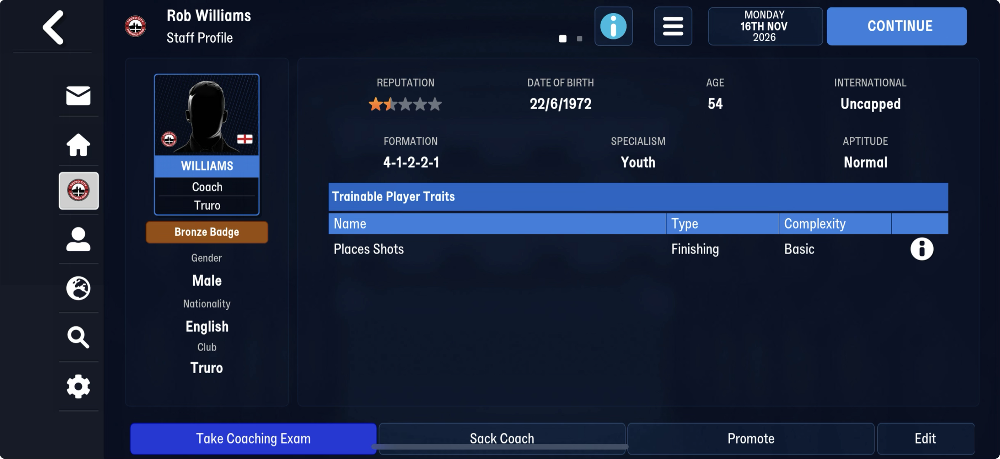

# A slot pool sized by the coach count (block table 7)

Part of [the block after the club titles](end_block.md). FMM27, at block offset 2,632,424 on
truro-2026-11-16: `[u32 cap][cap × 32 B]`.

| save | cap | used slots |
|---|---|---|
| 22 Jul | 5,682 | 0 |
| 25 Jul | 2,841 | 0 |
| 8 Aug | 2,841 | 55 |
| 16 Nov | 5,682 | 71 |

## Known

- `cap` is the coach count (2,841, [staff_roles](../staff_roles.md)) or exactly twice it,
  switching between saves.
- An empty slot is `ff × 32`. A used slot is `ff ff [u32][u16 318 or 319]` then `ff`: on
  16 Nov slot 2874 holds 25360 and 318, slot 2963 holds 8809 and 319.
- Where the used slots sit follows the capacity: slots 50–2,840 on 8 Aug (cap 2,841),
  2,874–5,662 on 16 Nov (cap 5,682, the second half only). A pool that doubles and uses one
  half at a time, perhaps.

**Slot k is coach k, and a used slot is the player he is working with.** On 16 Nov, 56 of
the 71 used slots name a player at the coach's own club (42 of 55 on 8 Aug; the rest have
probably moved), and the u16 after the player is a day of the year two days before the
save: 318/319 on 16 Nov (day 320), 218/219 on 8 Aug (day 220). A recent assignment,
refreshed. On the doubled capacity, slot k + 2,841 is coach k again (16 Nov uses only that
half). Truro's three coaches (Yetton 868, Williams 1397, the manager 1427) have empty slots
on both saves; none of them is working with a player.

The traits a coach can teach (FMM27's Trainable Player Traits: the manager's Tries Tricks,
Yetton's Gets Crowd Going, Williams's Places Shots) are not in the slot; they are stored
somewhere else, not yet found.

## Next

Set one of Truro's coaches to work with a player (train a trait) and save: his slot should
fill with that player and the day. Find the coaches' teachable traits.
