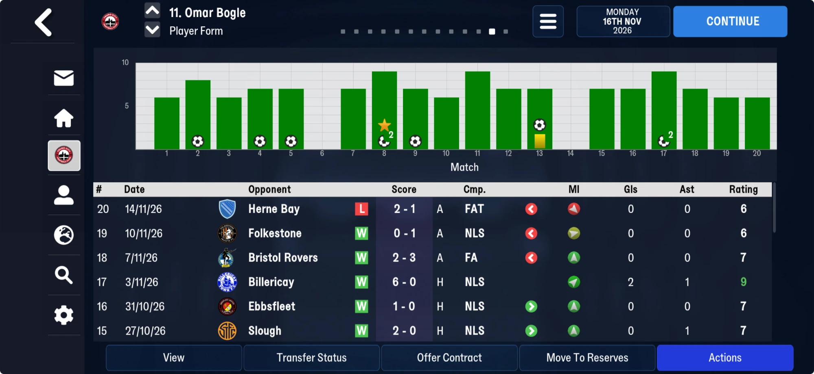

# Per-player lines of our matches: the Player Form page (block table 4)

Part of [the block after the club titles](end_block.md). FMM27, at block offset 1,253:
`[u16 n][n × 26 B]`, then one byte `00`.

| save | lines |
|---|---|
| 22 Jul, 25 Jul | 0 (friendlies only so far) |
| 8 Aug | 27: the league opener, both squads |
| 16 Nov | 548: 20 competitive matches |

## Known

One line per player per competitive match of the managed club, both sides (ours and the
opponents'; not the rest of the world). **It is the Player Form page**: Omar Bogle has 20
lines, the 20 matches of his form page in order, and every column agrees (below).

| offset | type | what |
|---|---|---|
| +0 | u32 | the player's tid |
| +4 | u16 | the opponent (Herne Bay 2424 for Truro's lines; Truro for theirs) |
| +6 | u8 | 2 or 3 |
| +7 | u24 | a match id, counting up (`dc d4 0f` = 1,037,532 for 8 Aug) |
| +10 | u16 | the player's club |
| +12 | 6 B | 0 on most lines; a byte 1 or 8 at +14 on a few |
| +18 | u8 | morale at the match, 1–20: the form page's MI arrow (equal to `player_status.morale` on 8 Aug for all 27) |
| +19 | u8 | the match rating; 0 when he did not play |
| +20 | u8 | goals, or goals conceded on a goalkeeper's line |
| +21 | u8 | assists |
| +22 | u8 | 1 = player of the match (the chart's star) |
| +23 | u8 | yellow cards |
| +24 | u8 | 0 on lines measured |
| +25 | u8 | 9 came on (green arrow), 10 went off (red arrow); 4 once (Bogle at Dover, with a yellow and a goal) and 16 once (Love-Holmes, a yellow and off) |

**Example** (16 Nov, Truro at Herne Bay on 14 Nov, lost 1-2): En-Neyah rating 7, goals 1;
Greenslade rating 8, assists 1; Lavercombe rating 6, conceded 2; Love-Holmes yellow 1, went
off; Jephcott, Bell and Matthews came on (9); Bogle and Harrison went off (10).

**Bogle's form page, 16 Nov** (matches 15–20 on screen, the chart for 1–20): Herne Bay
rating 6, off (10), morale 6 (red arrow); Folkestone 6, off, 14 (yellow); Bristol Rovers 7,
off, 20 (green); Billericay 9, 2 goals 1 assist, 17; Ebbsfleet 7, came on (9), 20; Slough 7,
1 assist, came on, 20. Matches 6 and 14 (no bar) read rating 0; match 8, the starred bar,
reads 2 goals and player of the match; match 13, the yellow card, reads 1 at +23.

These are separate bytes from the [match table](../matches.md) (which ends before the person
stamps) and hold less: a summary of what it already reads in full.

## Next

Name +6 (2 or 3: not home/away, not the competition), +12–17 (a byte 1 or 8 at +14 on a
few lines) and +25's 4 and 16 (a red card? an injury?). Then read it as a table: it gives
the form page of every player who played against us too.
