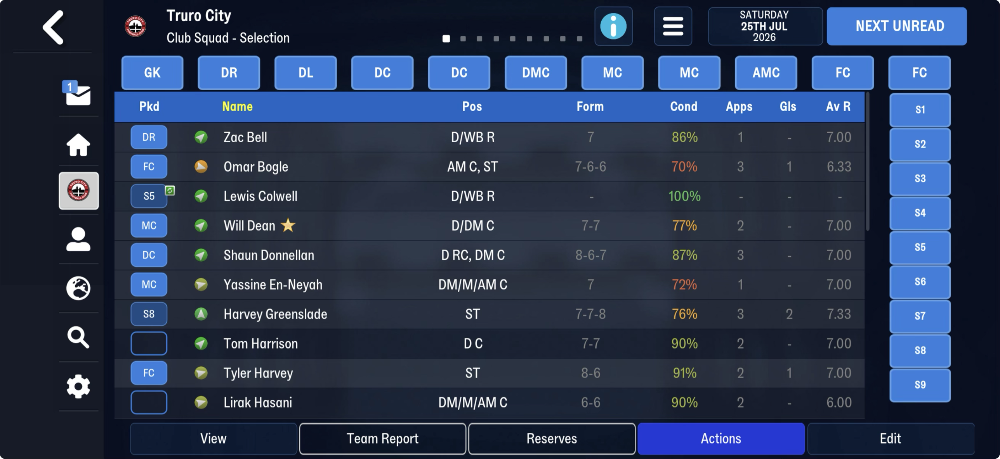
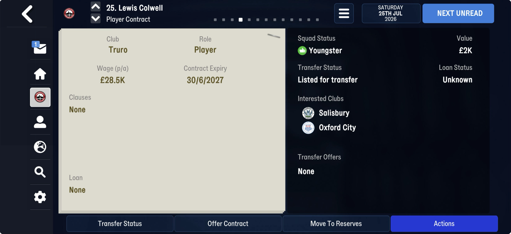

# The per-person chain (per-person rows → rule files)

| | from | to | size | still unread |
|---|---|---|---|---|
| FMM22 (frem-2026-06-11) | 14,441,326 | 16,752,549 | 2.31 MB | 15,083,143 → 16,752,549, 1.67 MB |
| FMM27 (truro-2026-08-08) | 17,158,293 | 22,951,767 | 5.79 MB | 18,593,817 → 22,951,767, 4.36 MB |

A chain of counted blocks with no `0xFF` frames, which is why frame searches found nothing
here. Each block is one row per entity of a table we already read, and each walk lands
exactly on the next block's count:

| link | count | row | read by |
|---|---|---|---|
| 1 | u32 = persons | 14 / 15 B | [person_index](../person_index.md) |
| 2 | u16 = staff | 8 B | [staff_rows](../staff_rows.md) |
| 3 | u16 = clubs | 51 / 132 B, + 66 / 68 B when flagged | [club_rows](../club_rows.md) |
| 4 | u16 = players (attribute records) | variable | **not read** (below) |

## Link 4: one block per player

Counted by the player-attribute count (26,505 on Frem, 36,344 on Truro), from where the club
rows end. Described from frem-2026-06-11 (FMM22).

### Known

- **Rows vary in length**, so no fixed width lands. A date reading 1 January 2000
  (`01 00 d0 07`, the save's "no date") recurs every 59 bytes on most rows and serves as an
  anchor: between two anchors, 2,226 of 3,000 sampled rows are 59 bytes, 476 are 64, 113 are 69.
- **The plain row (59 bytes), read from the anchor:** `[date][6 B][7 × u16]` (`ffff` = empty,
  a few hold ids such as 195 or 0x01d5), then **six u8 of 1–20 or `ff`** (`0d 07 05 08 07 07`),
  then `[4 B: a u32 or ffffffff][u8 0][u8 n][n items][u32][15 B]`, then the next row's date.
- **The items:** 5 bytes, `[00][u8 a][00][u8 b][u8 c]` (a 23–35, b small). An item whose first
  byte is 1 is 7 bytes (`01 [a] 00 16 00 00 00`, b always 22). Each extra 5 or 7 bytes matches
  the length past 59 on every plain row sampled.
- **A rich row:** where the byte before `n` is 1 (about one row in 20), the row carries more,
  with dates in 2025 and 2026 (`e9 07`, `ea 07`), club-sized u16s and runs of `ff`, which looks
  like contract or transfer state. Its layout is not worked out, and it is what stops the walk.

### Confirmed on truro-2026-07-25 (FMM27)

On FMM27 every block holds exactly one `01 00 d0 07` date: 36,344 of them for 36,344 players,
none closer than 119 bytes and none further than 175, so block k is attribute record k. The
seven u16 start 70 bytes after the previous block's date (block 0: 10 bytes into the block).

- **The seven u16 are the clubs interested in him** (`ffff` = empty). Lewis Colwell's block
  names Salisbury and Oxford City; his Player Contract screen lists exactly those two under
  **Interested Clubs**. 1,385 players have at least one. Some name their own club (Haaland,
  Saka, Kimmich): not yet explained.
- **The five u8 after the first of the six are his Form**, the last five match ratings, most
  recent last, `ff` for no match. Against the Club Squad screen, all ten players shown agree:
  Bogle 7-6-6, Donnellan 8-6-7, Greenslade 7-7-8, Harvey 8-6, Hasani 6-6, Dean 7-7,
  Harrison 7-7, Bell 7, En-Neyah 7, and Colwell (no matches) all `ff`.
- **The first of the six (10-20) is morale**, the arrow beside each name on the Club Squad
  screen, and not condition (Greenslade 20 at 76%, Colwell 16 at 100%). It orders the arrows
  exactly: 20, Greenslade, green arrow straight up; 16-17 (Bell, Colwell, Dean, Donnellan,
  Harrison) green, up and right; 12-13 (En-Neyah, Harvey, Hasani) yellow, flat; 11 (Bogle)
  orange, down and right. Where the bands split between 13 and 16 is not yet seen.

### Next

1. Read the FMM27 blocks as a table (the date anchors them; the walk still needs each block's
   own length rule), with `interested_clubs` and `form` named.
2. Decode the rich row: line a dozen up by their dates and find the counted lists inside.
2. Walk all 26,505 / 36,344 blocks and prove the landing on the next count, on both games.
3. Pin morale's bands: a squad with a 14, a 15 and a red arrow.

## Evidence that would help

A save from the same day as a squad screen (form, morale, ratings), and the same player's
profile in two saves either side of a match.

## Tried

- **The staff block as 12-byte rows** (before link 2 was read): it landed on a u32 of 2 on
  FMM27 and on 896,000 on FMM22. The rows are 8 bytes and start two bytes after a u16 count.
- **A greedy walk on FMM27** (6,212 × 12 → 2 × 169 → …) picked whichever width landed on a
  small number; none of it survived once the counts were matched to tables.
