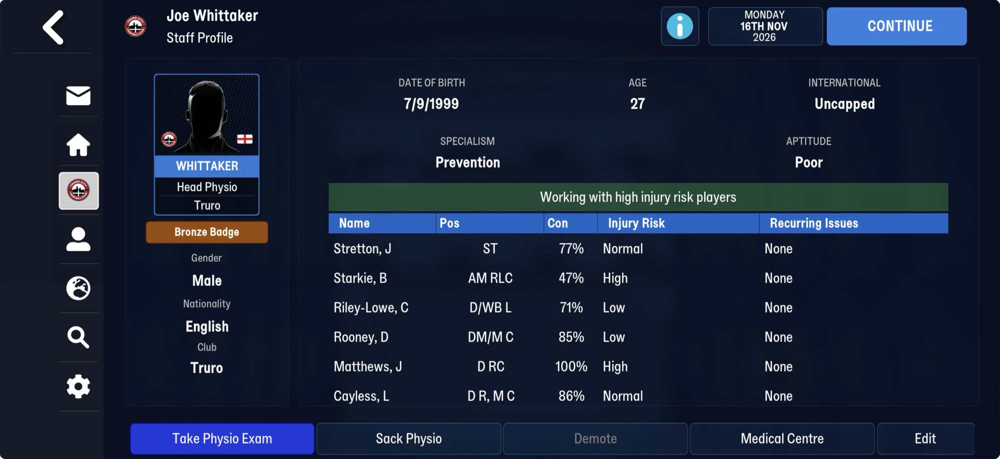

# One row per physio (block table 8)

Part of [the block after the club titles](end_block.md). FMM27, at block offset 2,814,252
on truro-2026-11-16: three bytes `00 00 00`, `[u16 n = 1,157]`, then n × 10 B.

## Known

- 1,157 is the physio count ([staff_roles](../staff_roles.md)), and row k's first u32 is k:
  row k is physio k.
- The other 6 bytes are `ff` on every row of all four Truro saves: nothing is assigned yet.
  A physio's patients (rehab) is the lead.

**Joe Whittaker** (Truro's head physio, physio 943) on 16 Nov: his row is `af 03 00 00`
(943) and six `ff`. His profile lists six players under "Working with high injury risk
players" (Stretton, Starkie, Riley-Lowe, Rooney, Matthews, Cayless, with condition and
injury risk); those six tids appear nowhere in the save as a list, so the screen works the
list out (the squad's highest injury risks) rather than storing it.

## Next

A save with an injured player at the managed club, to see a row fill.

## Evidence that would help

A save while one of your players is injured, with his injury screen.
