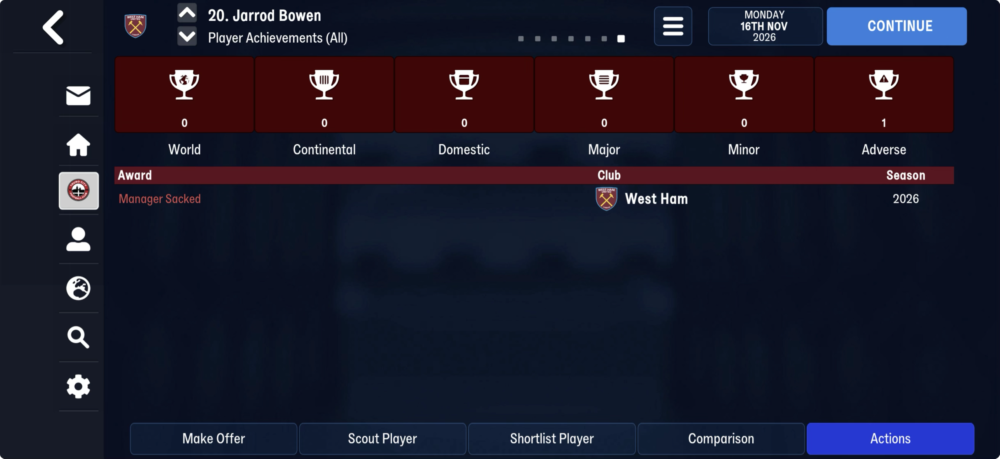
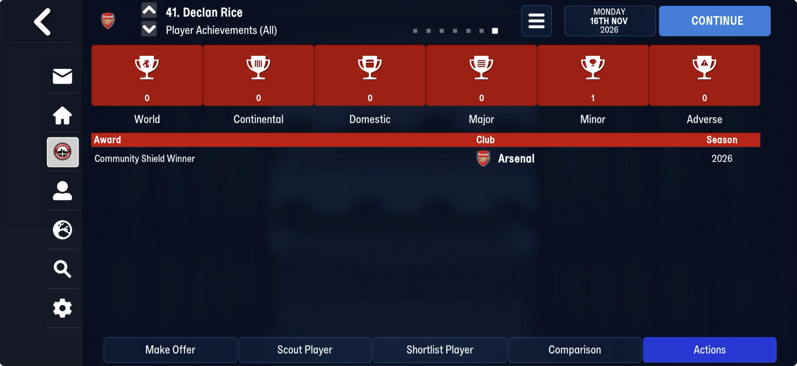
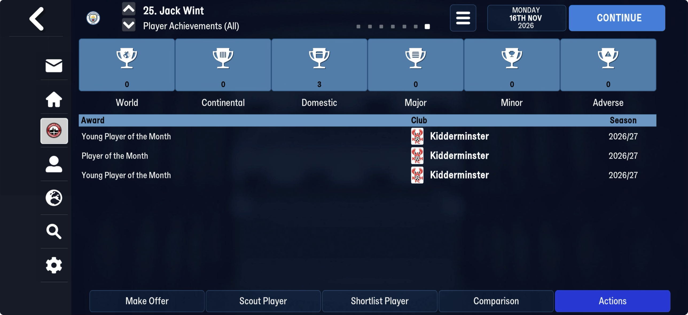

# Player achievements (block table 10)

Part of [the block after the club titles](end_block.md). FMM27, at block offset 2,907,675
on truro-2026-11-16: `[u32 100,000][100,000 × 24 B]`, then one byte `00`, then the player
lists. 2.4 MB, most of it empty. **It is the Player Achievements screen**: one row per
achievement, every player's in one log.

| save | used slots |
|---|---|
| 22 Jul | 0 |
| 25 Jul, 8 Aug | 1 (the same row: Serhou Guirassy, Dortmund) |
| 16 Nov | 887 (866 players) |

A capacity, not a count: 100,000 on every save. Rows fill from the front in the order the
achievements happen (the July super cups first, then the monthly awards), so the row number
is not an id and the person tids are unsorted. An empty slot is
`00 ff ff ff ff 00 00 00 00 ff × 14 00`.

## Layout

| offset | field | type | meaning |
|---|---|---|---|
| +0 | | u8 | `38` on every row |
| +1 | `person_tid` | u16 | the player |
| +3 | | 2 B | `00 00` on every row |
| +5 | `kind` | u32 | 2, 1, 32 or 128 (below) |
| +9 | `cid` | u16 | the competition (`ffff` on the one summer row) |
| +11 | | 2 B | `ffff` on every row |
| +13 | `club_tid` | u16 | his club at the time, not now |
| +15 | `award_id` | u32 | the award on a kind-128 row, else `ffffffff` |
| +19 | | u32 | `ffffffff` on 866 rows; a small number on 21, unread |
| +23 | | u8 | 0 |

`kind` on truro-2026-11-16:

| kind | rows | screen text | checked |
|---|---|---|---|
| 2 | 45 | "Community Shield Winner" (Minor) | Declan Rice: Arsenal, English Community Shield. The other winners: PSG (UEFA Super Cup), Bayern (Franz Beckenbauer Supercup) |
| 1 | 38 | the beaten finalists, probably "… Runner-up" | not yet: Man City (Community Shield), Aston Villa (Super Cup) |
| 32 | 629 | "Manager Sacked" (Adverse) | Jarrod Bowen: West Ham, whose manager went from Nuno Espírito Santo to Steven Schumacher. A row for every squad player of 21 clubs, 11 of them with a manager first seen on this save |
| 128 | 175 | the award's name (Domestic) | Jack Wint's three rows are the screen's three lines, in order (Young Player, Player, Young Player of the Month, Kidderminster); Tom Tweedy and Harvey Greenslade one each (Player of the Month, Truro) |

Wint is 1st in `award_history` three times and 2nd once, and has three rows: a row is a
win, not a placing. The screen's category (World, Continental, Domestic, Major, Minor,
Adverse) and season text ("2026" for a one-off, "2026/27" for an award) are not stored; they
follow from the kind and the competition. No date is stored.

## Next

- A kind-1 player (Enzo Fernández, Man City; Boubacar Kamara, Aston Villa) on the same
  screen: the runner-up text.
- The 21 rows with a value at +19, and Guirassy's summer row (kind 128, no competition, no
  award): what achievement it is.
- Whether past seasons' achievements live here too: a save after rollover.
- Then a parser table (`PLAYER_ACHIEVEMENTS_TABLE`) and a check on FMM22, where this block
  is not mapped yet.
