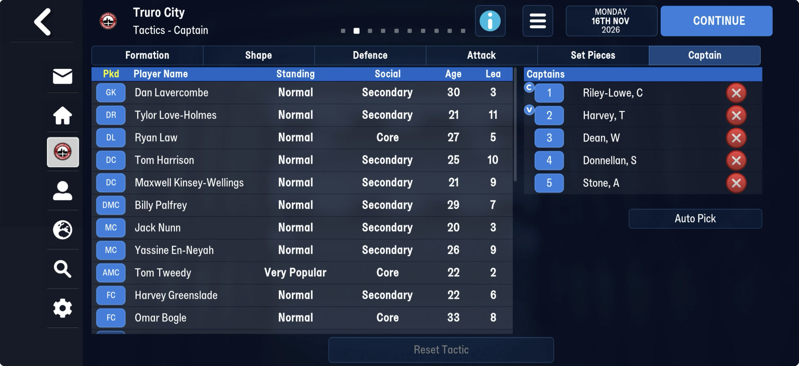

# Rule files → contract grid, 4: team selections (each team's matchday squad)

The fourth of five sub-tables between the [rule files](../rule_files.md) and the
[contract grid](../contracts.md), on both games. Before it: the
[formation presets](rf_formation_presets.md); after it: [the tail](rf_tail.md).

| save | from | to | slots |
|---|---|---|---|
| truro-2026-11-16 (FMM27) | 27,882,395 | 29,751,815 | 17,804 × 105 B, 1,362 filled (581 on 22 Jul) |
| frem-2026-06-11 (FMM22) | 20,623,465 | 29,167,499 | 14,506 × 589 B, 1,375 filled (567 on 2021-06-27) |
| bucaspor-2023-04-01 (FMM22) | | | 15,288 × 589 B, 1,428 filled |

The slot count is fixed for a career, so a preallocated grid. Most of FMM22's 9.15 MB
"filler" is this table's empty slots.

## Known

- **Slot k belongs to team tid k.** On frem-2026-06-11, 1,331 of the 1,375 filled slots hold
  only players in team k's squad array ([clubs](../clubs.md)); on truro-2026-11-16, 1,321 of
  1,362. The rest hold a player who has since left.
- **FMM27 slot**: `[u8][26 × u32 tid]`, `ffffffff` empty. **Truro's slot (3125) is the
  matchday squad**, checked against the Tactics – Captain screen:
  - +1, 16 tids: the screen's list in order (Lavercombe, Love-Holmes, Law, Harrison,
    Kinsey-Wellings, Palfrey, Nunn, En-Neyah, Tweedy, Greenslade, Bogle, then five
    substitutes);
  - then 4 tids (`ff` for Truro; set on most other filled slots);
  - then 6 tids: Bogle, then the screen's five captains in order (Riley-Lowe, Harvey,
    Dean, Donnellan, Stone). Bogle first is probably the captain on the pitch.

  The u8 at +0 is 14 for Truro; across slots it reads 6, 2, 0, 8, 16, 15, 17 … (not
  the squad size). Filled slots are mostly 16 + 4 + 2 (324), 16 + 2 + 2 (110),
  16 + 4 + 0 (68); some hold 1–4 tids only.
- **FMM22 slot**: `[u8][147 × u32 tid]`. Filled slots hold 14, 18 or 20 tids at the front
  (226, 132 and 85 slots on frem-2026-06-11), some a single tid further in.

## Next

1. Name the 4-tid group and the u8: compare a few clubs' slots with their last match's lineup
   ([fixtures](../fixtures.md), the match lines).
2. Name the FMM22 slot's 147: a squad limit, or several lists?
3. A table module: the grid's extent is proved on every save (slot count fixed, slot k = team k).
