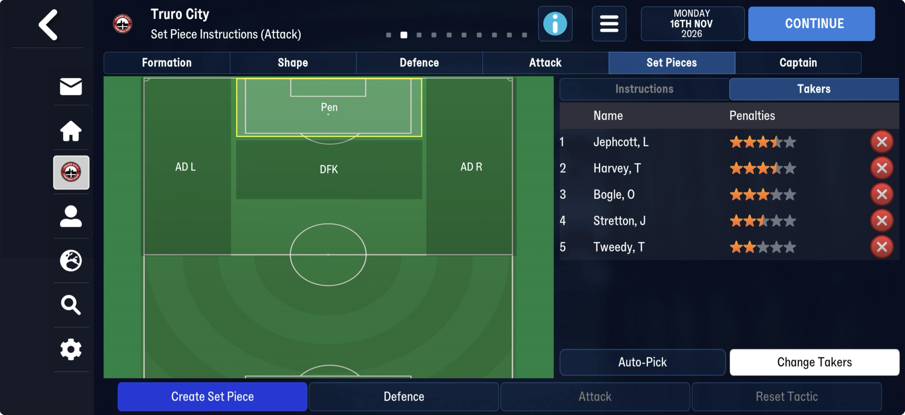
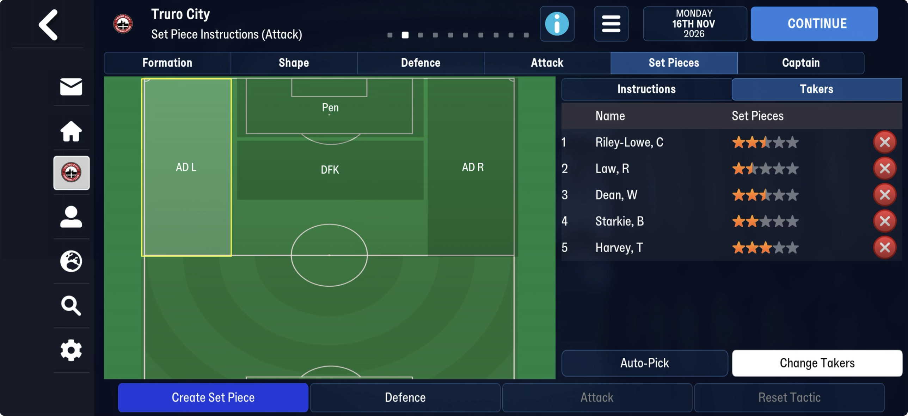
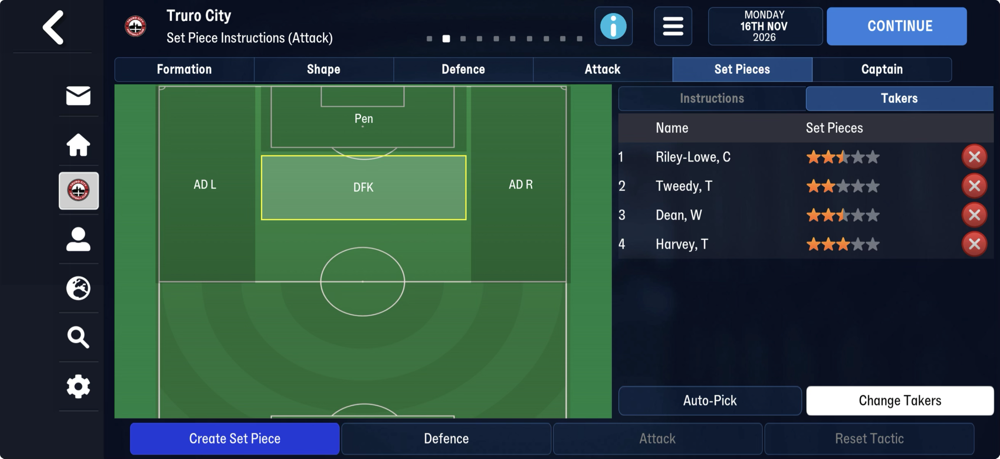
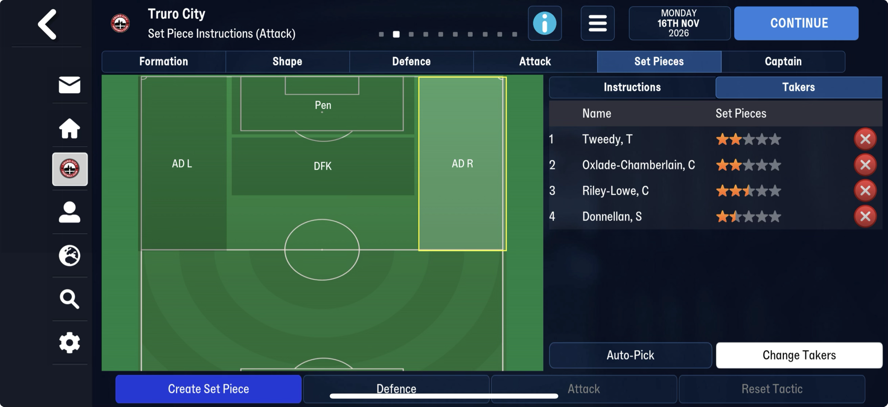

# Player lists → archive: scheduled events

| | from | to | size |
|---|---|---|---|
| FMM22 | 62,631,642 | 62,635,792 | 4,150 B |
| FMM27 | 69,983,908 | 70,132,864 | 148,956 B |

After the [player lists](../player_lists.md), up to the archive.

## Known

- **FMM22**: a short head (`03 00 22 00 ea 07 21 31 00 00 9b 01 00 00 05 00 …`), then
  14-byte entries `[ffffffff][u16 type][day u16][year u16][u32 tid]` dated about two weeks
  after the save. **Type 9 is a transfer going through on that day**: on frem-2026-06-11 all 41
  type-9 entries are players with an accepted bid in the transfer band and a
  [last transfers](../last_transfers.md) row. They are not contract expiries or loan ends
  (checked against both), and not retirements (ages 21–33).
- **FMM27 stores the region differently** and 36 times larger. It opens `00 00 01 00 e7 00 ea
  07 47 47 00 00 ff ff ff ff 09 00 ff ff ff ff 00 …` (day 231 of 2026, eleven days after
  truro-2026-08-08, and a type 9), and then holds a long run of u16 0, 1, 2, 3 …

## Next

1. Frame FMM27: find its 14-byte (or wider) entries and what the u16 run is (an index or
   ordering over the entries?).
2. Name the other types from what changes between two saves a few days apart.
3. Then one table for both games.

## Found on truro-2026-11-16 (first mid-season FMM27 save)

**Set-piece takers.** After the player lists, at 71,730,799, lists of ten u32 slots (unused
`ffffffff`), each the Set Pieces – Takers screen's order: penalties (Jephcott, Harvey, Bogle,
Stretton, Tweedy), left corners (Riley-Lowe, Law, Dean, Starkie, Harvey), right corners
(Tweedy, Oxlade-Chamberlain, Riley-Lowe, Donnellan), direct free kicks (Riley-Lowe, Tweedy,
Dean, Harvey), then two lists the screenshots do not show (Harvey, Oxlade-Chamberlain,
Jephcott, Hasani, Law: long throws? indirect free kicks?).

Near 71,664,780, a list of Truro players followed by length-prefixed strings
("Transition-Restrict", "Direct Play", "Defensive Shape", "Transition-Press"): training
units or tactical styles, not yet looked at.

