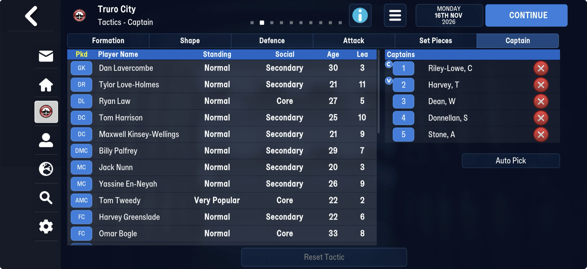

# Rule files → contract grid

| | from | to | size |
|---|---|---|---|
| FMM22 | 20,021,621 | 29,171,440 | 9.15 MB, 94% `0xFF`, 2% `00` |
| FMM27 | 27,142,672 | 29,572,704 | 2.43 MB, 79% `0xFF`, 8% `00` |

## Known

- **FMM22:** padding, as far as anyone has looked (Phase 4: prove it on every save).
- **FMM27:** about 2.4 MB of it was taken by the larger tables FMM27 added. What remains:
  - `ff ff ff ff 00 00`, then **73 six-byte slots** `[ffffffff][u16 1]`, the last
    `[ffffffff][u16 65,281]`. None filled on any Truro save.
  - Then blocks that carry **season years and dates**: `ff ff ff ea 07 eb 07 06 00 02 0a 07 ea 07
    0d 07 ea 07 0c 07 ea 07 0c 07 ea 07 01 00 6c 07 01 00 6c 07 62 00 03 0b 58 3e 02 00 02 0e
    07 ea 07 11 07 ea 07 10 07 ea 07 10 07 ea 07 01 …` (`ea 07` = 2026, `eb 07` = 2027). Read
    as each competition's current-season state is the lead.
  - The region changes between 25 Jul and 8 Aug (76% of bytes the same), and repeats every 48
    bytes in places.

## Next

1. Check whether FMM22 has the 73 slots or the season-year blocks anywhere in its 9 MB.
2. Frame the season-year blocks: look for a count and a cid in front of each, and check the
   cids against the [competitions](../competitions.md) and their dates against the
   [fixtures](../fixtures.md).

## Found on truro-2026-11-16 (first mid-season FMM27 save)

**The matchday squad and the captains.** From 28,210,521 (a byte 14 in front): 16 u32 tids, the Tactics – Captain
screen's list in its order (Lavercombe, Love-Holmes, Law, Harrison, Kinsey-Wellings, Palfrey,
Nunn, En-Neyah, Tweedy, Greenslade, Bogle, then five substitutes), an `ff` run, then six tids:
Bogle, then the screen's five captains in order (Riley-Lowe, Harvey, Dean, Donnellan, Stone).
Bogle first is probably the captain on the pitch, none of the five being in the XI.

